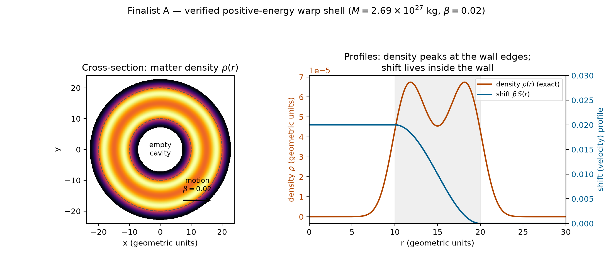

# Warp Pilot — an open, verified search for positive-energy warp metrics

An independent computational search for warp-drive spacetimes whose matter
satisfies the classical energy conditions (NEC, WEC, SEC, DEC) for **all
observers**, audited with a purpose-built verifier, adversarial red-teaming,
and three independent computation paths. Everything here is reproducible
from the code and frozen configurations in this repository.

**We are publishing this to ask for independent verification.** If you can
re-run an audit, break a result, or extend a search, please see the
[help-wanted issues](../../issues) — several are scoped as good first
issues (run a script, compare numbers, report).

## What's new here

Everything below passed this project's verification gate — an independent recomputation on a second code path plus a literature novelty check — before it was published. Archived releases are on Zenodo (all versions: https://doi.org/10.5281/zenodo.24425078).

- **v1.11.0 - Gate-9 claims.** Four gated results (`gate9-claims/`), each stated only in its gate-restated wording, all concerning ONE throat object in conformal (Weyl) gravity — the joining member (b = r0(r/r0)^0.1, Phi2 profile, a = 0.277734): whole-domain energy-condition legality to 10^3 r0 on an independent symbolic path; the exact join to a Mannheim–Kazanas exterior at 10^3 r0 with a legal shell (the same interior joins at no smaller radius); classical stability in the computable interior sectors; and formation PRE-EXISTING ONLY (grown-shell price unbounded, nucleation closed). No transport and no traversability is claimed; the theory's ghost question rides as (V-b) UNDECIDED in every claim. DOI: 10.5281/zenodo.24453655
- **v1.10.0 - Gate-7 and Gate-8 claims.** Five gated results (`gate7-claims/`, `gate8-claims/`), each stated only in its gate-restated wording: the (10,30) thick shell verified at beta = 0.10 in two configurations (halved smoothing - with a thin DEC-negative layer just inside its inner edge named in the claim’s scope - and a spline shift profile at full smoothing); an independent confirmation, at this programme’s bars, of Procaccia’s beta = 0.1363 shell design (his design, our audit; the standing verified mark in the single-shell category remains his 0.1363); the Gate-8 composed payload - nested shells carrying a payload at 0.0799c (payload transport category; the claim’s one caveat is a discretisation-floor DEC read in the cavity near-edge shell 4.6 < r < 5, sign-unstable at |DEC| ≲ 2.3×10⁻⁴ under refinement in the amended wording, with no convergent negative continuum value); and the attained form of the exhibited throat’s bulk shortcut - a Z2 mirror completion at y_c = 0.30 r0 makes the gain 0.167 an attained, everywhere-regular geodesic (the v1.9.0 figure 0.480 remains an unattained infimum; EFFECTIVE ONLY, pre-existing structure, no formation route). DOI: 10.5281/zenodo.24452706
- **v1.9.0 — Gate-6 claims.** Four gated results (`gate6-claims/`): the (10,30) thick shell verified at β = 0.07 **and β = 0.08** (Gate-6 found the 0.07 "ceiling" was a single-point instrument artefact; β = 0.09 unsettled); the Φ ≠ 0 inertness theorem for scalar-tensor throats; a measured bulk-shortcut gain (0.480) inside an exhibited wormhole-throat bulk lift — effective only, setup leg unavailable; and the component-blindness of the quantum-inequality sampling bound, with the species escape priced at N ≥ 1.06×10⁷². All four stated only in their gate-restated wordings. DOI: 10.5281/zenodo.24439601
- **A warp shell that beats the published benchmark, with the maths checked twice** — verified subluminal shells 40% lighter (Finalist A, β = 0.02) and 50% faster (Finalist B2) than the Fuchs et al. baseline, passing all energy conditions. [Release v1.0.0](https://doi.org/10.5281/zenodo.24425079)
- **A hard floor under every wormhole** — exact formulas for the minimum amount of "exoticity" any throat of a given size must have, whatever it is made of (the H6 floor identities). [Release v1.1.0](https://doi.org/10.5281/zenodo.24425833)
- **Warp shells inside curved spacetime, not just empty space** — shells re-solved in Schwarzschild and anti-de Sitter backgrounds; they work until a named pressure-amplification mechanism kills them at high background mass (H4). [Release v1.1.0](https://doi.org/10.5281/zenodo.24425833)
- **A published "stable wormhole" that isn't** — the Mironov–Rubakov–Volkova beyond-Horndeski wormhole of arXiv:1811.05832 carries a hidden instability (an even-parity ghost), certified directly from its action; two misprints in the paper, repeated in its sequel, documented along the way. [Release v1.7.0](https://doi.org/10.5281/zenodo.24434411) (audit trail: [v1.6.0](https://doi.org/10.5281/zenodo.24433260))
- **How to build a warp shell without breaking the rules on the way** — formation paths that stay legal at every instant exist (grow the wall and the shift together); the obvious "shift first" route is impossible already at β = 0.01. [Release v1.8.0](https://doi.org/10.5281/zenodo.24435291)
- **In one torsion-based gravity, a legal wormhole *is* an unstable one** — on the f(T) T ≡ 0 background, matter legality and a tensor ghost are the same sign choice (the ghost identity, restated scope). [Release v1.8.0](https://doi.org/10.5281/zenodo.24435291)
- **Why a leading alternative-gravity wormhole can't be certified, plus an unflagged misprint** — the EiBI throat obstructions (a forced sound speed of −1, a degenerating auxiliary metric), and the Böhmer–Harko–Lobo Eq. (29) misprint, no published erratum found on arXiv, the publisher's page, or INSPIRE (re-checked Nov 2026). [Release v1.8.0](https://doi.org/10.5281/zenodo.24435291)
- **The traversable-wormhole loophole, priced in plain numbers** — the Gao–Jafferis–Wall bounds evaluated at human scales: the open-time window falls 73.8 orders of magnitude short, the mass capacity 45.3 orders short. [Release v1.8.0](https://doi.org/10.5281/zenodo.24435291)
- **Quantum corrections that cancel exactly** — in asymptotic-safety gravity, the running-coupling corrections at a wormhole throat cancel identically (an analytic identity, not a numerical coincidence); three errors in the source paper documented. [Release v1.8.0](https://doi.org/10.5281/zenodo.24435291)
- **Hiding the exoticity in a second metric doesn't work — measured** — in bimetric gravity the violation relocates into the second sector, which then breaks the null energy condition on 70–100% of the volume in every configuration tried. [Release v1.8.0](https://doi.org/10.5281/zenodo.24435291)
- **A screen that hides a warp drive from gravity tests — and what it costs** — an environment-dependent coupling construction that switches off outside the shell, with its energy-budget laws; plus a "breathing" shell that stays legal while it pulses, and the exact law for how long a negative-energy pulse may last. [Release v1.5.0](https://doi.org/10.5281/zenodo.24432779)

## Headline results (all numbers in `REPORT.md` and `CHECKPOINT.md`)

- **Two novel subluminal warp shells, verified.** Shell geometries outside
  the Natário class (non-unit lapse, non-flat spatial slices) that pass all
  energy conditions for all observers, confirmed by a finite-difference
  auditor, an independent autodiff code (warpax), and a symbolic SymPy
  derivation, plus an adversarial optimiser that tried and failed to find
  a violating point:
  - *Finalist A* — β = 0.02c, ADM mass 2.69×10²⁷ kg, **40% below** the
    Fuchs et al. (2024) baseline mass at the same radius and velocity.
  - *Finalist B2* — β = 0.03c, 3.64×10²⁷ kg, **19% below** that baseline
    at 50% higher velocity.
  - A β = 0.05c frontier design of the Phase-1 family at compactness
    M/R₁ = 0.383 (lightest: 2.58×10²⁷ kg), with a fitted scale-covariance
    law for the frontier.
- EC-legal subluminal shells are known (Fuchs et al. 2024); this programme's
  verified rows include Finalist A (β = 0.02) and the Phase-26 (10,30)
  configuration at β = 0.07–0.08 (Gate-6). In the Phase-1 family, the
  positive-energy frontier terminates between β = 0.05 and β = 0.1: at
  β = 0.1, three independent constructions (named families, free-form machine
  search, and a conditions-first reverse construction) all land within ~10⁻⁸
  of zero worst-margin and none certifies a pass. The boundary is a wall:
  different energy conditions bind on its two sides.
- **No superluminal candidate anywhere.** A per-geometry exclusion map
  (16 rows in `REPORT.md`) covers spherical shells, toroidal shells
  (symmetric and asymmetric), free-form and fully-3D shapes, shells on
  Schwarzschild/(A)dS backgrounds, shells in expanding (FLRW/de Sitter)
  backgrounds, and modified-gravity / exotic-source lenses — f(R), f(Q),
  Kaluza–Klein lifts, Einstein–Cartan torsion, non-minimal scalars,
  Casimir threading, and multi-component sources (the last closed by a
  linearity proof, not by search).

## The shape of Finalist A

*Finalist A, computed from the frozen configuration in `results/frozen/finalist_A.json` with the repository's own `shell.py` (plot script: `plot_finalist_A.py`). Left: matter density in a cross-section through the centre — an empty cavity (r < 10) inside a spherical wall (10–20) whose density peaks at its two edges; the whole configuration moves at β = 0.02. Right: the density profile and the shift (velocity) profile — the interior rides at the full β and the shift falls to zero across the wall, so the transition lives entirely inside the matter. This is a constant-velocity configuration; formation and stability are not claimed (see Limits).*

### Finalist B2, and the frontier

*Finalist B2 (β = 0.03, 3.64×10²⁷ kg), computed from `results/frozen/finalist_B2.json` with `shell.py` (plot script: `plot_finalist_B2_shape.py`). Same edge-peaked wall design as Finalist A, at 50% higher velocity.*

*The mass–velocity frontier (plot script: `plot_frontier.py`). In the Phase-1 family, verified positive-energy designs exist at β = 0.02, 0.03 and 0.05 along a compactness curve; at β = 0.1 three independent constructions land within ~10⁻⁸ of zero worst-margin and none certifies a pass — the Phase-1 family's frontier terminates between β = 0.05 and β = 0.1.*

## Limits — read these before citing anything

- The verified shells are **constant-velocity** configurations. Formation,
  acceleration, and stability are **not** solved; a quasi-static snapshot
  sequence is included and labelled necessary-not-sufficient.
- Margins are numerical (~10⁻⁵–10⁻⁷), established by finite sampling of
  points and observers — strong evidence, **not a proof**.
- Matter is characterised only through the energy conditions; no specific
  physical matter model is proposed.
- No outside expert has re-run these results yet. That is the point of
  this repository.

## Phase 5 claims (gate-verified)

Three results from the later, origination phase of the programme, published after passing a novelty-and-verification gate (documented literature search for prior art + independent reimplementation of the deciding computations). Full write-ups, wording conditions and limits: [`phase5-claims/CLAIMS.md`](phase5-claims/CLAIMS.md); how each was gated: [`phase5-claims/GATE_SUMMARY.md`](phase5-claims/GATE_SUMMARY.md).

- **Wormhole exoticity floor identities** — the volume integral of ρ + p_r for zero-tidal wormholes decomposes exactly, and the proper-volume floor (−r₀) is twice the coordinate floor. Stated with a tightened hypothesis set; zero-tidal (Φ = 0) scope only.
- **Warp shells re-solved inside curved backgrounds** — a positive-energy shell re-equilibrated in Schwarzschild gravity passes the full audit at background masses 1 and 2 (an earlier superposition-based failure was an artefact of the method), fails at mass 4 by a named mechanism, and passes in AdS. Static configurations; the moving case fails in the cavity, by a named mechanism.
- **A decoupling criterion for gravity-sector exoticity (restated)** — when a modified-gravity term can supply an energy-condition violation while remaining healthy: strict for five audited theory cases, by structural analogy for two more, with the underlying mechanism credited to Mironov–Rubakov–Volkova. It also explains why throats admit this decoupling and warp walls resist it, and predicts that only a rank-≥2 correction could align on a wall — a prediction since tested in Phase 6, where it was refined (necessary, not sufficient).

## Learnings

[LEARNINGS.md](LEARNINGS.md) is the programme’s living methods record: the artefacts we now catalogue, the self-corrections (including an internal result retracted over a units error, and a scan signal killed by our own red team before it was ever published), and the standing rules each episode produced. It contains no discovery claims — it exists so others running searches like this can avoid our mistakes.

## Phase 8–9 claims (gate-verified)

Three further results have passed the same novelty + verification gate (independent literature search and independent re-computation), in the folder [`phase89-claims/`](phase89-claims/CLAIMS2.md):

- **A warp shell that moves legally through a curved background.** Re-solved in the total geometry around a Schwarzschild mass and set moving at β = 0.02, it passes the full energy-condition audit in the areal embedding at both distances tested (the result is embedding-dependent: in the total-lapse-consistent PG embedding it passes at the larger distance and fails at the closer one — both outcomes are part of the claim).
- **A speed-asymmetric wall supply in Einstein-aether theory.** The first non-scalar-tensor correction tested on a warp wall supplies nothing at β = 0.1 (best partial coverage 0.000) but reaches health-passing partial coverage 0.813 at β = 1.1 — starved subluminally, fed superluminally. Full coverage never reaches alignment, and every scanned row is excluded by solar-system PPN data (0 of 327 pass). The claim is the asymmetry and the exclusion together, not a drive.
- **The first realised toroidal shell of the conditions-first programme** (in the delimited sense stated in the claims file): the γ-extended meridional system solves to residual RMS 1.89×10⁻⁴, with the obstruction's branch boundary bracketed at (0.6–0.7)× the original density×size². Its motion audit at β = 0.02 is negative (converged −1.51×10⁻⁴) and is reported as part of the claim.

Two of the three are published in gate-restated form: the gate's second path disproved the original explanation of the aether exclusion mechanism (the exclusion itself reproduced exactly), and the torus motion headline was replaced by its converged value. The corrections and the errata appended to the internal records are documented in `phase89-claims/GATE2_SUMMARY.md`. No superluminal result is claimed anywhere in this release series.

## Phase 15–16 claims (gate-verified)

A third claims pack, in `phase1516-claims/`: a breathing warp shell audited legal at every instant of its cycle (with the motion tax measured), an exact transient quantum-inequality pulse law (scaling credited to Pfenning & Ford 1997), and a verified screening construction for Einstein-aether — published with its family closure on its face: screened aether is closed as a superluminal supply route. Each claim passed the programme's novelty + verification gate (Gate-4), two of them in gate-restated form. No superluminal result is claimed anywhere in this pack.

Archived release: https://doi.org/10.5281/zenodo.24432779

## Audit note (gate-verified)

An independent audit of a published beyond-Horndeski wormhole (Mironov–Rubakov–Volkova 2019), in `mrv-audit/`: what the audit verified (the background is a genuine solution; the radial and odd sectors are healthy), two certified defects in the paper’s printed stability formulas, and the construction's trajectory incompleteness — with the audit's own transcription error disclosed in the same place. The even-sector ghost question is under certification and is not claimed here.

Archived release: https://doi.org/10.5281/zenodo.24433260
Update (v1.7.0): the even-sector ghost claim is certified branch-independently at the action level and stated in full in mrv-audit/AUDIT.md §6; the l=0 soft-mode value reported in v1.6.x is retracted as a discretisation artefact (§2).
Archived release: https://doi.org/10.5281/zenodo.24434411

## Phase 17–23 results (gate-verified)

Gate-5 re-verified the programme's nine ungated results from Phases 17–23 by independent recomputation and literature novelty check: six stand in restated form (an f(T) ghost identity, EiBI throat obstructions and a literature misprint, the evaluated GJW ledger, an asymptotic-safety cancellation identity, legal formation paths, and a bimetric relocation anatomy), and three are labelled independent confirmations of published results. See phase1723-claims/RESULTS.md.

Archived release: https://doi.org/10.5281/zenodo.24435291

## Repository layout

- `REPORT.md` — the final internal report: plain-language summary,
  technical record, verification appendix, superluminal exclusion map.
- `CHECKPOINT.md` — the full ground record: every run, failure anatomy,
  fitted pattern, data binding (Planck, GW170817, Eöt-Wash, ATLAS values
  used as gates), and the exhaustion ledger.
- `verify_metric.py`, `metrics.py`, `shell.py` — the auditor (Einstein
  tensor by finite differences, Hawking–Ellis classification, all-observer
  margins).
- `results/frozen/` — the three verified configurations (A, B2, β=0.05
  frontier winner) exactly as audited.
- `results/` — JSON/log output of every run cited in the report.
- Track scripts: `trackL.py` (frontier), `trackP*.py` (free-form search),
  `mg1_*.py` / `mg2_*.py` (modified gravity), `x1_*.py`–`x5_*.py`
  (geometry/source lenses), `n1_*.py`–`n4_*.py` (new-physics tracks),
  `redteam*.py` (adversarial verification), `qi_ledger.py` (quantum
  inequality ledger).

## Re-running the headline check

Python 3.12, NumPy/SciPy/SymPy (float64 throughout). The finalist audits
are driven by `verify_finalist.py` / `run_finalistB2.py` against the
frozen configurations in `results/frozen/`; the cross-check path uses
`warpax_check.py` / `warpax_crosscheck.py` (optional, requires warpax).
Expected agreement: NEC minima +2.121×10⁻⁵ (A) and +2.864×10⁻⁵ (B2) on
both paths, Hawking–Ellis Type I everywhere.

## Licence

MIT. The physics, favourable or not, belongs to whoever checks it.
