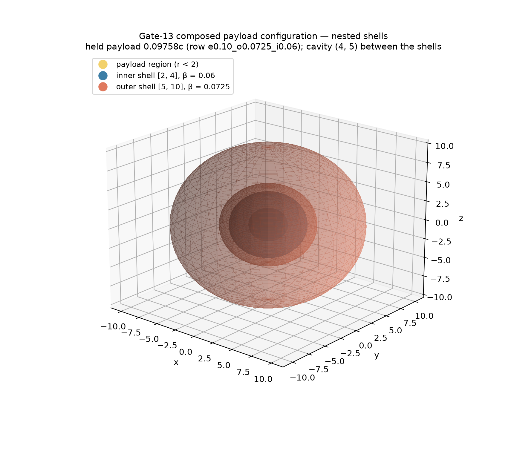
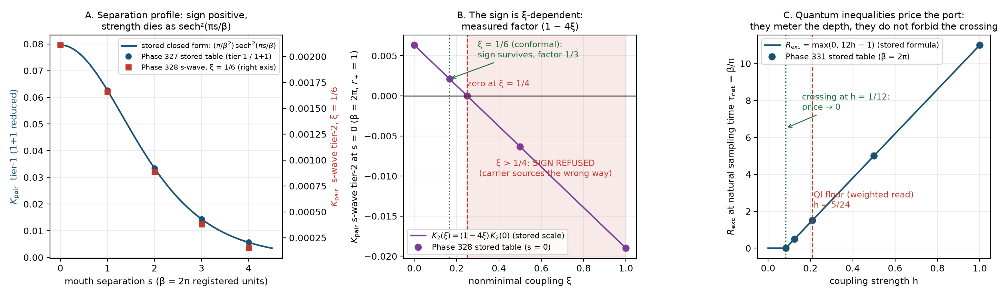
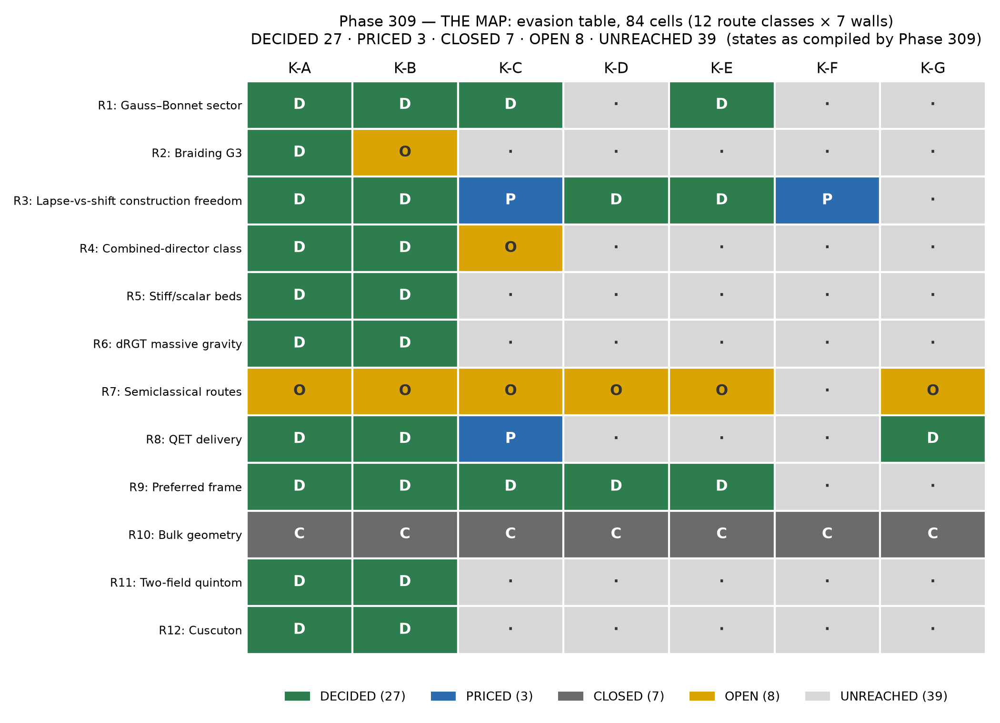
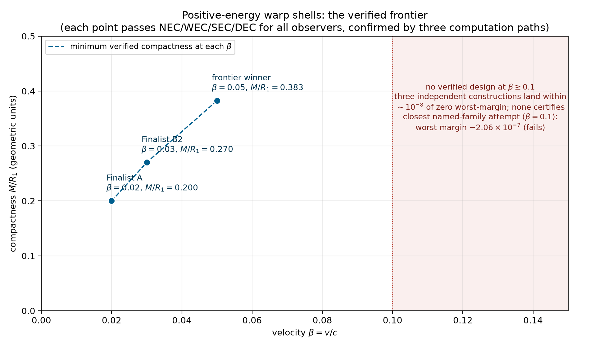

# Warp Pilot — an open, verified search for positive-energy warp metrics

An independent computational search for warp-drive spacetimes whose matter
satisfies the classical energy conditions (NEC, WEC, SEC, DEC) for **all
observers**, audited with a purpose-built verifier, adversarial red-teaming,
and three independent computation paths. Everything here is reproducible
from the code and frozen configurations in this repository.

**We are publishing this to ask for independent verification.** If you can
re-run an audit, break a result, or extend a search, please see the
[help-wanted issues](../../issues) — several are scoped as good first
issues (run a script, compare numbers, report).

## What's new here

Everything below passed this project's verification gate — an independent recomputation on a second code path plus a literature novelty check — before it was published. Archived releases are on Zenodo (all versions: https://doi.org/10.5281/zenodo.24425078).

- **v1.52.0 — Gate-62: Phase 479's member at the wide pose survives independent re-judgement — the first object in the record to pass the wide-pose line's DEFENDED bar with the pressure basin cured and DEC held: 450's BOUGHT-MAXJOINT + W474B = [0, −0.0014031443466063713, 0, 0, −0.0013795539861294259, 0, 0, −0.002009452499039281, 0] passes the sampled joint (+2.820462654076372×10⁻⁹), worst-null (+1.149158092307544×10⁻⁹) and adversary Type-I NEC depth (+2.333817817820605×10⁻¹³) bars — all three reproducing the bought base's values exactly, the joint spent nowhere — with SEC cured and DEC held at basin nodes 8/9/10 (SEC +2.440444/+2.441198/+2.439644 ×10⁻⁵; DEC +4.894588/+3.441161/+2.439644 ×10⁻⁵; sampled = Type-I-restricted, frame-invariant), AND carries a set SEC residue of −6.459908493210403×10⁻⁶ at node index 23 (r = 17.04878048780488, Type-I, frame-invariant; rider G62-R1 restates the phase record's "node 25" label — node 25 itself carries −3.293564937848059×10⁻⁶ on the member).** Phase 479's claim set, re-judged by Gate-62 on its own reads — the base, the member and 474's F1 control object each freshly evaluated (every deciding figure at diff 0.0; the constraint set demonstrated non-vacuous on the gate's own read: it excludes 474's F1 object, node-10 DEC −5.375277493220288×10⁻⁴), a full SET-244 four-channel read of the member computed by the gate from the per-point record (NEC/WEC/DEC/RHO set minima all positive; SEC the only failing condition, on an outer basin of six negative nodes 22–27), the mechanism checked on the stored records (both arms' objects identical at every rung; LP promises match exact reads to ≤ 8.12×10⁻¹¹), and an independent checker at 21/21 (`gate62-claims/`). FENCE (on every quotation): a DEFENDED member quoted with its residue — not a four-condition pass, not a working configuration, not a drive; the programme's member bar (all four conditions at full audit scope) is not met, and the remaining distance is exactly the outer SEC basin, whose composed lever address is Phase 481's charge.** DOI: 10.5281/zenodo.24618885.
- **v1.51.0 — Gate-61: Phase 478's shadow-data claim set survives independent re-judgement — the Fuu arbitration's identity ruling stands as a ruling (the Phase 226 combined datum is the home build's object: its registration fixes that build verbatim, `comp_jets` occurs zero times in both datum build files, Phase 169's (A1) clause set is its base set, and Phase 167's compensated pose is fenced off from the datum by its own (R1) clause; Phase 467's rescue radius 133,522,009.61 m stands unqualified and entry 1236's build caveat is discharged), and the two configurations the build divergence accidentally posed are verified data in their own right: X(m) (the compensated transplant's third configuration, D = e^{−0.2}·j − (1 − e^{−0.2})·τ_m) and H(0) (the tax-free pose, D = e^{−0.2}·j), each total-legal at jet scope with all seven clauses strictly positive (binding NEC_ρ = DEC_ρ = +0.6781346234610093; H(0)'s NEC_φ = +1.0541767526056953 is the highest transverse margin of the three), each with rescue radius ≈ 1.0676×10⁸ m radial-bound (106,756,986.38 m / 106,756,983.66 m; lateral 0.9733× bar at β = 0.1; β ceiling 0.194) and E_shell ≈ 1.6815079×10⁵² J at rescue — with the D-identity re-derived symbolically, legality scale-invariant as computed, and E_shell D-blind (datum and shadows share 1.6821854766×10⁵² J at any common radius, so the toll is priced by radius alone).** Phase 478's claim set, re-judged by Gate-61 on its own machinery — fresh builds with the gate's own posing and clause arithmetic (cross-checked against the engine's clause path at diff 0.0), the gate's absence scan of 1380 registration/checkpoint/run-record files (every compensated/combined both-marker file classified; none poses the P226-1 datum in the compensated family — the nearest, the combined march P229-1, itself fixes the datum on the home build as its C0 control), 50-digit mpmath recomputation of the rescue closed forms (agreement 0.0 m / 1.5×10⁻⁸ m) and of the shell integral's director term (1.5×10⁻¹⁵), an FD-Riemann second tide path agreeing at 7.51×10⁻⁵, and an independent checker at 16/16 (`gate61-claims/`). Disclosed on the face (rider G61-R1, touching no figure): the combined march FU-P226-1 is not "unrun" as the Phase 467/477/478 fences state — it ran as Phase 229 P229-1 and failed at or before t* (first NEC_φ crossing (0.48125, 0.4875]). FENCE (on every quotation): jet scope, t = 0, sector superposition, exhibit ≠ construction, sustainment untouched; none of the three data is the Gate-27 certified pose and none carries a certificate; no traversability claim — the wormhole line holds three verified total-legal throat data at jet scope, each tide-priced, and construction and sustainment remain its open problems.** DOI: 10.5281/zenodo.24618430.
- **v1.50.0 — Gate-58: Phase 432's graded-shell claim set survives independent re-judgement — the graded category's best rises to β = 0.194921875, a fourth consecutive rung held by three configurations of the 16-spline family (named holder C-5, sha256 cb56c301…), CONTINUUM-LEGAL: C-5 fully legal at the rung (worst SEC +3.740×10⁻⁷ @ r = 3.75, 60.9× the FD floor — thinner than B-4's 94.5×, the thinning stated on the face), C-1 (+2.976×10⁻⁷) and C-4 (+3.471×10⁻⁷) independently legal alongside it, the bracket [0.194921875, 0.197421875] confirmed as a plain SEC wall, and the dense read positive (refined SEC +1.432×10⁻⁷ @ r = 3.53, Richardson +1.431×10⁻⁷) — C-5 succeeds B-4 as the category's highest holder in both senses (registered-set best and continuum-legal best).** Phase 432's claim set, re-judged by Gate-58 (re-convened — its first convening correctly refused the then-absent verdict) on machinery independent of the phase's evaluator — Phase 417's panel-Lagrange organisation, the registered instrument pair on the registered set at both spacings under the Gate-42 common bars; every audited vector sha256-verified before auditing; all deciding reads VM reads, the laptop admitted as corroboration (deciding margin agreeing to 1.1×10⁻¹⁴); the phase's checker re-ran 27 PASS, 0 FAIL, and controls C-432-1..6 were re-judged before any rung figure was believed (machinery control A-6 at abs diff 0.0; B-4 reproduced, its multiple recomputed 94.5133×; the resumption cross-check recomputed 64/64 exact in both forms, n_pts 3,640) (`gate58-claims/`): **(a) SURVIVES (G58-A) — C-5 legal at β = 0.194921875: worst SEC +3.740426×10⁻⁷ @ 3.75 (gate) vs +3.740426×10⁻⁷ (phase), audit4 +3.728394×10⁻⁷, Type-I fraction 1.000 at both spacings, margin 60.9140× the gate's own re-measured FD floor (6.140506×10⁻⁹); (b) SURVIVES (G58-R3) — the tie is gate-verified: C-1 worst SEC +2.975793×10⁻⁷, C-4 +3.470775×10⁻⁷, both fully legal, named alongside C-5; (c) SURVIVES — the bracket stands: the failing rung 0.197421875 fails plainly (SEC −1.184160×10⁻⁵ @ 9.75, DEC also negative — not a Type-I-only wall), and the gate's own interior read at 0.196171875 also fails (SEC −4.593×10⁻⁶); (d) SURVIVES (G58-R1) — THE DENSE READ: C-5 CONTINUUM-LEGAL, dense significant SEC +1.571×10⁻⁷ @ 3.55, refined +1.432×10⁻⁷ @ 3.53, Richardson +1.431×10⁻⁷, keeping 38% of its registered margin (B-4 kept 42%, RW-5 47%). Disclosed on the face: the direction-sampled reads are quoted both ways (G58-R2 — q_max 0.9968 gate / 0.9990 phase @ r = 19.75, the closest flux-wall approach in the lineage on the phase's organisation; shell sampled-NEC +1.653×10⁻⁷ gate / +1.033×10⁻⁷ phase; neither is a legality bar), and the dense read's digit-exact agreement with the phase's appended read is expected — the phase's dense read was itself executed in 417's registered form, so the gate's dense run is an independent re-execution of the registered instrument from the hash-verified vector, its classification a sign property standing ~13.5× above the dense floor proxy. FENCE (on every quotation): graded-category wording only (G58-B) — Procaccia's β = 0.1363 stands in the step-profile category and the programme's verified best there remains β = 0.10; the ladder remains open on exactly one lever (further convergence; a fourth push is charged as Phase 448) and spent on every widening lever named (G58-R4).** DOI: 10.5281/zenodo.24615092.
- **v1.49.0 — Gate-59: Phase 431's persistent-mating claim set survives independent re-judgement — persistent spinor supplies exist for both standing targets: the commensurate-ladder arm mates T_req (the 405 winner's required stress) at maxR = 1.3730×10⁻¹⁶ for |a|² = 0.013963 = 0.4771× the drifting Fit A, periodic with T_c = 6.165222 units and ladder returns ≤ ~10⁻¹³ at 2¹⁰ cycles; the single-energy arm mates the SEC-corrected target T_corr at 9.9696×10⁻¹⁵ for 0.8251× the composite C-A, STATIONARY by construction over the full 3.860 yr window; the ladder mates T_corr too, at 1.2311×10⁻¹⁵ for 0.5887× — and the single-energy arm's failure on T_req is ruled STRUCTURAL at its registered scope (floor ≈ 1.27×10⁻³; residual carried almost isotropically by the spatial diagonals, peak site 7.40/7.36/7.34×10⁻⁴; constrained Jacobian full-rank, σ_min 5.41×10⁻⁴; per-site dictionary relaxation floors at the same per-site residuals, peak 1.285×10⁻³) — Phase 428's supply leg is satisfiable in principle for both targets; its geometry leg (GAP-3) still gates every sustainment claim, and the ACTIVE SUPPLY's premise is falsified for both targets.** Phase 431's claim set, re-judged by Gate-59 on machinery independent of the phase's evaluator — the gate's own field-bilinear implementation of the spinor stress tensor (its pair kernel derived in-file and validated against its field path at 3.2×10⁻¹⁶); every audited object sha256-verified against its stored record before auditing; all deciding reads VM reads, the laptop admitted as corroboration (admission read agreeing to 6.8×10⁻¹⁹); the phase's checker re-ran ALL PASS with output identical to the stored record, and the controls (Fit A and C-A reproductions, B-2 self-checks) were re-derived digit-for-digit before any mating was believed (`gate59-claims/`): **(a) SURVIVES (G59-A) — Arm B / T_req ADMITS in the PERIODIC form: six modes exactly on the ladder (1,1,2,2,3,3) of E₀ = 1.019134, maxR 1.3730105602628296×10⁻¹⁶ on the gate's pair path (field path 1.34×10⁻¹⁶), price 0.4771× Fit A, worst instant over the period 0.20791 (a geometry-side input, rider G59-R2), 5.923×10¹⁵ cycles in the window; (b) SURVIVES (G59-B) — Arm A / T_corr ADMITS in the STATIONARY form: (6,6) modes on one shell E = 2.189896 (scatter 4.44×10⁻¹⁶), maxR 9.969570519623321×10⁻¹⁵, price 0.8251× C-A, registered-energy deviation exactly 0.0 across the window in both evaluable forms, verbatim representation bound t* = 6.72×10⁷ units = 0.224 s in the corrected form (rider G59-R4); (c) SURVIVES (G59-C) — Arm B / T_corr ADMITS in the PERIODIC form: ladder of E₀ = 1.178657, maxR 1.2310921712911173×10⁻¹⁵, price 0.5887× C-A, worst instant 0.65688, 6.850×10¹⁵ cycles; (d) SURVIVES AS RULED (G59-D) — Arm A / T_req DOES NOT ADMIT, structural at the registered scope: the gate's anatomy reproduces the phase's per-component table digit-for-digit, its constrained Jacobian reproduces σ_min = 5.4083×10⁻⁴ at rank 30/30, its independent search re-converges to the same basin (polished 1.2716×10⁻³, 0.13% below the phase's best; 19 random starts at N = 6–16 find nothing lower), and its per-site relaxation (free amplitudes, 96-direction dictionary) floors at 6.4090×10⁻⁵ / 3.5095×10⁻⁴ / 1.2852×10⁻³ against the joint residuals 5.6074×10⁻⁵ / 3.4859×10⁻⁴ / 1.2754×10⁻³, with the A3 energy scan minimised at the mating's own shell and rising monotonically to 1.9139×10⁻³ at E = 4.3. Disclosed on the face: three corrections to the phase's printed record touch no verdict — the verbatim t* is 0.224 s, not 0.119 s (the printed crossing is an artefact of the per-mode-phase evaluation form; the gate reproduces the phase's stored spots digit-for-digit in that form and the faithful forms agree to 0.03% on the crossing); the comparison to the unconstrained fits is ~16 orders of magnitude, not 24; the anatomy's off-diagonal bound is ≤ 1.11×10⁻⁶, not ≤ 3.1×10⁻⁷. FENCE (on every quotation): 428's geometry leg — GAP-3, a four-condition geometry — is untouched and still gates every sustainment claim; the 405 winner's geometry fails SEC (−2.213557×10⁻⁴, Gate-50 record) and T_corr is a construction of Phase 420, not a geometry; "persistent" is never quoted without its form (stationary / periodic, rider G59-R1), and ladder worst instants travel as geometry-side inputs (rider G59-R2).** DOI: 10.5281/zenodo.24610532.
- **v1.48.0 — Gate-57: Phase 416's graded-shell claim set survives independent re-judgement — graded class best β = 0.194140625 (subjects B-3/B-4/B-5 tied at the ceiling, B-4 named on its deciding margin, hash 7a3fa7d5…), its deciding SEC margin stated both ways: +5.804×10⁻⁷ at r = 3.75 on the registered set (94.5× the FD floor — the ladder's margin-thinning trend reversed) and +2.450×10⁻⁷ at r = 3.52 on Phase 417's dense read (rider G57-R1); B-4 is CONTINUUM-LEGAL in the dense-read form and succeeds RW-5 (0.192578125) as the category's highest continuum-legal holder; Arm A's c idx 0 widening bought zero (its home best is its seed A-6, reproduced digit-for-digit) and c idx 13 leaves the price list on the D-416-1 diagnostic; the ladder stays open on exactly one lever — further convergence of the combination population — and is spent on every coordinate-widening lever named — graded category only.** Phase 416's claim set, re-judged by Gate-57 on machinery independent of the phase's evaluator — Phase 417's panel-Lagrange builder (a third numerical organisation of the graded family), read by the registered instrument pair (the wa auditor and audit4) under the Gate-42 common bars; every audited vector sha256-verified against its stored record before auditing; all deciding reads VM reads, the laptop admitted as corroboration (deciding margins agreeing to 1.1×10⁻²²); the phase's checker re-ran 31/31 PASS and claims (ii)–(iv) were recomputed by the gate's own code (`gate57-claims/`): **(a) SURVIVES (G57-A) — B-4 is fully legal under the Gate-42 common bars at β = 0.194140625: gate worst margin SEC +5.803597×10⁻⁷ @ r = 3.75 (agreement with the phase 7.9×10⁻¹⁵), 94.5133× its measured FD floor and 109.5889× the C-416-3 floor, Type-I fraction 1.000 at both spacings, audit4 worst +5.796199×10⁻⁷; the failure bracket [0.194140625, 0.196640625] is confirmed (SEC −6.191069×10⁻⁶ @ r = 10.25, a plain SEC wall; the gate's own midpoint read at 0.195390625 also fails, SEC −2.982×10⁻⁷ and DEC −7.475×10⁻⁷); B-3 (+5.566981×10⁻⁷) and B-5 (+5.543207×10⁻⁷) were independently audited legal at the same ceiling and are named alongside B-4 (rider G57-R3); (b) THE DENSE READ (G57-A, rider G57-R1) — in Phase 417's form (radii 2.6–10.6 step 0.05 × 26 directions, refinement step 0.01, binding-shell ladder with Richardson pairs), B-4's dense SEC margin is +2.450385×10⁻⁷ @ r = 3.52 (Richardson +2.450087×10⁻⁷; audit4 concurring; Type-I at every rung): CONTINUUM-LEGAL — unlike A-6 and E2-1, B-4 does not dip between the registered shells, and densification costs it margin in the lineage's usual proportion (42% retained; RW-5 kept 47%); (c) SURVIVES (G57-C) — Arm A's zero yield and the D-416-1 diagnostic, recomputed from the stored vectors: subject A-1 is the standing A-6 by hash (digit-for-digit), the arm's other subjects ceiling at 0.190078125–0.192578125, and every Arm A subject's c idx 13 sits 0.086–0.224 interior to its bound — idx 13 leaves the price list as inheritance, not demand, and B-4/B-3 sit on no box edge, so no unpriced bound-sitter remains; (d) SURVIVES (G57-D) — the ladder statement in rider G57-R4's form: still open on exactly one lever (further convergence of the combination population, charged as Phase 432), spent on every coordinate-widening lever named; the dose–response ends 0.193359375 → 0.194140625, the last three increments each exactly +0.00078125, one rung per finished push. Disclosed on the face: the direction-sampled reads differ between the two geometry organisations and are quoted both ways (rider G57-R2: q_max 0.9953 gate / 0.9972 phase @ r = 19.75; shell sampled-NEC minimum +1.418×10⁻⁷ gate / +1.637×10⁻⁷ phase @ r = 23.0) — the metrics agree to 3.4×10⁻¹¹ and the deciding eigenvalue margins to ≤ 3.5×10⁻¹³ at the same points, the gate's q formula reproduces the phase's stored q_max exactly on the phase's own tensor, and neither figure is a legality bar (q_max < 1 and the sampled-NEC minimum positive on both reads). FENCE (G57-B, verbatim): graded-category wording only — this set never contests the step-profile category: Procaccia's β = 0.1363 stands there, and the programme's verified best there remains β = 0.10. Speeds are comparable only within a stated category.** DOI: 10.5281/zenodo.24601614.
- **v1.47.0 — Gate-56: Phase 418's carried-point claim set survives independent re-judgement as fenced — a carrying-aware hunt finds base B418, an interior base in the A2 scaling lineage of this programme, whose criterion spend is 1.254×10⁻⁹ (≈136× below Phase 400's base, ≈8,660× below B1) and which carries the SS7 criterion at joint +3.652621×10⁻⁶ in the band [10, 20] — at the criterion — H2's own peak halved, by the SS7 definition — the shape scaled to the criterion target (rider G56-R1); B418 is a CRITERION SPECIALIST: it carries nothing at 2× the criterion in the registered search (search-scoped, rider G56-R2) and Phase 412's P* on Phase 400's base remains the 2× carrier of record (rider G56-R5); SEC −5.294469×10⁻⁴ at the carried point — NO member, NO EC pass.** Phase 418's claim set (THE CARRYING-AWARE HUNT: Phase 414 had raised the confirmed static level on base B1 to +6.257022×10⁻⁶, yet B1 carried the criterion far worse — criterion spend 1.086161×10⁻⁵, 63.8× Phase 400's base's spend at the same peak, its criterion joint −4.604584×10⁻⁶, illegal; Phase 418 optimised the CARRIED joint itself — joint optimisation over base scalings, base corrections and shift shape at the SS7 criterion peak 0.4426742490267404 under PEN400, seeded from both ends (Phase 400's base with Phase 405's proven carrier; B1 with its Part-2 shapes); verdict A BETTER CARRYING BASE EXISTS), re-judged by Gate-56 with fresh machinery built for the gate alone — its own not-a-knot cubic spline solver at every spline layer of the stored assembly, ALL metric derivatives derived symbolically with sympy from the metric and contracted by the gate's own einsum assembly (replacing exactly the layer where the lineage carries hand-derived formulas), its own ADM Eulerian tetrad, Hawking–Ellis eigenvalue margins, exact secular-equation worst-null with KKT certificate, adversary polish on gate machinery, and a 50-digit mpmath spot check of the full chain at the carried point's binding site; nothing imported from phase418/work or the lineage libraries in any deciding path; calibrations CAL-1…CAL-5 pass (≤2.7×10⁻¹⁵) and controls (the Phase 405 winner, Phase 412's P*, both statics) reproduce at roundoff before any claim read; the laptop admitted (endpoint joint diff −2.7×10⁻²⁰, SEC +1.7×10⁻¹⁸, ρ 0.0, worst-null +1.4×10⁻²⁰, argmin and peak identical), deciding reads the VM's (`gate56-claims/`): **(a) SURVIVES (G56-A) — on base B418, (μ_N, μ_M) = (2.0473858121439443, 5.606036969201072), K_B = 17, the stored criterion configuration (screen 1347) carries joint (NEC = DEC = WEC minimum) +3.6526207343841256×10⁻⁶ (gate diff +1.2×10⁻¹⁹), binding at r = 18.170731707317074, Type-I at every SET-244 point, worst-null +3.5127967556114907×10⁻⁶, adversary polish +3.616014548066894×10⁻⁶; the score-incumbent (screen 1320) reads joint +3.6518621144739354×10⁻⁶ the same way; the 50-digit spot check confirms the binding point (NEC 3.6526207343841666×10⁻⁶, worst-null 3.5127967556115107×10⁻⁶, eigenvalues exactly real); SEC minimum −5.294468643886768×10⁻⁴, on the face — not an EC pass, not a member; the peak quoted only as "at the criterion — H2's own peak halved, by the SS7 definition — the shape scaled to the criterion target" (rider G56-R1: the stored vector's achieved peak reads exactly the float 0.4426742490267404 at r = 10 on 401 / 20,001 / 200,001-point scans); (b) SURVIVES (G56-B) — B418's static joint is +3.653874736289154×10⁻⁶ (gate diff 0.0), so its criterion spend is 1.2540019050282306×10⁻⁹, the floor of the three-base comparison at matched peaks, gate-recomputed: B418 1.254×10⁻⁹ < Phase 400's base 1.703342770228576×10⁻⁷ < B1 1.0861605997805081×10⁻⁵ (≈136× and ≈8,660× above B418); the B1 leg carries rider G56-R3 (stored-joint form quotable; gate-frame global form 1.0932787907783542×10⁻⁵, +0.65%; the ordering untouched); (c) SURVIVES AS FENCED (G56-C, search-scoped under rider G56-R2) — on B418 at 2× the criterion the stored winners of both registered resolutions read joint −3.05568504581619×10⁻⁵ / −3.055685517891921×10⁻⁵ (the rungs agree), NEC-bound at r = 12.073170731707318, exact worst-null −3.206208318096399×10⁻⁵, SEC −5.578679240331959×10⁻⁴; B418 carries nothing at 2× in the registered search — a statement about a search, never a non-existence proof — and Phase 412's P* remains the 2× carrier of record; (d) SURVIVES (G56-D) — along the 400-base→B1 transect the static joint rises monotonically +1.182534×10⁻⁶ → +6.257022×10⁻⁶ while the carried joint peaks in the interior (+2.583524×10⁻⁶ at μ_M ≈ 6.36) and collapses at the B1 end (all twelve transect configurations re-derived; statics ≤2.7×10⁻¹⁹, interior carried ≤5.4×10⁻²⁰, B1-end carried inside the G56-R3 band); the screen-cloud recount is exact: 1,378 feasible criterion screens, 859 with joint > 0, 760 above the old bar +1.227385×10⁻⁶, every per-μ_M-bin maximum matching. Both of Phase 418's disclosures are CONFIRMED from the stored records: the Phase 414 seed-attribution correction (p414_screens2.jsonl id 0 bit-identical to the Gate-50 shape scaled to the criterion; id 1 the H2 seed; both seeds deep B1-carried failures under either label — no verdict changes) and the pattern-execution disclosure (stage counts S 6, T 228, A 800, B 350, R 300, R17 200; total 1,884 ≤ the 2,200 cap; the referred points are coordinate-descent screens, so the verdict rests on none of the squeezed blocks; cosmetic note: p418_state.json's total_screens field, 1,684, counts the main driver only). RIDER G56-R3 (C-10 application note): a SET joint whose argmin is a non-Type-I point is a frame-convention sampled statistic (Gate-43 C-10 band ±~3×10⁻⁶) — the gate's global sampled joints differ from the lineage's by ≤7.2×10⁻⁷ at B1T1, the 2× winners, the H2 centre and the Phase 414 seeds, the stored reads reproduce at roundoff at the phases' own argmin points and the exact worst-null anchors agree at ≤1.5×10⁻¹⁸; no deciding figure of (a) or of the B418/400 spend legs is exposed (their argmins are Type-I). FENCES (GATE56.md §0, verbatim in substance): band [10, 20] on every figure; NO member, NO EC pass (SEC −5.294469×10⁻⁴ at the carried point, printed on its face); the peak is construction, quoted only in G56-R1's form, never as a measured coincidence or as exceeding the criterion; B418 is a criterion specialist (G56-R5) — its 2× failure rides alongside the carried point whenever the ladder is discussed; the spend floor is a property of the three named bases at the criterion peak, not a bound on the family; every quotation retains "in the A2 scaling lineage of this programme" (G56-R4).** DOI: 10.5281/zenodo.24594660.
- **v1.46.0 — Gate-55: Phase 420's corrected-target supply claim set survives independent re-judgement as fenced — the SEC correction δ is expressible at essentially zero extra price at the Phase 405 candidate's binding sites and the supplied total is four-condition-clean at the sites; the composite is NOT necessary at site scope (the single m = 1 family reaches the corrected target alone, max residual 1.468×10⁻¹¹, rider G55-R1) — T_corr is a construction corresponding to no existing geometry; no corrected object exists or is claimed; sites only; sourcing a corrected target ≠ producing a legal design; novelty NONE.** Phase 420's claim set (W26: COMPOSITE SUPPLY OF THE CORRECTED TARGET: Phase 410 had sourced the Phase 405 winner's required tensor T_req at its binding sites AS IT STANDS, SEC violation included (Gate-54, v1.45.0); Phase 420 defined the corrected target T_corr = T_req + δ — δ built per site in the eigenframe of η·T_req, splitting Δ = −SEC_trace equally over the four eigenvalues entering SEC_trace (Δ = 2.213557×10⁻⁴ at A2, 3.388413×10⁻⁴ at A3; δ ≡ 0 at A1 and the five-point stencil) — and fitted a composite of two spinor families (410's m = 1 family plus a massless m = 0 family, fitted jointly with cross terms) to T_corr; verdict COMPOSITE SUPPLIES THE CORRECTED TARGET), re-judged by Gate-55 with fresh machinery built for the gate alone — γ matrices assembled by Kronecker products, the composite superposition evaluated as an explicit field function ψ(X) with per-mode masses and analytic mode-by-mode derivatives, T_ab from the canonical symmetrised bilinear on the total field with NO pairwise S-matrix in any deciding path (a separately written pairwise assembly exists in the gate lib only as the C1 self-consistency cross-check), the gate's own δ construction from the stored T_req, its own Hawking–Ellis classifier and eigen-channel decomposition and its own FD Jacobians; nothing imported from phase420/work, phase410/work, phase320/work, phase313/work or gate54/work for any deciding computation; controls C1–C3 ALL PASS before any claim read; the laptop admitted as corroboration for claims (a), (b) and (c) (claim (a) rebuild max diff 1.2×10⁻¹⁹; C-A residuals VM↔laptop ≤ 5.2×10⁻¹⁷; claim (c) quantities ≤ 4.1×10⁻¹⁷, with all channels positive on the laptop reads too), deciding reads the VM's (`gate55-claims/`): **(a) SURVIVES (G55-A) — the gate's independent build reproduces the stored T_corr bit-identically (max abs diff 0.0) at all eight sites; δ spends no joint surplus, verified channel by channel (every joint channel of T_corr ≥ T_req's at A2/A3; minimum difference +2.84×10⁻⁵ at A2 (DEC_flux), +8.29×10⁻⁵ at A3; A2 joint_min 1.384623×10⁻⁴ → 2.491401×10⁻⁴, A3 8.805×10⁻⁴ → 1.050×10⁻³); SEC_trace(T_corr) = 1.1×10⁻¹⁹ at A2, 0.0 at A3; (b) SURVIVES (G55-B) — gate direct residuals at the stored composite primary are bit-identical to the phase's stored values (4.057×10⁻¹² / 7.640×10⁻¹² / 3.496×10⁻¹⁰ at A1/A2/A3, max under the registered 1×10⁻⁹ bar), joint Jacobian σ_min 30.12132520520076 at that solution (stored 30.12132520557749, rank 30/30); the stored tracking primary tracks T_req along the five-site stencil at gate max direct residual 3.565×10⁻¹⁵ (bit-identical), σ_min 0.01139040693899883 at that solution (rank 50/50) — both σ_min values per-solution (rider G55-R3); (c) SURVIVES with rider G55-R2 (G55-C) — the supplied total tensor is Type-I and four-condition-clean at the sites (every NEC/WEC/DEC/SEC channel ≥ 0 at A1/A2/A3; the smallest joint channel is A1's +1.227388×10⁻⁶, where δ = 0); SEC_trace of the supplied tensor +2.7471977600765363×10⁻¹² at A2 and +2.2765634169474858×10⁻¹⁰ at A3 (the stored values exactly); the supplied total's density is positive at every site under BOTH definitions in the record, each named here as rider G55-R2 requires: the Eulerian T[0,0] is +1.238993×10⁻⁴ / +4.571965×10⁻⁴ / +1.944449×10⁻³ and the eigenvalue ρ is +1.238137×10⁻⁴ / +4.431937×10⁻⁴ / +1.944243×10⁻³ at A1/A2/A3 (the gate reproduces both — the Eulerian T[0,0] bit-identical to the phase checker's record, the eigenvalue ρ to all printed digits; no deciding number changes under either definition); prices |a|² reproduce bit-identically (family 1 (m = 1) 0.029172052178672605, family 2 (m = 0) 2.0362442383995038×10⁻⁶ — against Phase 410's uncorrected-target price 0.029266406597128584, gate re-read bit-identically — so the corrected target is supplied at essentially the uncorrected price); (d) CONFIRMED with binding rider G55-R1 (G55-D) — the single m = 1 family also reaches the corrected target at the three sites (the stored C-S N = 6 warm-A solution reads on gate machinery at max residual 1.468495007452498×10⁻¹¹ vs stored 1.468495745267423×10⁻¹¹), so "composite" must never be quoted as NECESSARY at site scope and no claim in this set is a claim that two families were required; the quotable content is that the SEC correction δ is expressible at essentially zero extra price — by the composite (family 2's price share 2.036×10⁻⁶ of a 0.029174 total) and by the single family alike; the supply side is not the bottleneck at site scope (the bottlenecks remain the geometry side's SEC, Phase 419, and the extent, Phase 413); context σ_min, quoted only under rider G55-R3: the C-S solution carries σ_min 0.3133085549618151 on the gate's Jacobian — a property of that solution. Phase 420's three disclosed registration amendments are ALL SOUND: the corrected control cap (the original cap was ill-posed against the stored value it had to reproduce, exactly as disclosed, and the corrected bar is met by the phase's reads and by the gate's C2/C3); the u_spinor 0/0 guard (the singularity is real on the gate's own independent spinor; the guard triggers only on exactly-zero massless momenta and the gate counted zero such momenta in the stored deciding solutions — the guard is inert on every deciding read); the completed perturbation ladder (fresh seed, tolerances 1×10⁻¹³, bar unchanged at 1×10⁻⁹, recloses at all four rungs at max 1.2781931870247612×10⁻¹⁴; the as-first-computed "DOES NOT SUPPLY" verdict string stands preserved in the results record beside it). FENCES (GATE55.md §0, verbatim in substance): T_corr is a construction of Phase 420, never the Phase 405 winner, and corresponds to NO existing geometry — no corrected object exists or is claimed, and its extent is unaudited because there is nothing to audit; site mating ≠ extent coverage — these claims are about named sites and a five-point radial stencil, and no coverage claim of any kind attaches; sourcing a corrected target ≠ producing a legal design — the mating sources a site-wise corrected tensor, no geometry requires that tensor, and no sourced design is claimed legal; novelty NONE for the method (Martín-Moruno & Visser 2021, Gate-25); σ_min is per-solution only (G36-C).** DOI: 10.5281/zenodo.24589977.
- **v1.45.0 — Gate-54: Phase 410's spinor-supply claim set survives independent re-judgement as fenced — the Phase 405 warp-grade candidate's required stress is reproduced in full at its binding sites by a single Dirac superposition with positive density throughout, the supplier missing no energy-condition channel (agreement ≤ 1.34×10⁻¹², rider G54-R2); the attribution ruling G54-D on the face: "σ_min = 0.0272" is Gate-34's Jacobian σ_min at Gate-34's own refit solution on the Phase 312 winner's target (full precision 0.027165249637030254) — exactly one standing claim-form changes (G34-C's parenthetical carries the attribution when quoted), no published claim's deciding number changes — sites only; sourcing ≠ curing; no no-exotic-matter claim.** Phase 410's claim set (SOURCE THE CANDIDATE: the Phase 405 winner's required tensor T_req put to the 6-mode Dirac mating machinery of the 313/320 pattern at the winner's binding sites — A1 joint argmin r = 17.926829268292682, A2 SEC argmin r = 12.073170731707318, A3 peak (10, 0, 0), and a five-point radial stencil along A1's direction; verdict SUPPLIES AT THE SITES), re-judged by Gate-54 with fresh machinery built for the gate alone — gamma matrices assembled by Kronecker products, the superposition evaluated as an explicit field function ψ(X) with analytic mode-by-mode derivatives, NO pairwise S-matrix in any deciding path (a separately written pairwise assembly exists in the gate lib only as the C1 self-consistency cross-check), T_ab from the canonical symmetrised formula with the Lagrangian density L computed honestly (|L| ≤ 3.1×10⁻¹⁸ at the sites), the gate's own Hawking–Ellis classifier and eigen-channel decomposition and its own FD Jacobians; nothing imported from phase410/work, phase320/work, phase313/work, gate34/work or gate36/work for any deciding computation; controls C1–C3 ALL PASS before any claim read; the laptop admitted for the deciding reads of claims (a) and (b) (residuals VM↔laptop ≤ 2.7×10⁻¹⁸ absolute, σ_min ≤ 1.6×10⁻⁸ relative), deciding reads the VM's (`gate54-claims/`): **(a) SURVIVES (G54-A) — Fit A (the stored m = 1 six-mode primary solution) reproduces T_req in full: gate direct residuals 8.144×10⁻¹⁵ / 2.763×10⁻¹³ / 2.966×10⁻¹² at A1/A2/A3 (~340× inside the 1×10⁻⁹ bar), joint Jacobian σ_min at that solution 0.3857618160623069 (stored 0.3857618146636974, rank 30/30); Fit B (the stored 12-mode primary solution) tracks the five-site stencil, gate max direct residual 2.305×10⁻¹⁴, joint σ_min at that solution 0.015432480949901446 (rank 50/50) — both σ_min values per-solution (rider G54-R1); (b) SURVIVES (G54-B) — the supplier misses no channel: on the gate's independent channel decomposition T_sup's NEC/WEC/DEC and SEC margins agree with T_req's to ≤ 1.34×10⁻¹² at all eight site reads (gate max |channel diff| 1.3366521431357192×10⁻¹² at A3, tangential channel); at A2 the SEC value −2.213557×10⁻⁴ is reproduced at diff +3.9×10⁻¹³ and at A3 the SEC trace combination −3.388413×10⁻⁴ at diff −9.0×10⁻¹³ — the supplier sources the winner's tensor as it stands, SEC violation included; (c) SURVIVES (G54-C) — the supplier's density is positive at every site read (Fit A +1.238993×10⁻⁴ / +3.956517×10⁻⁴ / +1.859720×10⁻³; stencil +1.405987×10⁻⁴ … +1.101573×10⁻⁴), not a Phase 257 negative-density match, and the prices |a|² reproduce at rel. diff 0.0 (0.029266406597128584 Fit A / 0.021228149358339266 Fit B); (d) CONFIRMED, QUOTABLE FORM RULED (G54-D) — "σ_min = 0.0272" (full precision 0.027165249637030254) is Gate-34's Jacobian σ_min at Gate-34's own refit solution on the Phase 312 winner's target, quotable only with that attribution on the face; Phase 313's stored solution carries σ_min 0.0347527502565207 (gate 0.03475275259383748; three independent builds agree), Phase 313's own record contains no σ_min and needs no correction, and exactly one standing claim-form changes — G34-C's parenthetical "(σ_min = 0.0272)" must carry the per-solution attribution when quoted (the historical GATE34.md is not edited; the correction rides in this release, per the v1.29.0 precedent); no published claim's deciding number changes — full row rank with σ_min bounded away from zero at both solutions; recipe note (rider G54-R3): the stored figure is the forward-FD-class value (central-FD at the same θ 0.027173817559233707; the 3.2×10⁻⁴ relative forward–central spread is a recipe note, not a discrepancy). FENCES (GATE54.md §0, verbatim in substance): site mating ≠ extent coverage — no coverage claim of any kind attaches (the candidate's extent audit is Phase 409's; the coverage line is 346/357/368/362); sourcing ≠ curing — the mating sources the winner's tensor AS IT STANDS, SEC violation included, and NO no-exotic-matter claim attaches to any sourced design (the composite-supply question W26 is not answered by this gate); novelty NONE for the method (Martín-Moruno & Visser 2021, Gate-25); σ_min is per-solution only (G36-C).** DOI: 10.5281/zenodo.24588432.
- **v1.44.0 — Gate-53: Phase 408's graded-shell claim set survives independent re-judgement as fenced — graded class best β = 0.193359375 (subject A-6, 16-mode basis) on the registered set, its deciding SEC margin stated both ways: +3.613×10⁻⁸ at the registered spacing (6.8× the FD floor) and +2.675×10⁻⁸ in the h → 0 limit (rider G53-R1); rider G53-R2 on the face: the graded lineage's ceilings are registered-radial-set statements — on denser radial sampling A-6 dips to −1.257×10⁻⁶ at r ≈ 5.42 and E2-1 (the v1.35.0 holder) to −1.162×10⁻⁶ at r ≈ 9.95, while RW-5 and y_his stay positive — a scope clarification of the Gate-42/44/51 sets, published openly; the Arm B seed of record is named 'RW-5 embedded, box-clipped at c13' (rider G53-R3) — graded category only.** Phase 408's claim set, re-judged by Gate-53 with fresh machinery built for the gate alone — a graded-family builder generalised to grading bases of n_c ∈ {8, 12, 16} in the gate-lineage builder pattern of Gates 42/44/51, the box-4 stages 2–4 evaluated by the spline-antiderivative scheme (a different numerical organisation from the phase's cumulative-trapezoid + Hermite scheme, carried alongside only as an internal cross-check), read by the registered instrument pair (the wa auditor and audit4); nothing imported from phase408/work or any earlier phase's work directory; every audited vector sha256-verified against its stored record before auditing; all deciding reads VM reads, the laptop admitted as a corroborating instrument for the deciding eigenvalue reads only (A-6's deciding SEC margin agrees VM↔laptop to 4.2×10⁻¹⁴) (`gate53-claims/`): **(a) SURVIVES AS FENCED (G53-A) — A-6 is fully legal under the Gate-42 common bars on the registered set at β = 0.193359375: wa worst margin SEC +3.612970×10⁻⁸ @ r = 5.0 (agreement with the phase 1.0×10⁻¹²), 6.82× FD floor, Type-I fraction 1.000 at both spacings, audit4 worst +2.6745×10⁻⁸; the failure bracket [0.193359375, 0.195859375] is confirmed (SEC −1.257×10⁻⁵ @ r = 9.75, a plain SEC wall); on the charged FD-floor question the margin is genuine, not an artefact — the gate's spacing ladder (down to h = 0.0046875, floor proxy ~5.0–5.3×10⁻⁹ at every rung) and three Richardson pairs converge to +2.675×10⁻⁸ (spread 3.2×10⁻¹¹), 5.4× the gate's floor at the finest spacing, above the registered 3× bar at every spacing; A-6's sole box bound-sitter is c idx 0; riders G53-R1 and G53-R2 bind every quotation (R2: A-6 is not SEC-legal in the radial continuum at this β — see the head of this bullet); (b) SURVIVES (G53-C) — the Arm B seed of record, 'RW-5 embedded, box-clipped at c13' (sha256 d228c82e…), home-verifies at exactly RW-5's ceiling β = 0.192578125 with RW-5's identical failure bracket [0.192578125, 0.195078125] and deciding SEC margins within 0.22% (+6.042×10⁻⁷ vs +6.056×10⁻⁷): the embedding plus clip is lossless at the registered bars — not in any continuum sense, since under the gate's densification the two vectors differ (RW-5 stays SEC-positive, the clipped seed dips at r ≈ 9.95) — and the combination's no-yield is quotable as 'unproven, not refuted'; (c) SURVIVES AS FENCED (G53-D) — Amendment A-408-1 stands as the quotable handling of the containment failure: the gate recomputed the embedding independently and reproduces the stored unclipped vector at max diff 0.0 (c idx 13 = −2.3199648239179234, 0.06996 outside the Arm B box; the clip changes exactly that one coordinate); the seed of record was changed post-hoc, by dated amendment with both vector hashes on record, gated on exact losslessness at screening and at home — both gates passed; the amendment itself is part of the quotable record, and the unclipped embedding was never a member of the Arm B box and supports no claim as a seed; (d) SURVIVES RESTATED (G53-E) — the ladder statement with its two precisions: more time is spent (a statement about bests — Arm B's population mean was still rising at its cap, 0.102 → 0.19034, its best the seed itself at every generation, which is exactly why the combination is unproven-not-refuted); the finer 16-mode basis paid once its truncated run was finished (+0.00078125, exactly the increment the 12-mode widening bought, carried by one member of six); the 12-mode widening is spent (RW-5 strictly interior, nearest edge 0.0427); the combination is unproven, not refuted (its one Powell screening rung does not survive home); the dose–response increments end +0.00078125, +0.00078125 — no longer shrinking — while the deciding margin thinned from +6.056×10⁻⁷ to +3.613×10⁻⁸ (16.8× as an absolute-margin ratio; 106.5× → 6.8×, i.e. 15.7×, as a floor-multiple ratio — quotations say which) and the bracket above the new best fails hard; the remaining headroom reads as a thin shell measured from a higher floor, with two named coordinates left priced (16-mode c idx 0 and c idx 13). Controls SURVIVE with calibration note C-1: y_his legal at 0.1363 (worst SEC +3.404178×10⁻⁷ @ r = 5.0, 109.5× floor — the Gate-42 calibration digit reproduced) and still legal pointwise at 0.1364 (+3.386649×10⁻⁷ — Gate-51's digit reproduced to eight significant figures), so 'fails at 0.1364' survives only as the FD screen's rating statement (β_crit(y_his) = 0.136328125); E2-1 legal at 0.191796875 (+7.075×10⁻⁸ @ r = 6.0, 13.4× floor); RW-5 legal at 0.192578125 (+6.056×10⁻⁷ @ r = 3.75, 106.5× floor), failing compound at 0.195078125. Disclosed on the face: the gate's first Richardson pass used the wrong-direction extrapolation formula — its printed values were discarded and the corrected limits recomputed from the stored ladder; no audit read was affected; direction-sampled diagnostics are subordinate (C-2) and no ruling turns on one. FENCE (G53-B, verbatim): graded-category wording only — this set never contests the step-profile category: Procaccia's β = 0.1363 stands there, and the programme's verified best there remains β = 0.10. Speeds are comparable only within a stated category.** DOI: 10.5281/zenodo.24586697.
- **v1.43.0 — Gate-52: Phase 412's speed-ladder claim set survives independent re-judgement — a free shift shape stands at 2× the criterion — H2's own peak, by the SS7 definition — the shape scaled to the rung target, with the band joint positive (+6.699289×10⁻⁷, gate-verified); the 5× ceiling bracket is search-scoped (rider G52-R2) and the million-c gap is a fit-based extrapolation (rider G52-R3); SEC −2.917201×10⁻⁴, failing, printed on the face — no member, no EC pass.** Phase 412's claim set, re-judged by Gate-52 with fresh machinery built for the gate alone — the stress tensor from the Cartan structure equations in an orthonormal tetrad, all tetrad derivatives carried by a forward-mode second-order Taylor-jet engine (no coordinate Einstein tensor, no Christoffel symbols in the deciding path; neither Phase 412's coordinate-tensor reads nor Gate-50's sympy (r, n)-frame algebra), the worst null a certified optimisation (scan + polish + an a-posteriori KKT/PSD certificate at the minimiser), named-point verification in 50-digit mpmath (nothing imported from phase412/work or any earlier gate; stored inputs extracted from the primary artefacts with md5s; all deciding reads VM reads, the laptop frame ADMITTED at roundoff — every margin diff ≤ 6.5×10⁻¹⁹, Type-I fractions and argmin radii identical, worst-nulls certified on both machines — with the deciding reads remaining the VM's) (`gate52-claims/`): **(a) SURVIVES (G52-A) — the P* candidate at peak |β·S| = 0.8853484980534808: joint = NEC = DEC = WEC = +6.699289×10⁻⁷ at r = 18.170731707317074 (gate +6.699288757137218×10⁻⁷, diff −3.9×10⁻¹⁹; Type-I fraction 1.0000), certified worst-null +1.657751×10⁻⁷ (gate +1.6577507677226363×10⁻⁷, diff −5.4×10⁻²⁰), adversary polish +6.489725×10⁻⁷ (diff +2.6×10⁻¹⁹), named points confirmed in 50-digit mpmath at ≤ 9.3×10⁻¹⁹; the peak is RULED CONSTRUCTION, disclosed (rider G52-R1): the SS7 criterion is H2's peak halved (float-exact), the rung target is that doubled (float-exact), and the winner was scaled to the target — quote the peak only as "at 2× the criterion — H2's own peak, by the SS7 definition — the shape scaled to the rung target", never as a measured coincidence; the gate's independent content is the stored vector's achieved peak reading 0.8853484980534808 exactly (diff 0.0, on the SET-244 grid and a 20 001-point dense scan), attained at r = 10, with the joint positive there; (b) SURVIVES, SEARCH-SCOPED (G52-B) — at 5× (peak 2.213371245133702) the best-found joint is ≈ −6.51×10⁻⁵ within the registered boxes (the phase's stored incumbents −6.507808×10⁻⁵ at K = 9 / −6.506282×10⁻⁵ at K = 17; the gate's reads of both stored winners −6.528451×10⁻⁵ / −6.526398×10⁻⁵, inside the C-10 band for sampled minima at non-Type-I points; frame-invariant companions negative at roundoff — Type-I NEC minimum −8.564017×10⁻⁶ (diff −6.4×10⁻¹⁹), certified worst-null −6.602178×10⁻⁵, adversary polish −1.775824×10⁻⁵ (diff +1.4×10⁻¹⁹); no screen in the stored 760-screen record at either knot count reaches joint ≥ 0): a best-found statement inside the registered boxes, family and base — never a non-existence proof (rider G52-R2); (c) SURVIVES (G52-C) — the cost law: spends against the static margin 1.3977194851281464×10⁻⁶ recomputed from the stored records at diff 0.0 — 1.703343×10⁻⁷ (criterion) → 7.277906×10⁻⁷ (2×) → 6.646054×10⁻⁵ (5×); Gate-50's quadratic law holds on [criterion, 2×] (local exponent 2.095; the law's own spends give 2.096/2.095, coefficient 8.692×10⁻⁷) and fails beyond it (local exponent 4.927 from 2× to 5×); the registered 3-point fit (A = 2.414947×10⁻⁶, p = 3.771023) refits at diff 0.0 and implies a zero-crossing at peak 0.865014 — below the rung measured joint-positive in (a) — so no single power law describes the ladder, the fit's failure is part of the claim, and the measured bracket governs wherever the two disagree; (d) SURVIVES AS A FENCED EXTRAPOLATION (G52-D) — peak 10⁶ is 6.05 orders above P*: under the fit the spend at peak 10⁶ is 1.02×10¹⁷ against the margin 1.40×10⁻⁶, ≈ 23 orders short (22.86); under the steeper local exponent anchored at 5×, ≈ 29 orders short (29.54); the naive Gate-50 quadratic gives ≈ 12 orders (12.39) and understates the gap; fit-based only (rider G52-R3) — the measured facts of this set are (a) and (b) only. Controls: CTL BASE (Phase 400's static winner, S ≡ 0) reproduces at diff 0.0 (joint +1.3977194851281464×10⁻⁶); CTL CRIT (the Gate-50 winner) joint diff +1.6×10⁻¹⁹, worst-null diff +1.1×10⁻¹⁹, peak diff 0.0; calibrations CAL-1…CAL-10 ALL PASS. Incidents on the face: the gate's initial frame-rotation build carried an einsum orientation error, caught by the BASE control before any claim read was trusted, fixed with a rotation-orthogonality calibration (CAL-10) added and the full calibration re-run to ALL PASS before the deciding reads; the initial mpmath comparison was basis-confounded across the degenerate tangential plane, resolved by comparing basis-invariant quantities only (≤ 9.3×10⁻¹⁹); Phase 412's search was killed twice by runtime restarts and resumed from its state file with no screen lost. FENCE: every value is a band [10, 20] read on Phase 400's winner base at a superluminal pose (β = 1.1); SEC −2.917201×10⁻⁴ failing and printed wherever the candidate is quoted; no member claimed, no EC pass claimed beyond the NEC/WEC/DEC joint as lettered, no drive implication; deciding values frame-invariant, sampled statistics named SAMPLER-M / SET-244 (C-10); novelty only in the A2 scaling lineage of this programme (G52-R4) — no external-first wording.** DOI: 10.5281/zenodo.24583851.
- **v1.42.0 — Gate-50: Phase 405's re-introduced claim set survives independent re-judgement — a free shift shape stands AT the SS7 warp criterion on Phase 400's static base with the band joint positive (+1.227385×10⁻⁶, gate-verified) at 1/62.10 of the fixed shape's margin spend; SEC −2.213557×10⁻⁴, failing, printed on the face (rider G50-R5) — no member, no EC pass.** Phase 405's claim set, re-judged by Gate-50 with fresh machinery built for the gate alone — `g50_lib.py`: the metric field differentiated by the gate's own operator algebra in the (r, n) frame, the Einstein tensor assembled by the gate's own Γ/Ricci loops, the profile stack rebuilt from the stored definitions and knot vectors, the Hawking–Ellis margins and sampled fallback re-implemented from their registered definitions, the worst null by the gate's own secular-equation solver with a KKT certificate, named-point verification in 50-digit mpmath (nothing imported from phase405/work, phase341 code or any earlier gate; stored inputs extracted once with source md5s; all deciding reads VM reads, the laptop frame ADMITTED on the gate's machinery — the winner's joint bit-exact there — with the deciding reads remaining the VM's) (`gate50-claims/`): **(a) SURVIVES — the winner's joint at the criterion peak: +1.2273852081036624×10⁻⁶ (diff −1.6×10⁻¹⁸ against the stored value), NEC-bound at r = 17.926829268292682, Type-I fraction 1.0 over the whole SET, exact worst-null at the argmin +7.282191×10⁻⁷ (diff −1.4×10⁻¹⁷), adversary-polished in-region worst NEC +1.214724×10⁻⁶ (diff −2.7×10⁻¹⁸, SAMPLER-M), both confirmed at the argmin point in 50-digit mpmath (NEC 1.2273852081053048×10⁻⁶, worst-null 7.2821913641119183×10⁻⁷); (b) RULED (G50-R5) — the peak question: the SS7 criterion is met as registered and is quotable AT THE CRITERION, never as exceeding it: the peak |β·S| = 0.44267424902674035 is attained at the band's inner edge r = 10 by a front-loaded ramp (S(10) = 0.40243113547885484 → S(20) = −0.00043513901545560714; S = 0.006480355337947923 at the fragile site r = 17.926829268292682, the shift essentially switched off where the static margin binds), and the bar's own reference peak (H2's 0.8853484980534808) is likewise attained at r = 10, so the comparison is like-for-like, not an artefact; the shape was scaled to the criterion target — the float peak sits one float64 ulp below the bar float and the exact-arithmetic shortfall over the stored floats is 6.58×10⁻¹⁷, ten orders below the joint's positivity; the ramp is monotone except a ≤ +3.74×10⁻⁶ S′ ripple on r ∈ [14.713, 14.737] (rise ≤ ~4×10⁻⁸), measured and recorded; (c) SURVIVES IN SUBSTANCE, exponent language restated — the cost at the criterion peak on the same base: the free shape's margin spend 1.703×10⁻⁷ (gate 1.7033427702199027×10⁻⁷) against the fixed H2-shape's 1.058×10⁻⁵ (gate 1.0576907517638473×10⁻⁵), spend ratio 62.10 (gate pair; 62.14 stored pair); both spends are ~quadratic in peak amplitude on this base (winner exponent ≈ 2.10, coefficient 8.69×10⁻⁷ per peak²; fixed ≈ 1.90, coefficient 5.40×10⁻⁵ per peak²) — the ≈62× is a coefficient fact, not an exponent fact, and the '~amplitude^2.16 law' was Phase 397's ridge-base fit, which does not transfer; what is nearly flat is the winner's JOINT (+1.395959×10⁻⁶ at peak 0.05 → +1.227385×10⁻⁶ at the criterion), because its spend stays far below the margin; (d) SURVIVES — the shape's locals at the fragile site reproduce at roundoff (S′′ −0.0006951492600860406), and the second (Stage B) shape's criterion landing reproduces at joint +9.733734×10⁻⁹ (diff +1.7×10⁻²⁰), DEC-bound at r = 19.878048780487802 on the same DEC plateau Phase 404's ladder showed; (e) RULED ONTO THE FACE (G50-E/G50-R2) — SEC at the winning point is −2.213557×10⁻⁴ (gate −2.2135565049905676×10⁻⁴, diff −8.7×10⁻¹⁹): it fails, it is outside the joint, and it is printed on every quotation. Controls: CTL-A (the Phase 400 base winner at vS = 0) at roundoff class (joint diff −2.49×10⁻¹⁸, recorded plainly, not rounded to 0.0; mpmath puts the stored value's own error at 6.1×10⁻¹⁹); CTL-C (Phase 404's ladder through the gate's assembly: μ_S = 0.171875 joint diff +9.0×10⁻¹⁴; μ_S = 0.5 diff +6.9×10⁻⁹, a sampled joint under C-10); CTL-B resolved — the −1.9423115870905664×10⁻⁴ H2 anchor is a SAMPLER-M sampled NEC minimum at a non-Type-I point (49.1% Type-I): three independent evaluations span 6.8×10⁻⁷ inside the C-10 band, so no independent frame can reproduce it at diff 0.0, and the same read's frame-invariant entries (DEC diff −3.5×10⁻¹⁸, ρ diff 1×10⁻²⁰) validate the assembly. FENCE: every value is a band [10, 20] read at the home pose (μ_N = 2.330448313835416, μ_M = 11.343911464156438, β = 1.1), with the programme's standing full-extent caveat (the Phase 356 rule); SEC −2.213557×10⁻⁴ failing and printed; no member claimed, no EC pass claimed beyond the NEC/WEC/DEC joint as lettered, no drive implication; deciding values frame-invariant, sampled statistics named SAMPLER-M (C-10); novelty only in the A2 scaling lineage of this programme (G50-R6) — no external-first wording.** DOI: 10.5281/zenodo.24578944.
- **v1.41.0 — Gate-51: Phase 392's graded-shell third push survives independent re-judgement — the graded-class best rises to β = 0.192578125 within the graded category only; more time bought nothing, more room bought the raise, and Arm R-16's no-yield is a truncated-run statement only (rider G51-D).** Phase 392's claim set, re-judged by Gate-51 with fresh gate machinery written for this gate in the Gate-42/44 gate-lineage builder pattern (nothing imported from phase392/work, phase391/work or phase386/work; stored bytes hash-verified before any audit; all deciding reads VM reads — the laptop was not used) (`gate51-claims/`): **(a) SURVIVES — RW-5 (vector hash 44719b50…) is fully legal at β = 0.192578125 under the registered bars (wa worst SEC +6.055586×10⁻⁷ @ r = 3.75, 106.5× the FD floor, Type-I 1.000 at both spacings, audit4 second path +6.050012×10⁻⁷ agreeing; the phase's stored digits reproduced to ≤ 3×10⁻¹³), with failure bracket β = 0.195078125 confirmed compound (SEC −1.031586×10⁻⁵ @ r = 9.75, Type-I 0.98499, shell sampled-NEC negative — not a Type-I-only wall); RW-1 (afcde914…) is also legal at 0.192578125 (worst SEC +5.792298×10⁻⁷ @ r = 3.75) — two subjects hold the ceiling, RW-5 leading on margin; (b) SURVIVES — RW-5 lies strictly inside the widened R-W box on all 26 coordinates (nearest edge c₁₀ = −2.2073, 0.0427 away; c₁ = +2.476579 uses the widened room but stops 0.898 short of the +3.375 edge; c₉ = −2.192138 inside even the old box): an interior optimum, and the next widening's price list is empty — the widening lever is exhausted at this optimum; (c) SURVIVES RESTATED (the identity wording only) — Arm T (more time) bought nothing: E2's DE, resumed from its stored final population at the original basis and box, ran its full registered cap (118 generations, 7,616 evaluations, 7,229.6 s, done = True) with its best-history exactly 0.191796875 at every one of the 119 recorded generations, so the cap was not the binding constraint; the DE's own final best is a distinct vector (sha e2d02cd9…) at that same screening level, and the arm's home ceiling is held by E2-1 itself (hash-identical, harvested as T-4); (d) SURVIVES as rider G51-D, binding on any quotation of the 16-mode arm: Arm R-16's no-yield is a truncated-run statement only — its DE was stopped at generation 106 (6,848 evaluations, 5,113.7 s, done = False in its staged state) by the phase's registered 6 h total pool budget, before its own 120-min arm cap, with its population mean still rising (0.10242 at gen 39 → 0.12791 at gen 71 → 0.15165 at gen 85 → 0.17787 at gen 106, the final figure recomputed by the gate from the staged population's stored β_crit array: 0.177869) and its best static at its gen-0 level 0.191015625; it is not a verdict on the 16-mode basis, whose population stands staged for resumption (FU-P392-2). Controls survive with calibration note C-1: y_his remains legal at β = 0.1363 (worst SEC +3.4041776408044866×10⁻⁷ @ r = 5.0 — digit-identical to Gate-42's stored read and to the phase's C-392-1 control, ratio 1.000000) and E2-1 at 0.191796875 (worst SEC +7.075488×10⁻⁸ @ r = 6.0, audit4 +5.407155×10⁻⁸ — Gate-44's gate digits exactly); C-1: the charged control shorthand '0.1364 fails' does NOT survive as a pointwise statement on either instrument — the verdict audit finds y_his still legal at exactly 0.1364 (worst SEC +3.386648×10⁻⁷ @ r = 5.0, 109.0× floor) and the screen's pointwise score there is +6.80×10⁻⁸; it survives only as the screen's rating statement (0.1364 > β_crit read 0.136328125, bracket [0.1359375, 0.13671875] under both masks); no claim (a)–(d) turns on it. The graded dose–response is now 0.1363 → 0.18671875 → 0.18984375 → 0.191796875 → 0.192578125, with increments shrinking (+0.0504, +0.0031, +0.0020, +0.0008) while the bracket above fails hard — the category's remaining headroom at this basis reads as a thin shell, not a slope. FENCE: graded category only — the graded-class best does NOT contest Procaccia's β = 0.1363 in the step-profile category; the programme's verified best in the step-profile category remains β = 0.10 (Gate-7); the β = 0.12 conversion in that category (Kaggle p1423, spec FINAL per Phase 251) remains owed.** DOI: 10.5281/zenodo.24578722.
- **v1.40.0 — Gate-49: the Phase 403 pose search survives independent re-judgement — widening pays unturned to the cap W28 (pose [1, 29]) and the re-optimised centre reads −3.676112×10⁻⁶ there, quotable as AT the SS7 criterion with the construction disclosed (riders G49-E/G49-F).** Phase 403's claim set, re-judged by Gate-49 with machinery built for the gate alone — brute-force Cartesian finite-difference differential geometry assembled pointwise from the stored profile values only (no lineage derivative consumed anywhere), Richardson-extrapolated, with the Eulerian frame and Hawking–Ellis margins re-implemented from their definitions and an exact secular-equation worst-null solver, an organisation used by no earlier read in this lineage (`gate49-claims/`): **(a) SURVIVES — carried by Phase 402's registered transport, C395 (0.601180962300002, 1.5934531363763935, 4.887238651223381) reads joint levels (SET-244, SAMPLER-M, band at each pose) of −2.980985×10⁻⁵ (W10, [10, 20]), −2.472805×10⁻⁵ (W12), −2.050977×10⁻⁵ (W14), −1.792647×10⁻⁵ (W16), −1.571427×10⁻⁵ (W18), −1.393772×10⁻⁵ (W20), −1.128452×10⁻⁵ (W24) and −9.384899×10⁻⁶ (W28, [1, 29]) — monotone increasing, unturned at the registered cap (geometric: centre-15 widenings end at a′ = 1; whether the trend turns past W28 is unmeasured in this claim set), with the exact worst-null improving in step at every width (−3.089621×10⁻⁵ → −1.054503×10⁻⁵) and ρ_min falling from +9.780858×10⁻⁵ to +4.705368×10⁻⁵: widening spends density margin to buy pressure level; the gate reproduces all eight joints at |diff| ≤ 6.5×10⁻¹³ and all eight worst-nulls at |diff| ≤ 6.6×10⁻¹³; (b) SURVIVES, with riders G49-E and G49-F attached wherever its level is quoted — at pose [1, 29], the per-profile scaling (μ_S, μ_N, μ_M) = (0.5000090643041506, 1.8999807308424006, 4.892092241322827) of H2's total profiles reads joint level −3.676112×10⁻⁶ (SET-244, SAMPLER-M frame convention; NEC-bound at r = 17.0488, a non-Type-I point), exact worst-null at the argmin −5.242074×10⁻⁶ (gate diff +2.5×10⁻¹³), adversary Type-I depth −3.928911×10⁻⁷ (independently re-derived by the gate at −3.928935×10⁻⁷ — the Type-I sector within 3.93×10⁻⁷ of legal), DEC min −3.809243×10⁻⁷ at r = 25.9268, ρ_min +4.705527×10⁻⁵ — above C395's home level by +2.613374×10⁻⁵ and above L_stat(H2) = −1.942246×10⁻⁴ by +1.905485×10⁻⁴; (c) SURVIVES — of the centre's total gain over C395's home level, transport alone contributes +2.042495×10⁻⁵ and the re-optimisation at the pose a further +5.708787×10⁻⁶ (beyond the C-10 band — the scaling pays at the new pose too); in Phase 403's registered box (μ_S ∈ [0.50, 1.10], μ_N ∈ [0.95, 1.90], μ_M ∈ [1.60, 6.50]) at pose [1, 29], all 334 stored reads are feasible and none is DEC-saturated (worst DEC −4.327×10⁻⁷, recounted exactly at diff 0.0), 334 beat C395's home level and 329 beat the transported seed; end-clamping reads −3.811020×10⁻⁶ (clamp cost 1.349×10⁻⁷) and the clamped level remains above C395's home level by +2.599883×10⁻⁵ — the margin over the anchor survives clamping; (d) SURVIVES as rider G49-E, part of G49-A, G49-B and G49-C wherever their levels are quoted: the centre presses the registered box's μ_S lower edge (0.5000090643041506 against 0.50, by 9.064×10⁻⁶) and its μ_N upper edge (1.8999807308424006 against 1.90, by 1.927×10⁻⁵) — the centre is the optimum of the registered box at pose [1, 29], and whether the level keeps rising outside the box is unmeasured in this claim set (for μ_S, unmeasured by the registration's design: see G49-F); (e) RULED as rider G49-F, part of G49-A, G49-B and G49-C wherever their levels are quoted: the centre is quotable as AT the SS7 physicality criterion, not as clearing it with margin, and not as an artefact candidate — its band peak |β·S| is 0.44268227409480604, which is the pre-registered half-of-H2 bar (0.4426742490267404, half of H2's peak 0.8853484980534808) plus 8.025×10⁻⁶; the peak ratio to H2's equals μ_S exactly, so the clearance is identically the centre's distance above the box's μ_S edge (9.064×10⁻⁶) rescaled by H2's peak — and that edge was placed at the criterion's boundary by the search's own registration (Phase 403 SS5), which excluded the sub-bar region from the search rather than searching and flagging it (twelve stored screens sit exactly on the edge with peak exactly the bar); the criterion as registered is met, so the centre is not an artefact candidate (contrast Phase 396's centre, peak ratio 0.400, below the bar, rider G47-F), but the pass certifies the fence, not a margin — the last centre on this line clearing the bar with a genuine margin is Phase 395's C395 (peak ratio 0.6012, clearance 8.958×10⁻², four orders of magnitude above this centre's 8.0×10⁻⁶). Fence: every level in this set is a band read at its stated pose under transport (the centre's pose is [1, 29]); Phase 356's full-extent caveats travel with every level; every level is negative; no EC pass, no member, no drive implication.** DOI: 10.5281/zenodo.24577224.
- **v1.39.0 — Gate-48: Phase 400's static level survives independent re-judgement — the A2 lineage's first non-negative static band level, +1.397719×10⁻⁶ (an internal first, fenced; static, SEC still negative — no EC pass).** Phase 400's claim set, re-judged by Gate-48 with machinery built for the gate alone — forward-mode second-order Taylor jets of the metric in spherical coordinates, with loop Christoffel/Ricci contractions in the spherical basis, a spherical orthonormal Eulerian frame, Hawking–Ellis eigenvalue margins and exact worst-nulls at named points, an organisation used by no earlier read in this lineage (`gate48-claims/`): **(a) SURVIVES — the static configuration on H2's total profiles with base scalings (μ_N, μ_M) = (2.330448313835416, 11.343911464156438), a K = 17 N-correction spline whose dip sits at knots 11–13 (−0.04167124952425175, −0.07069986031752953, −0.058496328373661255) and the stored near-zero K = 17 M-correction, S identically zero, has stationary joint level (SET-244, SAMPLER-M, band [10, 20]) +1.397719×10⁻⁶ (NEC = DEC = WEC = +1.3977194851281464×10⁻⁶ at r = 17.682926829268293; ρ min +9.943381×10⁻⁵; Type-I fraction 1.0000) — above Phase 398's static floor (−2.599171×10⁻⁷) by +1.657637×10⁻⁶ and above Phase 397's Trace-A endpoint (−6.587072×10⁻⁷) by +2.056427×10⁻⁶; the gate reproduces the joint at diff +6.0×10⁻¹⁹, with both Phase 397 endpoints, the Phase 398 anchor, H2 and C395 reproduced at roundoff on frame-invariant fields and the Type-I count on C395 exact (4067), rider G48-E attached; (b) SURVIVES — the exact worst-null at the winner's argmin is +1.397719×10⁻⁶, identical to the joint; S, S′ and S′′ are identically zero on the configuration's own assembly (max |g_ti| over a full shell = 0.0; Type-I fraction 6642/6642); and the adversary-polished in-region depth is +1.376183×10⁻⁶, independently re-derived positive by every path the gate ran (protocol polish +1.3761826609474655×10⁻⁶; tight polish +1.3761826576426817×10⁻⁶; radial bracket minimum +1.376184184408673×10⁻⁶) — the level is not a grid artefact (rider G48-E attached); (c) SURVIVES — the level was reached by 981 stored screens in five stages (A 328, B 22, C 432, D 182, E 17), zero rejected, with stage bests −2.599171×10⁻⁷ (anchor) → +1.230765×10⁻⁶ (A) → +1.123691×10⁻⁷ (B, the single-dip family alone) → +1.308679×10⁻⁶ (C) → +1.311540×10⁻⁶ (D) → +1.397719×10⁻⁶ (E); the zero crossing lies inside Stage A's walks (first positive screen at Stage-A index 15, +1.5792476403001996×10⁻⁷; the A-200 incumbent +9.219392729314463×10⁻⁷ matches the phase's quotation), the whole accounting recounted exactly from the stored record; (d) SURVIVES — the rescaled penalty PEN400 has LAM400 = LAM_REG × 10⁻³ exactly (LAM400 = 1.0×10⁻⁵, LAM_REG = 0.01); the incumbent's one-knot dip that Phase 398's penalised walks could not accept is priced 2.4×10⁻⁸ under PEN400 against 2.400000×10⁻⁵ under Phase 341's penalty, and all 981 screens' stored penalty fields recompute from their own vectors at max diff 0.0 — the crossing was inside the earlier search's reach, priced out by the penalty's scale; (e) SURVIVES as rider G48-E, part of G48-A and G48-B wherever their levels are quoted: no member and no EC pass is claimed or implied — the configuration is static (S ≡ 0, warpless) and has no drive content; the quoted level is the lineage's joint min(NEC, DEC), and SEC, outside that joint, is measured at the winner at −2.050292×10⁻⁴ (Gate-48's re-measurement), so the full set of energy conditions does not hold at this configuration; under Phase 397's fitted carried law (fitted on the endpoints' uncorrected bases — an estimate, not a measurement) the static margin +1.397719×10⁻⁶ would buy back the shift only to a break-even μ_S* = 0.271 (Trace-A law) / 0.282 (Trace-B), below the SS7 warp criterion of 0.5, with a shortfall to the required margin of 3.822×10⁻⁶ / 3.405×10⁻⁶; the direct measurement of the break-even on this corrected base is Phase 404's charged read, whose result supersedes these fitted figures when it lands. On novelty, the research claim gate (full report in the bundle, `CLAIM_GATE_400.md`) ruled NOVEL-INTERNAL-ONLY — static energy-condition-satisfying configurations are classical, the same NEC/WEC/DEC-held, SEC-violated signature dates to the Mazur–Mottola gravastar (2001), the object has no throat, and the warp literature's zero-shift limit is degenerate — so the quotable statement is the programme-internal one, with its full qualifier: the first non-negative value of the A2 scaling lineage's static band level in this programme's own record, conditional on Gate-48 — a condition this gate discharges. Fence: band pose [10, 20] only; Phase 356's full-extent caveats travel with every level in this set; the object is static (S ≡ 0); SEC's measured status is on the face of the set (G48-E); no EC pass, no member, no drive implication. The static line is now −6.587072×10⁻⁷ (Phase 397's endpoint) → −2.599171×10⁻⁷ (Phase 398) → +1.397719×10⁻⁶ (Phase 400, gate-verified).** DOI: 10.5281/zenodo.24576805.
- **v1.38.0 — Gate-46: Phase 395's widened-box centre survives independent re-judgement — the scaling line's gate-verified standing design centre at −2.980985×10⁻⁵.** Phase 395's claim set, re-judged by Gate-46 with machinery built for the gate alone — the Einstein tensor derived symbolically with sympy in spherical coordinates from the prescribed metric ansatz, lambdified, and transformed to Cartesian components point by point, an organisation used by no earlier read in this lineage (`gate46-claims/`): **(a) SURVIVES — at the per-profile stationary scaling (μ_S, μ_N, μ_M) = (0.601180962300002, 1.5934531363763935, 4.887238651223381) of the harvested centre H2's total profiles, the stationary joint level (SET-244, SAMPLER-M, band [10, 20]) is −2.980985×10⁻⁵ (NEC min −2.9809850277749006×10⁻⁵ at r = 15.73170731707317; DEC min −1.7766846142506707×10⁻⁶, Type-I, at r = 18.65853658536585; ρ min +9.780857711542179×10⁻⁵), above Phase 394's centre (−6.812653×10⁻⁵) by +3.831668×10⁻⁵, above Phase 393's ray point (−1.241372×10⁻⁴) by +9.432734×10⁻⁵, above Phase 389's mixed centre (−1.757074×10⁻⁴) by +1.458975×10⁻⁴, and above L_stat(H2) = −1.942246×10⁻⁴ by +1.644147×10⁻⁴ — the gate reproduces the joint at diff −1.9×10⁻¹⁹, the DEC minimum at diff −6.8×10⁻²⁰ and ρ_min at diff −6.9×10⁻¹⁸ on frame-invariant fields, all four lineage controls at roundoff, Type-I count exact (4067 of 6642), rider G46-E attached; (b) SURVIVES — the exact worst-null at the centre's NEC argmin is −3.089621×10⁻⁵ (gate diff −2.0×10⁻¹⁹), above Phase 394's centre's worst-null (−7.173153284502476×10⁻⁵) by +4.083532×10⁻⁵: the improvement survives at pointwise grade (rider G46-E attached); (c) SURVIVES — the end-clamp rider (G46-C): end-clamping H2's correction splines (all first/last knots zeroed) and applying the scaling to the clamped totals reads a joint level of −3.018921×10⁻⁵ (gate diff −5.4×10⁻²⁰), a clamp cost of 3.794×10⁻⁷, so the clamped level remains above Phase 394's centre's unclamped level by +3.793732×10⁻⁵ and above L_stat(H2) by +1.640354×10⁻⁴ — both margins survive clamping (rider G46-E attached); (d) SURVIVES — in Phase 395's registered extended box (μ_S ∈ [0.60, 1.10], μ_N ∈ [0.95, 1.60], μ_M ∈ [1.60, 5.00]) all 220 stored reads are feasible and none is DEC-saturated (worst DEC −6.5529696405777245×10⁻⁶, an ordinary Type-I read at (0.8015689430763502, 1.3179449338854314, 3.074968377899082), independently re-read at diff +1.6×10⁻¹⁹), 212 of the 220 reads beat Phase 394's centre's level, the registered diagonal (μ_S down, μ_N up, μ_M up) rises at every step with undiminished increments (+5.08, +5.50, +4.65, +4.72 ×10⁻⁶) and no turn inside the box, and the pure μ_M ray from the anchor dips (−6.912171×10⁻⁵ at μ_M = 3.75) then rises monotonically to the box edge (−6.333735×10⁻⁵ at μ_M = 5.0, stored) with no turn inside the box; (e) SURVIVES as rider G46-E, part of G46-A, G46-B and G46-C wherever their levels are quoted: the centre presses the registered extended box's μ_S lower edge (μ_S = 0.601180962300002 against the edge 0.60) and nears its μ_N upper edge (μ_N = 1.5934531363763935 against the edge 1.60): the centre is the optimum OF THE REGISTERED EXTENDED BOX, and whether the level keeps rising outside the box — below μ_S = 0.60, or above μ_N = 1.60 — is unmeasured in this claim set. With this gate, Phase 395's centre is the scaling line's gate-verified standing design centre — the last centre on the line clearing the registered half-of-H2 peak-shift bar, as Gate-47 named it (v1.37.0). Fence: band pose [10, 20] only; Phase 356's full-extent caveats travel with every level in this set; every level remains negative — no energy-condition pass, no member, no drive or transport implication. The stationary pressure wall is moved again (−1.942246×10⁻⁴ at H2 → −1.757074×10⁻⁴ at the mixed centre → −1.241372×10⁻⁴ at the ray point → −6.812653×10⁻⁵ at Phase 394's centre → −2.980985×10⁻⁵ at Phase 395's centre, the standing design centre), not broken.** DOI: 10.5281/zenodo.24575681.
- **v1.37.0 — Gate-47: Phase 396's third-widening centre survives independent re-judgement as a scaling-surface level only — its pre-registered degeneracy note is upheld (G47-F): NOT a design improvement; the standing design centre remains Phase 395's at −2.980985×10⁻⁵.** Phase 396's claim set, re-judged by Gate-47 with machinery built for the gate alone (`gate47-claims/`): **(a) SURVIVES, as a scaling-surface level with riders G47-E and G47-F attached wherever its level is quoted — at the per-profile stationary scaling (μ_S, μ_N, μ_M) = (0.4003528067864536, 1.9863455070489624, 6.715383396291902) of the harvested centre H2's total profiles, the stationary joint level (SET-244, SAMPLER-M, band [10, 20]) is −7.431892×10⁻⁶ (NEC min −7.4318921690925×10⁻⁶ at r = 16.46341463414634; DEC min −1.0979323923912478×10⁻⁶, Type-I, at r = 18.902439024390244; ρ min +9.858014400881535×10⁻⁵), above Phase 395's centre (−2.980985×10⁻⁵) by +2.237796×10⁻⁵, above Phase 394's centre (−6.812653×10⁻⁵) by +6.067464×10⁻⁵, above Phase 389's mixed centre (−1.757074×10⁻⁴) by +1.682755×10⁻⁴, and above L_stat(H2) = −1.942246×10⁻⁴ by +1.867927×10⁻⁴ — the gate reproduces the joint at diff +1.6×10⁻¹⁹ and all five lineage controls at roundoff on frame-invariant fields (largest |diff| anywhere 8.7×10⁻¹⁸), Type-I count exact (4756 of 6642); (b) SURVIVES — the exact worst-null at the centre's NEC argmin is −8.706719×10⁻⁶ (gate diff +1.9×10⁻¹⁹), above Phase 395's centre's worst-null (−3.0896210095678075×10⁻⁵) by +2.218949×10⁻⁵: the improvement survives at pointwise grade (riders G47-E and G47-F attach); (c) SURVIVES — the end-clamp rider (G47-C): end-clamping H2's correction splines (all first/last knots zeroed) and applying the scaling to the clamped totals reads a joint level of −7.644644×10⁻⁶ at diff 0.0, a clamp cost of 2.128×10⁻⁷, so the clamped level remains above Phase 395's centre's unclamped level by +2.216521×10⁻⁵ and above L_stat(H2) by +1.865800×10⁻⁴ — both margins survive clamping (riders G47-E and G47-F attach); (d) SURVIVES — in Phase 396's registered box (μ_S ∈ [0.40, 1.10], μ_N ∈ [0.95, 2.00], μ_M ∈ [1.60, 7.00]) all 336 stored reads are feasible and none is DEC-saturated (worst DEC −2.0253148251802704×10⁻⁶, a Type-I read at r = 18.65853658536585, independently re-read at diff −1.5×10⁻¹⁹), 326 of the 336 reads beat Phase 395's centre's level, and the registered diagonal from that centre rises at every one of its eight steps to −9.943226×10⁻⁶ at the box's corner region, its increments decaying only mildly (last/first = 0.617) with no turn inside the box; (e) SURVIVES as rider G47-E, part of G47-A, G47-B and G47-C wherever their levels are quoted: the centre presses the registered box's μ_S lower edge (0.4003528067864536 against the edge 0.40) and nears its μ_N upper edge (1.9863455070489624 against 2.00) — the third widening in a row whose centre has arrived at the new μ_S edge; the centre is the optimum OF THE REGISTERED BOX, and whether the level keeps rising outside the box — below μ_S = 0.40, or above μ_N = 2.00 — is unmeasured in this claim set; (f) the degeneracy note SURVIVES RESTATED as rider G47-F, part of G47-A, G47-B and G47-C wherever their levels are quoted: the centre is quotable only as a scaling-surface level, NOT as a design improvement — its peak |β·S| is 0.35445175617988206, 40.0% of H2's peak 0.8853484980534808, below the half-of-H2 bar pre-registered in Phase 396's SS7, with the lapse doubled (band N max 2.458052773695781 against H2's 1.237474933224289) and the spatial deformation grown ~6× (band M max 47.336550068823556 against 7.90006025484854); on the gate's own one-factor attribution from Phase 395's centre, shift removal alone buys +1.726871×10⁻⁵ of the +2.237796×10⁻⁵ gain (77%; μ_N alone 46%, μ_M alone 5%); the mechanism is restated — at the centre's binding site the NEC violation grows approximately linearly in μ_S (log–log slope 1.00005) above a positive shift-free floor (worst-null at μ_S = 0: +8.716515×10⁻⁶, Type-I), not as μ_S², whose fits leave residuals the size of the effect — and the shift-free configuration at the centre's (μ_N, μ_M) itself violates, at joint −1.049934×10⁻⁶ in the (N, M) sector, so the level's approach is not a pure trivial limit either; the last centre on this line clearing the registered half-of-H2 peak-shift bar is Phase 395's centre (μ_S = 0.601180962300002, peak ratio 0.6012, level −2.980985×10⁻⁵) — the standing design centre — and whether the ridge's continuation reaches a legal level only in the shift-free limit is referred to Phase 397's degeneracy probe, the measuring instrument named for that question in G47-F. Fence: band pose [10, 20] only; Phase 356's full-extent caveats travel with every level in this set; every level remains negative — no energy-condition pass, no member, no drive or transport implication. The stationary pressure wall is moved again (−1.942246×10⁻⁴ at H2 → −1.757074×10⁻⁴ at the mixed centre → −1.241372×10⁻⁴ at the ray point → −6.812653×10⁻⁵ at Phase 394's centre → −2.980985×10⁻⁵ at Phase 395's centre → −7.431892×10⁻⁶ at Phase 396's centre, a scaling-surface level under G47-F), not broken.** DOI: 10.5281/zenodo.24575181.
- **v1.36.0 — Gate-45: Phase 394's ray-seeded scaling centre survives independent re-judgement — the stationary level improves to −6.812653×10⁻⁵ (band [10, 20]), its margin survives end-clamping, and its box-edge rider is on its face.** Phase 394's claim set, re-judged by Gate-45 with machinery built for the gate alone (`gate45-claims/`): **(a) SURVIVES — at the per-profile stationary scaling (μ_S, μ_N, μ_M) = (0.8015689430763502, 1.3179449338854314, 3.574968377899082) of the harvested centre H2's total profiles, the stationary joint level (SET-244, SAMPLER-M, band [10, 20]) is −6.812653×10⁻⁵ (NEC min −6.812652656191736×10⁻⁵ at r = 15.487804878048781; DEC min −4.611098054060287×10⁻⁶, Type-I, at r = 18.170731707317074; ρ min +9.678145350055573×10⁻⁵), above the Phase 393 seed (−1.241372×10⁻⁴) by +5.601066×10⁻⁵, above Phase 389's mixed centre (−1.757074×10⁻⁴) by +1.075808×10⁻⁴, and above L_stat(H2) = −1.942246×10⁻⁴ by +1.260980×10⁻⁴ — the gate reproduces the joint at diff −8.1×10⁻²⁰ and all three controls ((1,1,1), the mixed centre, the seed) at roundoff on frame-invariant fields, Type-I counts exact (3311 at the centre; 3262 at (1,1,1); 3359 at the mixed centre); (b) SURVIVES — the exact worst-null at the centre's NEC argmin is −7.173153284502476×10⁻⁵ (gate diff −4.1×10⁻²⁰), above the seed's worst-null (−1.2477276305772507×10⁻⁴) by +5.304123×10⁻⁵: the improvement survives at pointwise grade; (c) SURVIVES — the end-clamp rider (G45-C): end-clamping H2's correction splines (all first/last knots zeroed) and applying the scaling to the clamped totals reads a joint level of −6.968823×10⁻⁵, a clamp cost of 1.562×10⁻⁶, so the clamped level remains above the seed's unclamped level by +5.4449×10⁻⁵ and above L_stat(H2) by +1.2454×10⁻⁴ — both margins survive clamping, the gain carried by the scaling direction, not the correction vectors' end knots; (d) SURVIVES — in Phase 394's registered box (μ_S ∈ [0.80, 1.10], μ_N ∈ [0.95, 1.35], μ_M ∈ [1.60, 3.60]) all 349 stored reads are feasible and none is DEC-saturated (worst DEC −5.3917400712468285×10⁻⁵, an ordinary Type-I read at r = 19.634146341463413, independently re-read at diff −2.6×10⁻¹⁸), 318 of the 349 reads beat the seed's level, and the pure μ_M ray from the seed rises monotonically to the box edge (−1.039017×10⁻⁴ at μ_M = 3.6) with no turn inside the box; (e) SURVIVES as rider G45-E, part of G45-A, G45-B and G45-C wherever their levels are quoted: the centre presses the registered box's μ_S lower edge (μ_S = 0.8015689430763502 against the edge 0.80) and the pure μ_M ray was still rising at the box's μ_M edge — the centre is the optimum OF THE REGISTERED BOX, and whether the level keeps rising outside the box (below μ_S = 0.80, or beyond μ_M = 3.60) is unmeasured in this claim set. The seed's raw batch sampled minimum differs between the phase's and the gate's batch reads by 7.7×10⁻⁸ — inside the C-10 frame-convention band (±~3×10⁻⁶) mechanised at Gate-43; no deciding value rests on a raw sampled minimum.** **Fence: band pose [10, 20] only; Phase 356's full-extent caveats travel with every level in this set; every level remains negative — no energy-condition pass, no member, no drive or transport implication. The stationary pressure wall is moved again (−1.942246×10⁻⁴ at H2 → −1.757074×10⁻⁴ at the mixed centre → −1.241372×10⁻⁴ at the ray point → −6.812653×10⁻⁵ at the ray-seeded centre), not broken.** DOI: 10.5281/zenodo.24574334.
- **v1.35.0 — Gate-44: Phase 391's graded-shell push survives independent re-judgement — the graded-class best rises to β = 0.191796875 (graded category only).** Phase 391's claim set, re-judged by Gate-44 with machinery built for the gate alone (`gate44-claims/`): **(a) SURVIVES — E2-1 (12-spline lineage, vector hash 61679383…) is fully legal at β = 0.191796875 under the common bars (worst SEC +7.075×10⁻⁸ at r = 6.0, 13.4× the FD floor, Type-I fraction 1.000 at both spacings, audit4 second path +5.407×10⁻⁸), failing at β = 0.1921875 (inner-ramp SEC −7.281×10⁻⁷ at r = 9.75); (b) SURVIVES RESTATED — H4, H5 and H6 are each legal at β = 0.18671875, so five distinct configurations (S1, Rank-1, H4, H5, H6) now hold the Gate-42 best, and H3's ceiling stands at 0.1859375 with its failure mode restated precisely in G44-C: H3 fails at 0.18671875 on the Type-I clause of the primary audit at the fine spacing alone (fraction 0.99719), with every EC margin positive at both spacings — its three non-Type-I points sit at the r = 16.3 flux site (q_max 1.00025) and carry a marginally negative fine-spacing sampled-NEC (−3.6×10⁻⁸), the same flux-clause event, not an EC-margin failure (the phase's "Type-I-only" wording does not stand); (c) SURVIVES — the enrichment yield ladder, both enrichments registered before their searches: widened coefficient box (E1) 0.18671875 → 0.18984375 (+0.003125), 12-spline basis (E2) a further +0.001953125 → 0.191796875; (d) SURVIVES — the c = 0 member remains legal at β = 0.1363 at ratio 1.000 to Gate-7's stored read, and the gate's own screen convicts the Phase-386 artefact at β_crit = 0.120703125 on the extended mask while leaving the c = 0 member at 0.136328125 under both masks; (e) SURVIVES — the category fence (G44-E). Calibration note C-1 is carried on the claim's face: for H4/H5 the second path classifies a handful of points as non-Type-I (fractions identical in the phase's own stored record) while every deciding (eigenvalue) margin stays positive and sign-agreeing — the registered bar is sign agreement on the deciding margins, and no ruling turns on a sampled diagnostic at a non-Type-I point.** **FENCE: this is the graded category. The graded-class best does NOT contest Procaccia's β = 0.1363 in the step-profile category; the programme's verified best in the step-profile category remains β = 0.10 (Gate-7); the β = 0.12 conversion in that category (Kaggle p1423, spec FINAL per Phase 251) remains owed. Speeds are comparable only within a stated category. Prescribed-geometry audits throughout — no matter model, formation route or stability is claimed for any row; this is the subluminal line and no FTL wording attaches to this set.** DOI: 10.5281/zenodo.24573286.
- **v1.34.0 — Gate-43: Phase 389's mixed-centre stationary improvement survives independent re-judgement — and its margin survives end-clamping.** Phase 389's claim set, re-judged by Gate-43 with machinery built for the gate alone (`gate43-claims/`): scaling the harvested centre H2's three profiles independently — (μ_S, μ_N, μ_M) = (0.9323593026620368, 1.1444417317708335, 1.1445068359375) — improves the stationary joint level (SET-244, SAMPLER-M, band [10, 20]) to −1.757074×10⁻⁴ (NEC min −1.7570735537945242×10⁻⁴ at r = 12.561; DEC min −1.5670690855768682×10⁻⁴, Type-I, at r = 19.634; ρ min +8.936712674433238×10⁻⁵; adversary-polish depth −9.660225437141954×10⁻⁵), +1.851724×10⁻⁵ above L_stat(H2) = −1.942246×10⁻⁴, with every deciding value reproduced by the gate at the stored argmin points at float64 roundoff (NEC diff +5.4×10⁻²⁰; DEC diff −8.1×10⁻¹⁹; Type-I count 3359 exact) and both controls at roundoff. **(a) SURVIVES; (b) SURVIVES RESTATED — the exact worst-null at the NEC argmin (−1.7703703917379307×10⁻⁴) stands above the bar by +1.7188×10⁻⁵, restating the phase prose's +1.721×10⁻⁵, a figure the phase's own stored numbers never supported (a prose-figure correction, not a substance failure); (c) the end-clamp re-read SURVIVES as rider G43-E: end-clamping H2's correction splines and applying the mixed scaling to the clamped totals reads −1.766963×10⁻⁴ — a clamp cost of 1.03×10⁻⁶, an order of magnitude below the 1.450533×10⁻⁵ the same clamping cost at H2 — so the margins over L_stat(H2) (+1.7528×10⁻⁵) and over the dwelling ceiling (+3.3242×10⁻⁵) both SURVIVE clamping, the opposite of the G41-E outcome at H2, because the improvement is carried by the scaling direction itself rather than the correction vectors' end knots; (d) SURVIVES — the gate's own 125-point cube and quadratic fit over its 116 non-saturated points reproduce the nonzero gradient at H2 (gate (−1.089, +1.108, +0.830)×10⁻⁴ per unit μ; Hessian all-negative in both fits), so Phase 381's fixed point was the dwell→harvest iteration's fixed point, not a local optimum of the stationary level surface; (e) SURVIVES as scoped — the μ_M near-identity J(1,1,μ) = J(μ,μ,μ) at roundoff and the DEC-saturated corner of exactly 9 grid points pinned at −1.0000003…−1.0000006. The gate also mechanises the sampled-margin convention band (C-10): raw sampled SET minima at non-Type-I points are frame-convention-dependent at ±~3×10⁻⁶ (the Eulerian triad inside γ's exactly degenerate tangential eigenspace is rounding-determined; That components can differ by ~2×10⁻⁴ between evaluation paths while the coordinate tensor and eigenvalues agree to ~10⁻¹⁸) — deciding values are taken at named points or from frame-invariant statistics, and any quotation of a raw sampled SET minimum must name its frame convention.** **Fence: band pose [10, 20] only; Phase 356's full-extent caveats travel with every level in this set; every level remains negative — no energy-condition pass, no member, no drive or transport implication. The stationary pressure wall is moved again (−2.319453×10⁻⁴ at the A2 centre → −1.942246×10⁻⁴ at H2 → −1.757074×10⁻⁴ at the mixed centre), not broken.** DOI: 10.5281/zenodo.24570533.
- **v1.33.0 — Gate-42: Phase 386's graded shell survives independent re-judgement — a new category for the subluminal record.** Phase 386's claim set, re-judged by Gate-42 with machinery built for the gate alone (`gate42-claims/`): freeing the shell density from a flat step to a continuously graded profile inside Procaccia's (10,20) configuration class (same geometry, same continuum mass M = 6.11288573784887775, same p_r ≡ 0 background rule and source-derived shift; the step design is the family's c = 0 member, reproduced by the gate's independent builder at float64 roundoff and legal at β = 0.1363 through the graded factory at ratio 1.000 to Gate-7's stored read, failing at 0.1364 on the fine and second-path reads) gives a graded-class best β = 0.18671875, held by two distinct configurations (S1: worst SEC +3.971×10⁻⁷ at r = 3.75, 123× the FD floor, Type-I 1.000; Rank-1: worst SEC +2.253×10⁻⁷ at r = 7.0, 65× the FD floor), with failure brackets 0.19171875 (S1) and 0.1875 (Rank-1) and the dose–response ladder 0.1363 → 0.1515625 (grading alone) → 0.16640625 (joint Powell) → 0.18671875 (joint DE) re-audited rung by rung. **(a)/(b)/(c)/(d)/(e) SURVIVE — the category fence ruled sound and the phase's wording compliant throughout. Phase 386's first Stage-1 champion (screening 0.17461) is independently convicted as a screening-mask artefact — illegal at β = 0.1363 (worst SEC −7.043×10⁻⁶ at r = 7.0, Type-I 0.964), all binding sites below the old mask's 9.25 floor — and is excluded from the claim set by hash; the amended screening set convicts it at β_crit = 0.120703125 while leaving the c = 0 member at 0.136328125 under both masks. G42-A carries a coarse-read disclosure: at the (0, 16.635, 0) cross-check point the tensor sits at the FD floor (~5×10⁻⁸) and the single coarsest 2nd-order stencil flips (+7.46×10⁻⁸ at β = 0.1364) while every finer and every 4th-order read decides the point — an artefact of the stencil, not of the design.** **Fence: this is a NEW CATEGORY — the graded-class best does NOT contest Procaccia's β = 0.1363 in the step-profile category; the programme's verified best there remains β = 0.10 (Gate-7), and the β = 0.12 conversion in that category (Kaggle p1423, spec FINAL per Phase 251) remains owed. Prescribed-geometry audits throughout; no matter model, formation route or stability is claimed; subluminal line only, no FTL wording.** DOI: 10.5281/zenodo.24569965.
- **v1.32.0 — Gate-41: the harvested centres' stationary improvement survives independent re-judgement.** Phase 379's claim set, re-judged by Gate-41 with machinery built for the gate alone (`gate41-claims/`): re-centring the stationary search on the dwelling pose's harvested bottom configurations improves the stationary level at both centres — H2 (μ = 1.15) joint level −1.942246×10⁻⁴ (NEC min at r = 16.220; DEC −1.898259×10⁻⁴; ρ min +8.789654×10⁻⁵), +8.957×10⁻⁶ above its centre bar and +1.571×10⁻⁵ above Phase 374's Gate-40-verified dwelling ceiling; H1 (μ = 1.1125) joint level −2.014605×10⁻⁴, +8.478×10⁻⁶ above its centre bar — every deciding value reproduced by the gate at float64 roundoff (max |gate − stored| 3.9×10⁻¹⁸). **(a)/(b)/(c)/(d) SURVIVE; (e) SURVIVES RESTATED with a mandatory rider (G41-E): end-clamped, H2 reads −2.087299×10⁻⁴ — below its centre bar by −5.549×10⁻⁶ (that margin does not survive end-clamping) but still above the dwelling ceiling by +1.208577×10⁻⁶ (the classification margin survives clamping in reduced form); band-edge freedom is a standing feature of this family's registered reads (Phase 344's incumbent included), not a device of this phase.** **Fence: these are stationary level improvements on the A2 lineage in the band pose [10, 20] only — every level remains negative and every configuration still violates NEC and DEC at its binding site; no energy-condition pass, no member in the energy-condition sense; Phase 356's full-extent caveats travel; no sustainment, transport or drive implication. The stationary pressure wall is moved (−2.319453×10⁻⁴ at the A2 centre → −1.942246×10⁻⁴ at H2), not broken.** DOI: 10.5281/zenodo.24561401.
- **v1.31.0 — Gate-40: the long dwell's worst-instant improvement survives independent re-judgement.** Phase 374's claim set, re-judged by Gate-40 with machinery built for the gate alone (`gate40-claims/`): the long dwell improves the worst-instant level again — champion (SNM, a = 0.15, T = 640 m, D = 0.75, m = 0.875) NEC_worst −2.099385×10⁻⁴ / DEC_worst −1.941081×10⁻⁴, both at φ = π, a joint worst-instant level +6.966×10⁻⁶ above Phase 364's gate-verified level and +2.200681×10⁻⁵ above the stationary level — with ρ ≥ 0 at every audited instant (global minimum +8.638078×10⁻⁵) and C2 adversary polish past the bar at the worst instants; every deciding value reproduced by the gate at float64 roundoff (max |gate − stored| 5.42×10⁻¹⁹). **(a) SURVIVES in a ruled joint-level form; (b)/(c) SURVIVE; (d) SURVIVES RESTATED.** Two corrections to the Phase 374 record, neither touching the verdict: the champion is quotable only as a joint-level champion — its DEC regresses against Phase 364's DEC champion by −8.638217×10⁻⁶, a figure carried on the claim's face — and its stored worst-null equality does not hold (the SET argmin points are non-Type-I, so the SET margin there is a sampled bound; the true pointwise worst-null at the champion's worst instant is −2.099412×10⁻⁴, the SET value less 2.69×10⁻⁹, itself beating Phase 364's level by 6.94×10⁻⁶); and the §SS4.2 period-lever prose figures are restated at a tenth of their printed size (T160→T320 +3.160267×10⁻⁶, T320→T640 +1.752888×10⁻⁷ — the lever is nearly exhausted, more so than stated). **Fence: these are worst-instant level improvements over the stationary plateau under periodic posing — every level remains negative and every member still violates NEC and DEC at its worst instant; no energy-condition pass, no member in the energy-condition sense, and no sustainment, transport or drive implication. The pressure wall is moved at the worst instant (−2.319453×10⁻⁴ → −2.169048×10⁻⁴ → −2.099385×10⁻⁴), not broken.** DOI: 10.5281/zenodo.24560816.
- **v1.30.0 — Gate-39: the dwelling pose's worst-instant improvement survives independent re-judgement.** Phase 364's claim set, re-judged by Gate-39 with machinery built for the gate alone (`gate39-claims/`): four dwelling members beat Phase 344's stationary level on NEC and DEC jointly at their worst instants — best member (SNM, a = 0.30, T = 160 m, D = 0.75, m = 0.75) NEC_worst −2.169048×10⁻⁴ / DEC_worst −1.854699×10⁻⁴, margins +1.504×10⁻⁵ / +3.790×10⁻⁵ — with ρ ≥ 0 at every audited instant (global minimum +5.9449×10⁻⁵) and C2 adversary polish past the bar at the worst instants; every deciding value reproduced by the gate at float64 roundoff. **(a)/(b)/(c) SURVIVE; (d) SURVIVES RESTATED.** Two corrections to the Phase 364 record, neither touching the verdict: its stored worst-null equality does not hold (the SET argmin points are non-Type-I, so the SET margin there is a sampled bound; the true pointwise worst-null at the best member's NEC-worst instant is −2.170011×10⁻⁴, the SET value less 9.63×10⁻⁸, itself beating the stationary NEC level by 1.494×10⁻⁵), and the period-tax range is restated to 1.68×10⁻⁴ … 3.88×10⁻⁴. **Fence: these are worst-instant level improvements over the stationary plateau under periodic posing — every level remains negative and every member still violates NEC and DEC at every instant; no energy-condition pass, no member in the energy-condition sense, and no sustainment, transport or drive implication. The pressure wall is moved at the worst instant (−2.319453×10⁻⁴ → −2.169048×10⁻⁴), not broken.** DOI: 10.5281/zenodo.24549824.
- **v1.29.0 — Gate-38 correction to the v1.27.0 identification set.** The Gate-37 set, re-adjudicated by Gate-38 and finalised by its Addendum on the record of Phases 355, 361, 363 and 365 (`gate38-claims/`). **G37-A FAILS and the misprint attribution is withdrawn:** the Phase 259 ξ⁰ residual was never carried by a printed number in Décanini & Folacci (2007) — its origin was this programme's own Phase 241 driver, whose monomial function m39 computed the (3.15) monomial N40 with an index raised from the wrong Riemann slot, worth exactly +16 in the stored ξ⁰ T^r_r total, which the Stage-4 back-out faithfully converted into the published "misprint". Print Eq. (2.23) is the derived tensor (80, 16, 112) at the Ellis throat, verified by direct exact evaluation. **G38-B survives verbatim** (derived H{2,0}(3) at the A-family throat = (9/4, 3/4, 21/4), exact). **G38-C is the only quotable form of the identification claim** — under the derived assembly both harness cores close exactly and the Ellis gate coefficient is 187 exactly; the stored print-side coefficient 203 is withdrawn as a comparator (it differs from 187 by exactly the corrupted +16 and was never a faithful print value). Phase 241's H(6,3)(5), (6), (8) non-conservation result is a separate result about separate tensors and stands untouched; the m39 defect is in this programme's code and in nothing of Décanini & Folacci's. No other claim set is affected. DOI: 10.5281/zenodo.24547290.
- **v1.28.0 — Gate-36 claims (the spinor mating on the pointwise member).** Phase 320's claim set, re-judged by Gate-36 with its own machinery throughout (`gate36-claims/`); **G36-A/B/C are the ONLY quotable form of the mating claims — G36-A and G36-B SURVIVE, G36-C SURVIVES RESTATED.** **(G36-A)** one six-mode Dirac superposition reproduces the pointwise member's full T_req jointly at its four binding sites at direct-path residuals ≤ 8.231×10⁻¹⁴ against the 1×10⁻⁹ bar — the gate's independent builder and starts find fits at ≤ 1.128×10⁻¹³ and reproduce the phase's stored winner at diff 0.0 on every field; the threshold is structural (N ≤ 5 stalls ≥ 5 orders above the bar in both records, N ≥ 6 closes). **(G36-B)** the matched configuration's density is the target's own — +6.263182×10⁻⁴ / +6.818808×10⁻⁴ / +6.257630×10⁻⁴ / +1.172278×10⁻⁴ at S1/S2/S3/S4, positive at all four sites (the target's volume positivity is Gate-35's G35-B, at Gate-35's scope). **(G36-C, restated)** the match is structural on the operative evidence — full row rank 40 at every solution found in either record, and the perturbation ladder re-closing at every rung — while σ_min is a property of the individual solution, not of the target or the mating: Phase 320's reported solution carries σ_min = 3.994×10⁻⁴, and the gate's census of five successful solutions on the same target spans 3.99×10⁻⁴ … 4.94×10⁻² (median 6.88×10⁻³), the thin end being exactly the Phase 257 warm-start lineage; no σ_min figure is quotable as a property of either target or of the mating itself. Gauge note carried with the set: the stored target components carry one arbitrary transverse eigh gauge (Gate-36's CTRL-T1 failed on its literal bars with the excess proven to be exactly this gauge) — future component-level comparisons must adopt the stored basis or compare invariants. Fences: binding-site scope only — not an extent construction, not a configuration on the background, not sustainment, not transport; the member's EC reads stand violated exactly as stored (NEC min −1.170007×10⁻³, WEC min −1.044069×10⁻², DEC min −1.000003, SAMPLER-M; depth −5.327659×10⁻⁴, a negative NEC read) — no energy-condition pass, front pass, legality, or drive is implied; no QI read exists for this member and none is quoted. DOI: 10.5281/zenodo.24525927.
- **v1.27.0 — Gate-37 claims (the semiclassical identification set).** The Phase 318 + 323 identification, re-judged by Gate-37 with its own independent variation machinery (`gate37-claims/`); **G37-A/B/C are the ONLY quotable form of the identification claims — all three SURVIVE.** **(G37-A)** the Phase 259 ξ⁰ throat residual (+16.0 in T^r_r at the Ellis throat) is carried by exactly one printed number: Décanini–Folacci's printed H{2,0}(3) = (80, 80/3, 112) against the derived (80, 16, 112) — T^t_t and T^θ_θ agree exactly; the 32/3 difference's weighted effect is exactly 16. Scope note carried on the face: the "one printed number" statement is exact at the Ellis throat; at the A throat the deciding content is the exact core closure. **(G37-B)** derived H{2,0}(3) at the A-family throat = (9/4, 3/4, 21/4) exactly — Phase 318's registered prediction, confirmed by Phase 323's two routes and the gate's third; the A-throat core ξ⁰ residual arbitrates to (0, 0, 0) exactly. **(G37-C)** T_S is identified in the registered form only — against THA's targets on the harness cores (Ellis + A) and the Ellis gate, at all powers, under the fully arbitrated assembly. Fences: D1 stands (the residual was not a reading artefact); the D2 generic-θ gap remains a gap; the THA Eq. (26) ξ³ defect stands. No wormhole construction, no traversability claim, and no FTL claim follows from this set. DOI: 10.5281/zenodo.24525801.
- **v1.26.0 — Gate-35 claims (the pointwise member, continuum form).** Phase 314's pointwise member re-judged by Gate-35 (`gate35-claims/`): **G35-A SURVIVES, G35-B SURVIVES RESTATED, G35-C SURVIVES**. The member (ramp M(r) = 1 + 4.00·[U(r; 9, 20.5) − U(r; 21, 24)] on the Gate-30 winner's (S, N) at β = 1.1) has ρ_req > 0 throughout the closed posed volume r ∈ [10, 20], all directions — certified at adversary grade (exact angular reduction × radial mesh Δr ≤ 0.01, Δr = 0.001 on the rim; continuum minimum +8.100317×10⁻⁵ at r = 20; certified regional lower bounds +2.547705×10⁻⁴ / +1.167761×10⁻⁴ / +8.081922×10⁻⁵) — an adversary-grade numerical certificate at the stated resolution, not an analytic proof; G35-B is the only continuum form (Phase 314's SET-244 set read, +8.272455×10⁻⁵, remains quotable as a set read). EC fence, carried with every claim: the member's SET EC reads remain violated (NEC min −1.170007×10⁻³, WEC min −1.044069×10⁻², DEC min −1.000003, SAMPLER-M) and its depth (−5.327659×10⁻⁴) is a negative NEC read — every claim is a density statement about a target, none is a legality, front, or drive statement. DOI: 10.5281/zenodo.24525604.
- **v1.25.0 — Gate-34 claims (the positive-density pair).** Phase 312's extended-class member and Phase 313's Dirac match, re-judged by Gate-34 (`gate34-claims/`): **all four claims SURVIVE (G34-A/B/C/D)**. The member (broad ramp m₀ = +1.0 on the Gate-30 winner's base pose, β = 1.1) has required density positive at all four binding sites (+2.168496×10⁻⁴ / +1.521832×10⁻⁴ / +2.161432×10⁻⁴ / +6.498030×10⁻⁵, R-carried), and the gate certifies the site rule beyond its wording: no binding-grade negative-density locus exists anywhere in the member's volume (negative loci only where M ≡ 1, |ρ| ≤ 2.6×10⁻⁷). One six-mode Dirac superposition supplies the member's full required tensor at all four sites (residuals ≤ 3.253×10⁻¹³; the gate's own fits ≤ 7.1×10⁻¹⁶; the match is structural — Jacobian σ_min = 0.0272, re-closes under 1×10⁻⁴ perturbations), at the target's own positive density. Fences: the full-volume density minimum is still −7.561×10⁻⁸ (10⁻⁷ level — positivity is NOT pointwise over the shell); the depth −1.180275×10⁻³ is a negative NEC read — no energy-condition pass, front pass, or drive is implied; no QI price exists for this class and none is quoted. DOI: 10.5281/zenodo.24525800.
- **v1.24.0 — Gate-33 claims (the spin-1 set, re-issued).** The Einstein-aether spin-1 signalling claims after Phase 307's red team and Gate-33's re-judgement (`gate33-claims/`); **G33-E/F/G are the ONLY quotable spin-1 form** — Gate-32's §5 forms, including the flat value 2.8044×10⁻⁵, are superseded and not quotable. **(G33-F)** the flat curve at the data-grade cap 0.067: HT 1.87×10⁻⁵ / NS–BH 1.70×10⁻² at c_V = 1, 2 and 10 alike (the 95% face 5.42×10⁻⁵ / 4.91×10⁻² is the stated alternative, not the headline); the value stands exactly and only where far-zone/energy-balance Ṗ_b pricing is correct (Taherasghari–Will near-zone re-pricing carried on the claim's face). **(G33-E)** Corner B survives at its second-pathed coordinate c₁₄* = 6.4227×10⁻⁹, c_V = 3593.4; YBBY's drawn-region exclusion of its projection is a reduced-family statement, carried on the face. **(G33-G)** distance-0: met at c_V = 2 under every pricing on record; at c_V = 10 under far-zone pricing only. Signalling channel only — not a drive, not transport, not a detection claim. DOI: 10.5281/zenodo.24525602.
- **v1.23.0 — Gate-25 claims (spinor sourcing set).** Three gated results from Phases 253/257 (`gate25-claims/`), all **survived in restated wording**, novelty **NONE**: **(G25-A)** a three-mode on-shell Dirac superposition breaks Phase 31's sign identity at the drive's β = 1.1 worst site — T(k*,k*) = −10.8785 with density ρ = +2.2404 at the same point; the negativity is purely multi-mode interference (single modes each ≥ 0); classical Dirac NEC violation in other settings is published prior art, and the mechanism/setting distinction travels with the claim. **(G25-B)** Dirac superpositions are not confined to real-spectrum tensors (Type-IV members generic: 40/300 draws); a six-mode superposition reproduces T_req at the site to residual 1.77×10⁻¹⁶ — the residual's smallness is a parametrisation fact and carries no weight. **(G25-C)** the matching configuration does NOT inherit the positive density (ρ_unit = −0.012431); the match is a point match; the QI price is unchanged by construction (a definitional identity, not a computed invariance). Pointwise scope throughout; no global field or drive is claimed. DOI: 10.5281/zenodo.24525797.
- **v1.22.0 — the sustainment line at verdict grade (Gates 22/23/26/27/28 + Gate-31 companion).** One coherent release (`gate22-claims/`), novelty **NONE** throughout. **Lead — G27-A:** the combined-class pose, unclamped, is certified to a first crossing at t ∈ (0.675, 0.68125] on NEC_φ = DEC_φ (grid-stability certificate, 1×10⁻⁶ bar), with Gate-28's fence on its face: the fitted trim coefficient's measured uncertainty δc_trim ∈ [−1.159, +0.441] — under it the lead over the wound pose's certified bracket (0.55625, 0.5625] survives the full range, while the ordering past the pose's own clamped certificate (0.65625, 0.6625] is a property of the stored coefficient and is not claimed under refit. G27-A replaces the clamped G26-A as lead (the clamped certificate remains of record). Behind it: **Gate-22** (director arm meets every clause bar at the 21 sampled instants of [0, 0.5], worst +0.0045418770853060675; the Phase 207 refinement gate is a grid artefact — Richardson limit 3.108629483945071×10⁻⁷ ≤ the 1×10⁻⁶ bar), **Gate-23** (three-channel pose certified, first crossing (0.55625, 0.5625]; Phase 214's (0.5, 0.50625] certified under the same certificate), **Gate-26** (the lead changes hands at verdict grade; fences), and **companion G31-A** (Axis A member certified to (0.575, 0.58125] on a background TOV-consistent at the audit order by construction — a programme-internal distinction, stated exactly; it does not replace the lead). All claims are jet-scope sector-superposition exhibits — exhibit ≠ construction; programme-level sustainment wording remains gated by the p1592 deciding scan; no traversability claim is made. DOI: 10.5281/zenodo.24525597.
- **v1.21.0 — Gate-21 claims.** Two gated results from Phase 186 (`gate21-claims/`): **(G21-1, survived in restated wording)** the flipped pose's enriched-instrument gate read HOLDS at finite λ = 0.10 — closure 0.6233418793559693 ≤ the 0.63 cap, Type-I [False, False], count 52 — with the fence as part of the claim: the witness is coefficient-large and near-null-carried (‖d‖₂ = 4.407427, 99.976% of ‖d‖² below σ_cut) and the pass is an exact-reads pass via the registered fallback route. **(G21-2, survived intact)** at λ = 0.1452 the read FAILS under the registered count-preserving discipline; onset bracket (0.10, 0.12], tightened by the gate's probes to (0.10, 0.11]. Both SPECULATIVE and instrument-scoped. DOI: 10.5281/zenodo.24525077.
- **v1.20.0 — Gate-20 claim.** One gated result from Phase 178 (`gate20-claims/`): **(G20-1, survived intact)** P178-1 (SPECULATIVE): the flipped pose's recovery gate PASSES in the enriched diagonal instrument (E-a: {1, P₂, P₄} × 8 knots) — a single exhibited field reads coupled closure 0.6232117059867903 ≤ the registered 0.63 cap, Δq inside the 5×10⁻⁴ tolerance, Type-I [False, False], subset count 52. Instrument scope only — not an untruncated-pose verdict; the finite-λ question is NOT decided by this claim. DOI: 10.5281/zenodo.24524702.
- **v1.19.0 — Gate-15 claim.** One gated result from Phase 122 (`gate15-claims/`): **(G15-1, survived in restated wording)** the two-mouth RE-MATCH CLOSES in the full linearised Bach system — a posed two-mouth configuration exists: the complete condition set ([B], [K], [R̃], [R̃_,n] + the angular Darmois pair per mode, round Σ, modes ℓ ≤ 3, ε ∈ {0.1, 1/30, 0.01, 0.003, 0.001}) is satisfied in the full homogeneous solution space — settled dimensions ℓ=0: 7, ℓ=1: 10 (four of them a verified pure-gauge family; (e) quotient 6), ℓ=2: 8, ℓ=3: 8 (response rank 6, full, at every mode) — with residuals ≤ 1.2×10⁻¹⁷ per unit ε^entering (bar 10⁻⁵) and amplitudes ≤ 2.2×10⁻² (bar 10²); the joining shells are legal at BOTH mouths (shell sign minimum Ŝ⁰⁰/α₀ = +0.0202914453 at both; +0.0202882 after the corrected ℓ≥4 tail bound 2.459×10⁻⁶, ε = 0.1 row). **Qualifications, inseparable:** restricted to the (e)-quotient representatives alone, the residuals still close (≤ 5.7×10⁻¹³) but at ℓ=1 the representative amplitudes reach 6.949×10³, above the 10² bar — the small-amplitude closing representative uses the full space, gauge directions included (physically inert). The gate corrected the claim's dimension clause, its [R̃]₂ coefficient (−1.213920×10⁻⁴ → −2.260117×10⁻⁴) and its uniform amplitude bound. **Scope fences, inseparable:** linearised pose (channels above ε⁴ and O(ε²) nonlinear terms unposed); formation PRE-EXISTING ONLY; (V-b) UNDECIDED (Pais–Uhlenbeck spin-2 ghost vs Mannheim PT-symmetric quantisation — opposed literature positions, B3 NOT COMPUTABLE); chronology protection POSTURE ONLY; the second-order standing beyond ℓ=0 is not gate-judged. **Novelty: PARTIALLY KNOWN** — the exact pose was not found in the gate's search (limits: web-index only, INSPIRE-HEP/Semantic Scholar via web indexes not direct sessions, no exhaustive arXiv sweep, English only) and every ingredient is published; no unique/first wording. Phase 122's second claim (G15-2, the measured shortcut) is not part of this release; it received its verdict at the completed gate (survived in restated wording, with the corrected boosted tide at β = 0.9 of 1.65–1.75×10⁻⁶ s⁻²) and is recorded in the public ledger. The claim is stated only in Gate-15's restated wording. DOI: 10.5281/zenodo.24523644.
- **v1.17.0 — Gate-10 claims. Two gated results from Phase 80 (`gate10-claims/`), both upload-ready after restatement in Gate-10’s wordings only: **(G10-1, correctness reproduced)** payload transport — a nested (composed) warp configuration, an inner shell and an outer shell, each shell’s shift derived by integration from an optimised Procaccia-form source, composed under the Phase-46 protocol with both shells’ orthonormal shifts held at their alone values by lapse re-equilibration, carries a held payload of **0.08745c** at full legality (Hawking–Ellis Type-I at every significant point of the full-volume audit over both shells, the cavity, the payload region and the exterior; worst margins: payload +3.85×10⁻⁶, inner wall +1.188×10⁻³, outer wall +3.20×10⁻⁵, exterior +1.04×10⁻⁶; sampled-null NEC positive everywhere; a second composed row at 0.08104c corroborates). This row **supersedes the Gate-8-verified 0.0799c as the payload transport category’s gate-verified best**; no comparison with any bare-shell result is made or implied. **Cavity caveat, in its settled form:** the primary finite-difference auditor’s raw cavity DEC read on this row is −1.107×10⁻⁴ at r ≈ 4.53; an independent symbolic radial-reduction audit with analytic derivatives (Gate-10) reads that site cleanly positive (DEC +2.02×10⁻⁴ at r = 4.53), reads the control row’s cavity site at floor level with no convergent negative continuum value, and finds the only residual negative reads on either row at floor level (|DEC| ≲ 5×10⁻⁷ near r ≈ 4.87), sign-unstable under refinement — the flagged read is a finite-difference representation artefact, settled on three different-in-kind machineries. Accounting (C12): a prescribed-geometry audit of a subluminal, pre-arranged configuration; construction-inclusive arrival is ≥ D/c; no transport claim beyond the payload’s own speed; no matter model, formation route or stability claimed; Le’s source-consistency standard (arXiv:2605.25417) stands as a caveat. **(G10-2, confirmed at our bars)** an independent confirmation of Le’s multipole (Darmois) shell, arXiv:2606.22531 v3 — a subluminal accelerating shell of Bobrick–Martire class; no superluminal claim is made or implied: on a fresh reconstruction from the published record, audited on a pole-inclusive grid with both poles evaluated exactly (θ = 0 and θ = π as computed points, the π−0.15…π band covered), the shell is Type-I at every grid point at (x, λ) = (0.1, 0.19), (0.2, 0.20) and (0.3, 0.19), with worst-observer DEC margins +1.728×10⁻³ (binding at the rear pole θ = π), +5.139×10⁻³ and +9.102×10⁻³ (both binding at the front pole θ = 0) at L = 6, L = 4 agreeing in sign and value at every pin, and closure max|[h]| = 1.40×10⁻⁷ at x = 0.1 (the paper prints 1.4×10⁻⁷; the paper prints margins 1.8×10⁻³ at x = 0.1 and 9.1×10⁻³ at x = 0.3 and no margin at x = 0.2, where our value confirms Phase 80’s audit). As recorded by Phase 80 from the published code, the author’s own multipole stress grid stops at π−0.12, so the author’s binding-at-the-pole statement was not pole-evaluated by the author; this confirmation’s pole reads are pole-exact. **Open clause: the x ∈ {0.5, 0.7} pins are untested (our solvers’ gap), not impeached; the paper’s margins there (18, 21×10⁻³) stand untested.** Succession note: the payload chain’s current gate-verified best is 0.09758c (Gate-13, v1.14.0), via 0.09556c (Gate-11); the 0.08745c row above is stated at its place in that chain, in Gate-10’s wording. The claims are stated only in Gate-10’s restated wordings. DOI: 10.5281/zenodo.24522763
- **v1.16.0 — Gate-16 claim, as corrected by Gate-19.** One gated result from Phase 128 (`gate16-claims/`), on the registered superluminal front (Phase 48 bed at β = 1.1, 56-point subset, hinge theory): **(G16-1, survives in restated wording)** the first joint legality + solution-grade improvement on the front, by composing Phase 119’s two escapes — a non-flat profile blend AND the exact constraint H,_φ(π₀) = 0 — Pareto-dominating the hinge best: subset legality 0.75 → 0.8928571428571429 (both margin forms; the hinge’s 0.75 and the candidate’s 0.8928571428571429 are Gate-19’s corrected re-reads — the legality figures in Gate-16’s original record were computed with a fluid stress-energy function later proved to transpose its tensor, and are superseded), worst-point relative EoM residual 0.9999999999784565 → 0.999981215379503 (a 1.9×10⁻⁵ move); the median EoM residual WORSENED (0.22437629566157347 → 0.47963896879690177) and health fails (on the cr2 clause); the alignment set is empty and the pin re-forms one point out, at point 44, carried by t_FB (share 0.882). **Fence, inseparable:** Frontier A = 0 — an improvement, not a pass; no legal superluminal configuration is claimed. Accounting (C12): a pre-existing wall at β = 1.1 inside one designer scalar+fluid theory; a moved front is not a legal wall, and nothing here implies transport or anything faster than light in the world. The claim is stated only in its Gate-19-restated wording (in `gate16-claims/RESULTS.md`). (A second Gate-16 claim, G16-2, was withdrawn before publication: under Gate-19’s corrected re-reads its legality coordinate reversed against the corrected hinge, 0.6071428571428571 < 0.75, so it fails as a joint improvement; its surviving anatomy is in the phase record, not in this release.) DOI: 10.5281/zenodo.24522116.
- **v1.15.0 — Gate-14 claim.** One gated result from Phases 108/119 (`gate14-claims/`): **(G14-1, survived intact)** multipartite QET delivers net negative energy against its uncorrelated reference, with the entanglement resource fully counted — in the N-qubit quantum-energy-teleportation model of Xun & Ren (arXiv:2410.04919; the model is theirs, the accounting result is ours), the receiving sector’s net delivered energy E_net,B = E_prep^(marg) − E_out is negative at eight (N, m, k/h) rows, first at (5,1,0.5), and the Ford–Roman ratio R exceeds 1 at the five deciding rows under the τ_marg convention (3.196, 4.681, 11.054, 5.195, 14.337) and under τ₀ as well, with (10,1,2) standing under τ₀ alone at 5.134 and no τ_marg return for t ≤ 30 — the claim is not convention-dependent at the deciding rows. **Price caveat, inseparable:** against the cheapest uncorrelated preparation (the separable minimum E_prep^(sep) = 4k²/(D + N)) the total price is 5.34–28.17 per unit delivered at the deciding rows, classical leg omitted, so the figure is a lower bound — this is NOT an energy source: every unit delivered costs between 5.34 and 28.17 units of preparation and injection. **Scope:** a finite spin model under a pulse construction; not a field-theory claim — no multipartite field/oscillator QET exists in published form (Phase 119-2), and the 1/N dilution behind the effect is a property of this model’s single shared interaction. Accounting (C12): a sourcing-accounting result in a finite model; it implies no device, no transport, and nothing faster than light. The claim is stated only in Gate-14’s upload wording. DOI: 10.5281/zenodo.24521594.
- **v1.14.0 — Gate-13 claim.** One gated result from Phase 116 (`gate13-claims/`): **(G13-1, survived intact)** the payload transport category’s new gate-verified best — a nested (composed) warp configuration carrying a held payload of 0.09758c at full legality, **superseding Gate-11’s 0.09556c as the payload transport category’s gate-verified best** (Phase 80’s 0.08745c row remains phase-verified under Gate-10; its outcome is not cited); no comparison with any bare-shell result is made or implied. The mechanism: raising the outer shell’s alone β from 0.07 to 0.0725 inside its span-narrowed legal window (alone ceiling bracketed to (0.0725, 0.075) at span ±0.10W) raises the composition’s held payload from 0.09556c to 0.09758c. Cavity, in its settled form: the flagged finite-difference read is a representation artefact, settled on different-in-kind machineries — the Gate-13 analytic path reads the flagged site cleanly positive, and the only residual negative reads are at floor level (|DEC| ≲ 3.0×10⁻⁶ near r ≈ 4.87), sign-unstable under refinement, with the row’s legality resting on the re-derived settlement, not on any floor-class bound. Accounting (C12): this is a prescribed-geometry audit of a subluminal, pre-arranged configuration; construction-inclusive arrival is ≥ D/c; no transport claim beyond the payload’s own speed is made; no matter model, formation route or stability is claimed. The source-consistency standard of Le (arXiv:2605.25417) stands as a caveat on this result: the audit certifies the geometry’s required source against the classical energy conditions and does not supply a source-first matter model. The claim is stated only in Gate-13’s upload wording. DOI: 10.5281/zenodo.24521116.
- **v1.13.0 — Gate-12 claims.** Two gated results from Phase 96 (`gate12-claims/`): **(G12-1, survived intact)** Le's multipole accelerating shell (arXiv:2606.22531) confirmed at this programme's bars at the (0.7, 0.09) pin — closure 1.989087×10⁻³ against the 2.0×10⁻³ bar, Type-I everywhere, worst DEC margin +1.345981×10⁻² — our independent confirmation at our bars, not a priority claim over the author; the (0.5, 0.14) pin remains STILL UNCLOSEABLE, its obstruction named in the claim. **(G12-2, restated)** the P61-1 shell endowed with the Brown–Gladush surface perfect-fluid action — a NEW labelled object, NOT the conformal member — has an ℓ = 0 fixed-bulk spectrum: stable at the action's linear EoS (ω² = +6.384×10⁻¹⁰ r₀⁻² in shell proper time; Gate-12 restated Phase 96's values, which were squared coordinate-time frequencies) and unstable if pressureless, threshold β² = 0.0020611430310; the member's own shell sector remains UNPOSABLE in pure Weyl gravity, and (V-b) UNDECIDED rides with any mention of the member. Both claims stated only in their gate wordings. DOI: 10.5281/zenodo.24520713.
- - **v1.12.0 - Gate-11 claim.** One gated result (`gate11-claims/`), stated only in its gate wording: the nested (composed) payload configuration of Phase 88 — inner and outer shells, each shell’s shift derived by integration from an optimised Procaccia-form source, the outer shell’s source-spline span narrowed to ±0.10W — carries a held payload at 0.09556c at full legality (Hawking–Ellis Type-I at every significant point of the full-volume audit; the cavity caveat settled in its stronger form on an independent symbolic path; both of the phase’s open disclosures closed on their merits). Gate-11’s verdict: SURVIVED INTACT; novelty graded NOVEL in the documented search (limits stated in the bundle). This row supersedes G8-1’s 0.0799c (v1.10.0) as the payload transport category’s gate-verified best; no comparison with any bare-shell result is made or implied. DOI: 10.5281/zenodo.24457976.
- **v1.11.0 - Gate-9 claims.** Four gated results (`gate9-claims/`), each stated only in its gate-restated wording, all concerning ONE throat object in conformal (Weyl) gravity — the joining member (b = r0(r/r0)^0.1, Phi2 profile, a = 0.277734): whole-domain energy-condition legality to 10^3 r0 on an independent symbolic path; the exact join to a Mannheim–Kazanas exterior at 10^3 r0 with a legal shell (the same interior joins at no smaller radius); classical stability in the computable interior sectors; and formation PRE-EXISTING ONLY (grown-shell price unbounded, nucleation closed). No transport and no traversability is claimed; the theory's ghost question rides as (V-b) UNDECIDED in every claim. DOI: 10.5281/zenodo.24453655
- **v1.10.0 - Gate-7 and Gate-8 claims.** Five gated results (`gate7-claims/`, `gate8-claims/`), each stated only in its gate-restated wording: the (10,30) thick shell verified at beta = 0.10 in two configurations (halved smoothing - with a thin DEC-negative layer just inside its inner edge named in the claim’s scope - and a spline shift profile at full smoothing); an independent confirmation, at this programme’s bars, of Procaccia’s beta = 0.1363 shell design (his design, our audit; the standing verified mark in the single-shell category remains his 0.1363); the Gate-8 composed payload - nested shells carrying a payload at 0.0799c (payload transport category; the claim’s one caveat is a discretisation-floor DEC read in the cavity near-edge shell 4.6 < r < 5, sign-unstable at |DEC| ≲ 2.3×10⁻⁴ under refinement in the amended wording, with no convergent negative continuum value); and the attained form of the exhibited throat’s bulk shortcut - a Z2 mirror completion at y_c = 0.30 r0 makes the gain 0.167 an attained, everywhere-regular geodesic (the v1.9.0 figure 0.480 remains an unattained infimum; EFFECTIVE ONLY, pre-existing structure, no formation route). DOI: 10.5281/zenodo.24452706
- **v1.9.0 — Gate-6 claims.** Four gated results (`gate6-claims/`): the (10,30) thick shell verified at β = 0.07 **and β = 0.08** (Gate-6 found the 0.07 "ceiling" was a single-point instrument artefact; β = 0.09 unsettled); the Φ ≠ 0 inertness theorem for scalar-tensor throats; a measured bulk-shortcut gain (0.480) inside an exhibited wormhole-throat bulk lift — effective only, setup leg unavailable; and the component-blindness of the quantum-inequality sampling bound, with the species escape priced at N ≥ 1.06×10⁷². All four stated only in their gate-restated wordings. DOI: 10.5281/zenodo.24439601
- **A warp shell that beats the published benchmark, with the maths checked twice** — verified subluminal shells 40% lighter (Finalist A, β = 0.02) and 50% faster (Finalist B2) than the Fuchs et al. baseline, passing all energy conditions. [Release v1.0.0](https://doi.org/10.5281/zenodo.24425079)
- **A hard floor under every wormhole** — exact formulas for the minimum amount of "exoticity" any throat of a given size must have, whatever it is made of (the H6 floor identities). [Release v1.1.0](https://doi.org/10.5281/zenodo.24425833)
- **Warp shells inside curved spacetime, not just empty space** — shells re-solved in Schwarzschild and anti-de Sitter backgrounds; they work until a named pressure-amplification mechanism kills them at high background mass (H4). [Release v1.1.0](https://doi.org/10.5281/zenodo.24425833)
- **A published "stable wormhole" that isn't** — the Mironov–Rubakov–Volkova beyond-Horndeski wormhole of arXiv:1811.05832 carries a hidden instability (an even-parity ghost), certified directly from its action; two misprints in the paper, repeated in its sequel, documented along the way. [Release v1.7.0](https://doi.org/10.5281/zenodo.24434411) (audit trail: [v1.6.0](https://doi.org/10.5281/zenodo.24433260))
- **How to build a warp shell without breaking the rules on the way** — formation paths that stay legal at every instant exist (grow the wall and the shift together); the obvious "shift first" route is impossible already at β = 0.01. [Release v1.8.0](https://doi.org/10.5281/zenodo.24435291)
- **In one torsion-based gravity, a legal wormhole *is* an unstable one** — on the f(T) T ≡ 0 background, matter legality and a tensor ghost are the same sign choice (the ghost identity, restated scope). [Release v1.8.0](https://doi.org/10.5281/zenodo.24435291)
- **Why a leading alternative-gravity wormhole can't be certified, plus an unflagged misprint** — the EiBI throat obstructions (a forced sound speed of −1, a degenerating auxiliary metric), and the Böhmer–Harko–Lobo Eq. (29) misprint, no published erratum found on arXiv, the publisher's page, or INSPIRE (re-checked Nov 2026). [Release v1.8.0](https://doi.org/10.5281/zenodo.24435291)
- **The traversable-wormhole loophole, priced in plain numbers** — the Gao–Jafferis–Wall bounds evaluated at human scales: the open-time window falls 73.8 orders of magnitude short, the mass capacity 45.3 orders short. [Release v1.8.0](https://doi.org/10.5281/zenodo.24435291)
- **Quantum corrections that cancel exactly** — in asymptotic-safety gravity, the running-coupling corrections at a wormhole throat cancel identically (an analytic identity, not a numerical coincidence); three errors in the source paper documented. [Release v1.8.0](https://doi.org/10.5281/zenodo.24435291)
- **Hiding the exoticity in a second metric doesn't work — measured** — in bimetric gravity the violation relocates into the second sector, which then breaks the null energy condition on 70–100% of the volume in every configuration tried. [Release v1.8.0](https://doi.org/10.5281/zenodo.24435291)
- **A screen that hides a warp drive from gravity tests — and what it costs** — an environment-dependent coupling construction that switches off outside the shell, with its energy-budget laws; plus a "breathing" shell that stays legal while it pulses, and the exact law for how long a negative-energy pulse may last. [Release v1.5.0](https://doi.org/10.5281/zenodo.24432779)

## Figures and 3D models

Every headline claim set has a visual in the [gallery index](figures/FIGURES.md) — charts and plots drawn by code from the stored result files, each captioned with its claim's fence. The headline ones:

**The density that works (Gate-35)** — the pointwise member's required density is positive throughout the volume; the pressures are not legal (that fight is the programme's live one):

**The bubble wall, 3D** — required-source geometry of that same prescribed configuration (density legal, pressures not; a model of the target configuration, not of a working drive). Downloadable meshes: [`bubble_wall_shell.obj`](figures/bubble_wall_shell.obj) / [`.stl`](figures/bubble_wall_shell.stl):

**The Gate-34 winner's wall, 3D** — the earlier member whose density is positive at its binding sites (not pointwise). Meshes: [`gate34_wall_shell.obj`](figures/gate34_wall_shell.obj) / [`.stl`](figures/gate34_wall_shell.stl):

**The payload shells, 3D** — the gate-verified subluminal payload configuration (0.09758c, Gate-13). Meshes: [`payload_shells.obj`](figures/payload_shells.obj) / [`.stl`](figures/payload_shells.stl):

**The wormhole-coupling line** — the measured sign of the mouth-coupling, its zero at ξ = 1/4, and the quantum-inequality price of crossing (Phases 327/328/331):

**The design-space map (Phase 309)** — the exhaustion classification the guidebook is built from, at compile time:

## Headline results (all numbers in `REPORT.md` and `CHECKPOINT.md`)

- **Two novel subluminal warp shells, verified.** Shell geometries outside
  the Natário class (non-unit lapse, non-flat spatial slices) that pass all
  energy conditions for all observers, confirmed by a finite-difference
  auditor, an independent autodiff code (warpax), and a symbolic SymPy
  derivation, plus an adversarial optimiser that tried and failed to find
  a violating point:
  - *Finalist A* — β = 0.02c, ADM mass 2.69×10²⁷ kg, **40% below** the
    Fuchs et al. (2024) baseline mass at the same radius and velocity.
  - *Finalist B2* — β = 0.03c, 3.64×10²⁷ kg, **19% below** that baseline
    at 50% higher velocity.
  - A β = 0.05c frontier design of the Phase-1 family at compactness
    M/R₁ = 0.383 (lightest: 2.58×10²⁷ kg), with a fitted scale-covariance
    law for the frontier.
- EC-legal subluminal shells are known (Fuchs et al. 2024); this programme's
  verified rows include Finalist A (β = 0.02) and the Phase-26 (10,30)
  configuration at β = 0.07–0.08 (Gate-6). In the Phase-1 family, the
  positive-energy frontier terminates between β = 0.05 and β = 0.1: at
  β = 0.1, three independent constructions (named families, free-form machine
  search, and a conditions-first reverse construction) all land within ~10⁻⁸
  of zero worst-margin and none certifies a pass. The boundary is a wall:
  different energy conditions bind on its two sides.
- **No superluminal candidate anywhere.** A per-geometry exclusion map
  (16 rows in `REPORT.md`) covers spherical shells, toroidal shells
  (symmetric and asymmetric), free-form and fully-3D shapes, shells on
  Schwarzschild/(A)dS backgrounds, shells in expanding (FLRW/de Sitter)
  backgrounds, and modified-gravity / exotic-source lenses — f(R), f(Q),
  Kaluza–Klein lifts, Einstein–Cartan torsion, non-minimal scalars,
  Casimir threading, and multi-component sources (the last closed by a
  linearity proof, not by search).

## The shape of Finalist A

*Finalist A, computed from the frozen configuration in `results/frozen/finalist_A.json` with the repository's own `shell.py` (plot script: `plot_finalist_A.py`). Left: matter density in a cross-section through the centre — an empty cavity (r < 10) inside a spherical wall (10–20) whose density peaks at its two edges; the whole configuration moves at β = 0.02. Right: the density profile and the shift (velocity) profile — the interior rides at the full β and the shift falls to zero across the wall, so the transition lives entirely inside the matter. This is a constant-velocity configuration; formation and stability are not claimed (see Limits).*

### Finalist B2, and the frontier

*Finalist B2 (β = 0.03, 3.64×10²⁷ kg), computed from `results/frozen/finalist_B2.json` with `shell.py` (plot script: `plot_finalist_B2_shape.py`). Same edge-peaked wall design as Finalist A, at 50% higher velocity.*

*The mass–velocity frontier (plot script: `plot_frontier.py`). In the Phase-1 family, verified positive-energy designs exist at β = 0.02, 0.03 and 0.05 along a compactness curve; at β = 0.1 three independent constructions land within ~10⁻⁸ of zero worst-margin and none certifies a pass — the Phase-1 family's frontier terminates between β = 0.05 and β = 0.1.*

## Limits — read these before citing anything

- The verified shells are **constant-velocity** configurations. Formation,
  acceleration, and stability are **not** solved; a quasi-static snapshot
  sequence is included and labelled necessary-not-sufficient.
- Margins are numerical (~10⁻⁵–10⁻⁷), established by finite sampling of
  points and observers — strong evidence, **not a proof**.
- Matter is characterised only through the energy conditions; no specific
  physical matter model is proposed.
- No outside expert has re-run these results yet. That is the point of
  this repository.

## Phase 5 claims (gate-verified)

Three results from the later, origination phase of the programme, published after passing a novelty-and-verification gate (documented literature search for prior art + independent reimplementation of the deciding computations). Full write-ups, wording conditions and limits: [`phase5-claims/CLAIMS.md`](phase5-claims/CLAIMS.md); how each was gated: [`phase5-claims/GATE_SUMMARY.md`](phase5-claims/GATE_SUMMARY.md).

- **Wormhole exoticity floor identities** — the volume integral of ρ + p_r for zero-tidal wormholes decomposes exactly, and the proper-volume floor (−r₀) is twice the coordinate floor. Stated with a tightened hypothesis set; zero-tidal (Φ = 0) scope only.
- **Warp shells re-solved inside curved backgrounds** — a positive-energy shell re-equilibrated in Schwarzschild gravity passes the full audit at background masses 1 and 2 (an earlier superposition-based failure was an artefact of the method), fails at mass 4 by a named mechanism, and passes in AdS. Static configurations; the moving case fails in the cavity, by a named mechanism.
- **A decoupling criterion for gravity-sector exoticity (restated)** — when a modified-gravity term can supply an energy-condition violation while remaining healthy: strict for five audited theory cases, by structural analogy for two more, with the underlying mechanism credited to Mironov–Rubakov–Volkova. It also explains why throats admit this decoupling and warp walls resist it, and predicts that only a rank-≥2 correction could align on a wall — a prediction since tested in Phase 6, where it was refined (necessary, not sufficient).

## Learnings

[LEARNINGS.md](LEARNINGS.md) is the programme’s living methods record: the artefacts we now catalogue, the self-corrections (including an internal result retracted over a units error, and a scan signal killed by our own red team before it was ever published), and the standing rules each episode produced. It contains no discovery claims — it exists so others running searches like this can avoid our mistakes.

## Phase 8–9 claims (gate-verified)

Three further results have passed the same novelty + verification gate (independent literature search and independent re-computation), in the folder [`phase89-claims/`](phase89-claims/CLAIMS2.md):

- **A warp shell that moves legally through a curved background.** Re-solved in the total geometry around a Schwarzschild mass and set moving at β = 0.02, it passes the full energy-condition audit in the areal embedding at both distances tested (the result is embedding-dependent: in the total-lapse-consistent PG embedding it passes at the larger distance and fails at the closer one — both outcomes are part of the claim).
- **A speed-asymmetric wall supply in Einstein-aether theory.** The first non-scalar-tensor correction tested on a warp wall supplies nothing at β = 0.1 (best partial coverage 0.000) but reaches health-passing partial coverage 0.813 at β = 1.1 — starved subluminally, fed superluminally. Full coverage never reaches alignment, and every scanned row is excluded by solar-system PPN data (0 of 327 pass). The claim is the asymmetry and the exclusion together, not a drive.
- **The first realised toroidal shell of the conditions-first programme** (in the delimited sense stated in the claims file): the γ-extended meridional system solves to residual RMS 1.89×10⁻⁴, with the obstruction's branch boundary bracketed at (0.6–0.7)× the original density×size². Its motion audit at β = 0.02 is negative (converged −1.51×10⁻⁴) and is reported as part of the claim.

Two of the three are published in gate-restated form: the gate's second path disproved the original explanation of the aether exclusion mechanism (the exclusion itself reproduced exactly), and the torus motion headline was replaced by its converged value. The corrections and the errata appended to the internal records are documented in `phase89-claims/GATE2_SUMMARY.md`. No superluminal result is claimed anywhere in this release series.

## Phase 15–16 claims (gate-verified)

A third claims pack, in `phase1516-claims/`: a breathing warp shell audited legal at every instant of its cycle (with the motion tax measured), an exact transient quantum-inequality pulse law (scaling credited to Pfenning & Ford 1997), and a verified screening construction for Einstein-aether — published with its family closure on its face: screened aether is closed as a superluminal supply route. Each claim passed the programme's novelty + verification gate (Gate-4), two of them in gate-restated form. No superluminal result is claimed anywhere in this pack.

Archived release: https://doi.org/10.5281/zenodo.24432779

## Audit note (gate-verified)

An independent audit of a published beyond-Horndeski wormhole (Mironov–Rubakov–Volkova 2019), in `mrv-audit/`: what the audit verified (the background is a genuine solution; the radial and odd sectors are healthy), two certified defects in the paper’s printed stability formulas, and the construction's trajectory incompleteness — with the audit's own transcription error disclosed in the same place. The even-sector ghost question is under certification and is not claimed here.

Archived release: https://doi.org/10.5281/zenodo.24433260
Update (v1.7.0): the even-sector ghost claim is certified branch-independently at the action level and stated in full in mrv-audit/AUDIT.md §6; the l=0 soft-mode value reported in v1.6.x is retracted as a discretisation artefact (§2).
Archived release: https://doi.org/10.5281/zenodo.24434411

## Phase 17–23 results (gate-verified)

Gate-5 re-verified the programme's nine ungated results from Phases 17–23 by independent recomputation and literature novelty check: six stand in restated form (an f(T) ghost identity, EiBI throat obstructions and a literature misprint, the evaluated GJW ledger, an asymptotic-safety cancellation identity, legal formation paths, and a bimetric relocation anatomy), and three are labelled independent confirmations of published results. See phase1723-claims/RESULTS.md.

Archived release: https://doi.org/10.5281/zenodo.24435291

## Repository layout

- `REPORT.md` — the final internal report: plain-language summary,
  technical record, verification appendix, superluminal exclusion map.
- `CHECKPOINT.md` — the full ground record: every run, failure anatomy,
  fitted pattern, data binding (Planck, GW170817, Eöt-Wash, ATLAS values
  used as gates), and the exhaustion ledger.
- `verify_metric.py`, `metrics.py`, `shell.py` — the auditor (Einstein
  tensor by finite differences, Hawking–Ellis classification, all-observer
  margins).
- `results/frozen/` — the three verified configurations (A, B2, β=0.05
  frontier winner) exactly as audited.
- `results/` — JSON/log output of every run cited in the report.
- Track scripts: `trackL.py` (frontier), `trackP*.py` (free-form search),
  `mg1_*.py` / `mg2_*.py` (modified gravity), `x1_*.py`–`x5_*.py`
  (geometry/source lenses), `n1_*.py`–`n4_*.py` (new-physics tracks),
  `redteam*.py` (adversarial verification), `qi_ledger.py` (quantum
  inequality ledger).

## Re-running the headline check

Python 3.12, NumPy/SciPy/SymPy (float64 throughout). The finalist audits
are driven by `verify_finalist.py` / `run_finalistB2.py` against the
frozen configurations in `results/frozen/`; the cross-check path uses
`warpax_check.py` / `warpax_crosscheck.py` (optional, requires warpax).
Expected agreement: NEC minima +2.121×10⁻⁵ (A) and +2.864×10⁻⁵ (B2) on
both paths, Hawking–Ellis Type I everywhere.

## Licence

MIT. The physics, favourable or not, belongs to whoever checks it.
