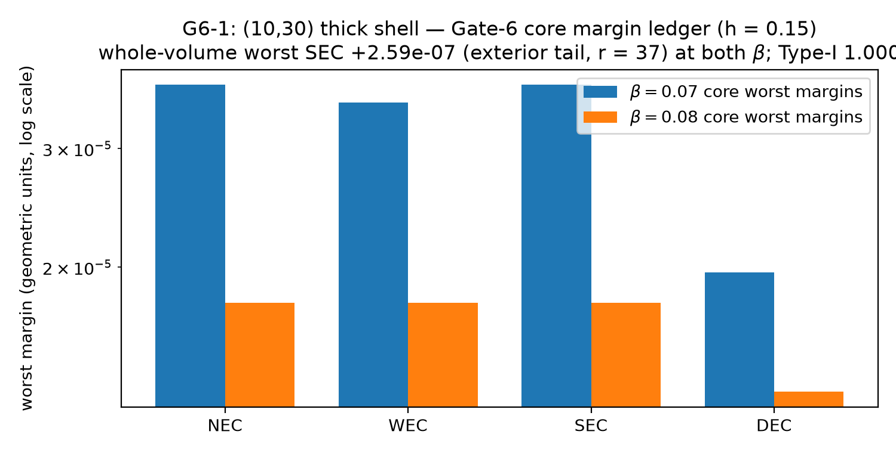
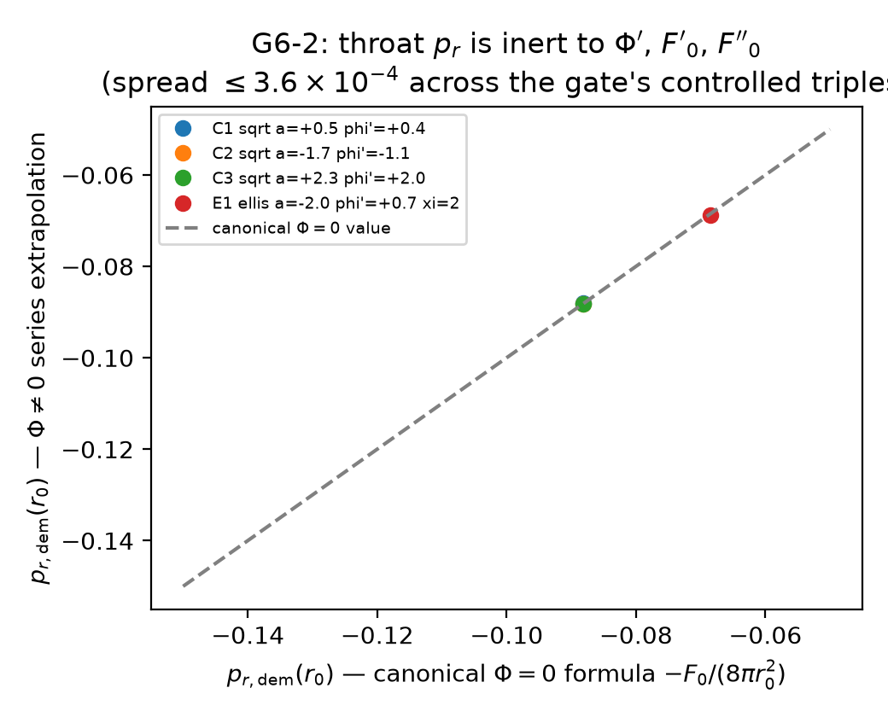
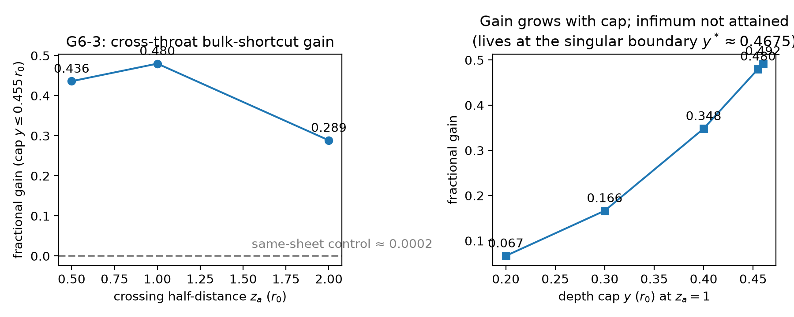
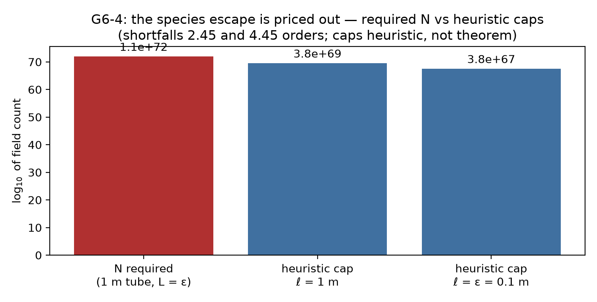

# Gate-6 claims — RESULTS (release v1.9.0)

Four results from Phases 26, 42 and 43, put through Gate-6
(2026-11-22): the programme's standing two-part gate — an
independent second-path recomputation AND a documented
literature novelty search, under the ruling "verify everything
and tell honestly what you found." Full gate record:
`GATE6.md` in this folder; per-claim worker reports in
`results/`; verifier code and numbers in `code/` and
`results/`; the phase-source records each claim rests on in
`sources/`.

**Count: UPLOAD-READY intact 0 · UPLOAD-READY AFTER
RESTATEMENT 4 · DEAD AS OURS 0** — but two sub-claims died:
the β = 0.07 "ceiling" (a machinery artefact; §1) and the
"first/past 0.05" framing for EC-legal shells (Procaccia,
Oct 2026; §1). Every claim below is stated ONLY in its
Gate-6 restated wording, quoted verbatim. Novelty verdict
for all four: PARTIALLY KNOWN — each has published roots,
cited, and a delimited novel residue.

---

## 1. G6-1 — the (10,30) thick shell at β = 0.07 and β = 0.08

> Within the Fuchs et al. (2024) TOV-shell family, the thick-shell configuration (R₁,R₂) = (10,30), ADM mass M = 8.0 geometric units = 1.0773×10²⁸ kg (compactness M/R₁ = 0.80), edge-peaked density (wd = 6.0, floor = 0.2), Gaussian smoothing (s_rho, s_P) = (4.0, 2.32), cosine shift on [10,30], satisfies NEC, WEC, SEC and DEC at every audited point (1,404 points, Hawking–Ellis Type-I fraction 1.000, whole-volume worst margin SEC +2.59e-07 in the exterior tail at r = 37.0, core margins NEC +3.73e-05 / DEC +1.94e-05 at r = 10.25) at β = 0.07 — and, on independent re-audit with an h-ladder to h = 0.0375 (continuum inner-edge NEC +1.767e-05), also at β = 0.08, so β = 0.07 is not the family ceiling. Fully EC-legal subluminal shells are known (Fuchs et al. 2024, arXiv:2405.02709), and a certified all-EC shell reaching β = 0.1363 in a different (zero-radial-pressure, shift-optimised (10,20)) design was publicly posted by Procaccia (Oct 2026); the novel content of this result is the specific TOV thick-shell configuration and its margin ledger, not the existence of EC-legal shells above β = 0.05.

Gate evidence (worker W-A, `results/wA_g6_1.md`; fresh
auditor `code/wa_auditor.py`, numbers `code/wa_results.json`):
the β = 0.07 configuration reproduced on a discretisation
different in kind from the phase's judge (whole-volume worst
SEC +2.580e-07 at h = 0.3 / +2.590e-07 at h = 0.15 vs claimed
+2.591e-07 / +2.593e-07). Phase 26's β = 0.08 failure was NOT
reproduced: it rested on one point read by the Phase-1
nested-Γ-stencil judge; the gate's inner-edge h-ladder gives
the continuum value +1.767e-05 ± 1e-07, positive, and the full
β = 0.08 audit passes. Phase 26's β = 0.09 row failed at the
same impeached point and is UNSETTLED pending re-audit
(Phase 50); β = 0.10's mid-shell h-stable failure is not
impeached. Caveat carried with this claim: Le
(arXiv:2605.25417) finds Type-IV tail violations in the Fuchs
shell under a stricter source-consistency standard. Coverage
limit: this claim's novelty search reached INSPIRE-HEP /
Semantic Scholar only via arXiv-linked indexes (no native
sessions) — a bounded gap, recorded in the gate record.

## 2. G6-2 — the Φ ≠ 0 inertness theorem

> In F(φ)R scalar-tensor gravity (canonical scalar, potential V(φ)) on a Morris–Thorne throat with regular Φ (Φ, Φ′, Φ″ finite at r₀), the demanded matter pair at the throat is exactly the canonical Φ = 0 pair for any such Φ: ρ_dem(r₀) = F₀β/(8πr₀²) − (1−β)F′₀/(16πr₀) and p_r,dem(r₀) = −F₀/(8πr₀²), because every radial-derivative term in the t–t and r–r field equations carries the factor A = 1 − b/r — including AΦ′₀F′₀ and 2AF₀Φ′₀/r₀ — the AΦ′F′ piece of □F cancels identically against ∇^t∇_tF = AΦ′F′, F″₀ enters neither channel, and Φ′ survives only in the scalar equation of motion via R(r₀) = 2β/r₀² − (1−β)Φ′₀/r₀, moving the EoM flux's magnitude but not its sign on the families tested. Phase 40's Φ = 0 result is the Φ′₀ = 0 special case of this theorem. Phase 35's teleparallel p_r lock (P35-4) is the same *pattern* by a *different mechanism* — there the r–r equation contains no derivative term at any r — not the same theorem.

Gate evidence (worker W-B, `results/wB_g6_2.md`; code
`code/wb_g62_derivation.py`, `code/wb_g62_numeric.py`):
reproduced on a third, structurally different derivation
(general lapse/radial parametrisation, series throat limit);
general-r pair differences exactly 0 in both channels; the
cancellation is a computed output, not an assumption. The
only restatement is the unification clause, downgraded to
pattern level (above).

## 3. G6-3 — the bulk-shortcut measurement

> In the P29-3 constructed Gaussian-normal bulk lift of the exhibited √-shape braneworld throat (brane metric Φ = 0, b(r) = r₀√(r/r₀); slab y ∈ [0, 0.46] r₀, bulk curvature singularity at the throat at y* ≈ 0.4675 r₀), a cross-throat bulk null geodesic between brane points z = ∓z_a beats brane-confined light by a fractional gain of **0.480 at z_a = 1** (brane time 6.2784 r₀/c → bulk 3.2646 r₀/c, u_eff = 1.92 c, depth cap y ≤ 0.455 r₀), **0.436 at z_a = 0.5**, and **0.289 at z_a = 2** (all cap-labelled at y ≤ 0.455 r₀; independently reproduced by geodesic-ODE shooting, flat-bulk gate exact). The gain is throat-specific (same-sheet control gain ≈ 0.0002), grows monotonically with the depth cap (0.067 at y ≤ 0.20, 0.166 at y ≤ 0.30, 0.348 at y ≤ 0.40, 0.480 at y ≤ 0.455, 0.492 at the slab edge y ≤ 0.46), and its infimum is **not attained** inside the existing bulk — it lives at the singular boundary. **EFFECTIVE ONLY** under C12: formation of throat+bulk has no classical route (Phase 28), so the setup leg is unavailable, not merely losing; the carrier is graviton-only.

Gate evidence (worker W-C, `results/wC_g6_3.md`; code
`code/wc_g63_solver.py`, `code/wc_g63_rest.py`,
`code/wc_g63_scans.py`; numbers `results/wc_g63_numbers_*.json`):
headline gain confirmed by fresh geodesic-ODE shooting
(0.4800 ± 0.002; flat-bulk gate exact, relative error 0.0);
two phase rows corrected (z_a = 0.5: 0.436, not 0.422;
z_a = 2: 0.289, not 0.177 — the phase's subdivided path was
tangled). The shortcut concept and measurements in other
bulks are published — Chung & Freese, arXiv:hep-ph/9910235;
Caldwell & Langlois, arXiv:gr-qc/0103070; Abdalla et al.;
Dai & Stojkovic, arXiv:2306.04069 — the measurement inside
an exhibited wormhole-throat bulk lift, with its control and
unattained-infimum structure, was not found.

## 4. G6-4 — component-blindness of the sampling bound

> **G6-4 (restated).** Let the total stress-energy be realised on a fixed background, along a fixed worldline with a fixed sampler f = g², by a fixed content of mutually non-interacting (free) quantum fields, each admitting a state-independent worldline QEI over Hadamard states (scalar, Dirac, Maxwell, Proca class; non-minimally coupled scalars, classical components and interacting components are outside this statement). Then the smeared total obeys ∫⟨T_tot(u,u)⟩ f dt ≥ −B_tot with **B_tot = Σᵢ Φᵢ[f]**, where each Φᵢ depends only on field i's identity, the sampler, the worldline and the background — never on how the fixed total is attributed among the components. Where the per-field bounds share a common functional up to constants (identical fields; flat-space massless species), B_tot factors as (Σᵢcᵢ)·Φ[f]. Hence a decomposition of a fixed total cannot inflate its applicable bound; the only enlargement is adding fields, worth exactly N× for N identical fields. For the 1 m Krasnikov tube that escape needs **N ≥ 1.06×10⁷²** (L = ε; 1.06×10⁷³ at L = a), which is **2.4 orders** beyond the heuristic cap ℓ²/l_P² = 3.8×10⁶⁹ at ℓ = 1 m and **4.4 orders** beyond 3.8×10⁶⁷ at ℓ = ε = 0.1 m (caps heuristic, not theorem), and at N = 10⁷² the Dvali species scale is **Λ ~ M_P/√N ≈ 1.2×10⁻⁸ eV** (cutoff length ħc/Λ ≈ 16 m), so the escape dissolves the semiclassical frame the bound lives in. In curved backgrounds the statement holds in difference-QEI form (excursion below the summed reference-state value). Reopening condition (unchanged): a theorem-grade interacting-field QEI in 4D whose total bound is decomposition-dependent.

Gate evidence (worker W-D, `results/wD_g6_4.md`; check code
`code/wd_arith.py`): the proof stands — all three
counterexample routes independently attacked and closed, and
per-field QEIs quantify over all Hadamard states, so
cross-component entanglement also buys nothing. Restatements:
the theorem-grade summed form B_tot = Σᵢ Φᵢ[f] (above); the
scope clauses made explicit; and one number corrected — the
phase memo's Λ ~ 10⁻¹⁷ eV was a GeV↔eV slip for ≈ 1.2×10⁻⁸ eV
(conclusion unchanged). The summed form is effectively in
print in 2D CFT via c = Σᵢcᵢ (Fewster, Rev. Math. Phys. 17
(2005) 577); the anti-loophole corollary for a fixed
metric-pinned total and the tube species pricing were not
found.

---

## Errata issued with this release

- `phase26/CHECKPOINT26.md`: Gate-6 erratum appended (the
  β = 0.07 ceiling is wrong; β = 0.08 passes; β = 0.09
  UNSETTLED; rung-2b best is the β = 0.08 row).
- `phase43/CHECKPOINT43.md`: Gate-6 erratum appended
  (P43-1 gains at z_a = 0.5 / 2 are 0.436 / 0.289; the p433
  memo's Λ ≈ 1.2×10⁻⁸ eV; Chung–Freese is
  arXiv:hep-ph/9910235).
- `NEW_PHYSICS_LEDGER.md`: the four claims moved from
  GATE-QUEUED to PUBLISHED (entries 12–15), in the restated
  wordings only.

## What this bundle does not claim

No FTL transport: the shell is subluminal (β = 0.08), the
bulk shortcut is EFFECTIVE ONLY with its setup leg
unavailable, and the other two results are no-go structure
theorems. Nothing here is a device, a drive design, or a
discovery claim beyond the delimited residues stated above.
