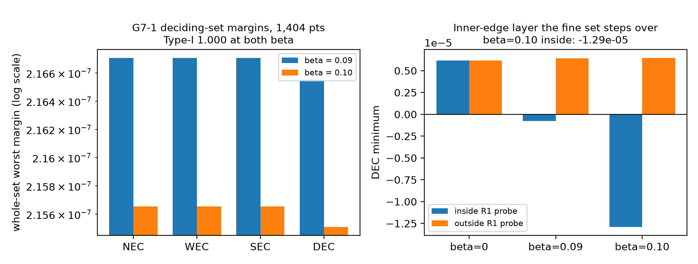
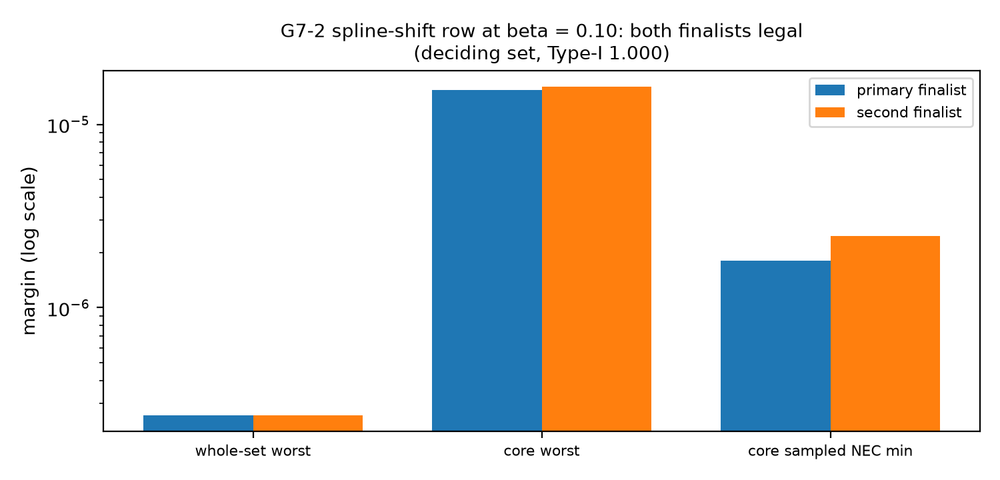
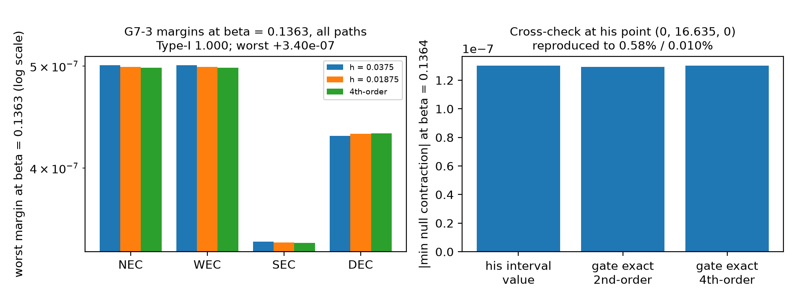

# Gate-7 claims — RESULTS (release v1.10.0)

Three results from Phase 50, put through Gate-7 (2026-11-22):
the programme's standing two-part gate — an independent
second-path recomputation AND a documented literature novelty
search, under the ruling "verify everything and tell honestly
what you found," with the Uniqueness Protocol amendment of
2026-11-22 applied to every wording. Full gate record:
`GATE7.md` in this folder; per-claim worker reports in
`results/`; verifier code and numbers in `code/` and
`results/`; the phase-source records each claim rests on in
`sources/`; file-by-file provenance in `MANIFEST.md`.

**Count: UPLOAD-READY intact 0 · UPLOAD-READY AFTER
RESTATEMENT 3 · DEAD AS OURS 0.** Every claim below is stated
ONLY in its Gate-7 restated wording, quoted verbatim. Novelty:
PARTIALLY KNOWN for G7-1 and G7-2 (published roots cited, the
residue delimited and worded "not found in our search" with
its limits); for G7-3 the claim and design are Procaccia's and
the programme's product is the independent confirmation only,
itself not found in our search within the limits named in
§3. Categories, stated exactly: G7-1 and G7-2 are
single-shell speed configurations (subluminal); G7-3 is an
independent confirmation of another author's single-shell
speed design. No cross-category comparison is made anywhere
in this bundle.

---

## 1. G7-1 — the halved-smoothing row at β = 0.10 and β = 0.09

> On the 1,404-point fine audit set (radii 3–9 step 1.0, 9.25–30 step 0.5, 31–39 step 2.0, × 26 Fibonacci directions), the (R₁,R₂) = (10,30) shell — ADM mass M = 8.0 geom (1.0773×10²⁸ kg), compactness M/R₁ = 0.80, edge-peaked density (wd = 6.0, floor = 0.2), TOV pressure, cosine shift on [10,30] — with Gaussian smoothing halved to (s_ρ, s_P) = (2.0, 1.16) satisfies NEC, WEC, SEC and DEC at every significant point with Hawking–Ellis Type-I fraction 1.000 at β = 0.10 (whole-set worst margin +2.16×10⁻⁷) and at β = 0.09 (+2.17×10⁻⁷), verified by an independent symbolic radial-reduction auditor. This is a prescribed-geometry audit: the audited source is the stress tensor the metric's Einstein tensor requires, conservation is automatic (Bianchi), and no matter model, formation route or stability is claimed; Le's (arXiv:2605.25417) stricter source-consistency standard is a standing caveat, not a bar met here. Scope limit: a denser radial probe finds a DEC-negative layer immediately inside the inner edge at β = 0.10 (10 < r ≲ 10.2, minimum −1.3×10⁻⁵ at r ≈ 10.01), which the fine set's radii 9.75 and 10.25 step over; at β = 0.09 the same layer appears only as a dip of at most 7.5×10⁻⁷ confined to r ≲ 10.02. "Fully legal" is therefore claimed on the audited fine set, not at every radius in (10, 10.25).

Gate evidence (worker W-A, `results/wA_g7_1.md`; fresh
symbolic radial-reduction auditor `code/wa_symbolic.py`,
`code/wa_eval.py` — analytic derivatives, no Cartesian
finite-difference stencil anywhere in the deciding path;
numbers `results/wa_g71_numbers.json`, layer anatomy
`results/wa_anatomy.json`): all three registered anchors
passed before any claim number (Minkowski max|G| =
8.7×10⁻¹⁹; β = 0 vs the exact spherical stress tensor:
density relative error 2.18×10⁻⁵; the Gate-6 champion at
β = 0.08 reproduced legal, worst +2.5926×10⁻⁷). On the
deciding set every registered bar passes at both speeds:
β = 0.10 — Type-I 1.000, whole-set worst +2.155×10⁻⁷ (DEC,
r = 6.0 cavity; phase claim +1.47×10⁻⁷, ratio 1.47, inside
the registered factor-3 band; 155× the gate floor
1.39×10⁻⁹), core worst +3.276×10⁻⁶, core sampled-null NEC
+1.568×10⁻⁶. β = 0.09 — Type-I 1.000, worst +2.166×10⁻⁷,
core worst +7.923×10⁻⁶, core sampled NEC +6.461×10⁻⁶. The
restatement is forced by the robustness set: a genuine thin
DEC-negative layer immediately inside R₁ (at β = 0.10,
minimum −1.33×10⁻⁵ at r ≈ 10.01) that the fine set's radii
step over — confirmed β-driven by a finite-difference
tie-break and by the β = 0 exact spherical read. Novelty:
the premise that smoothing decides legality is Fuchs et al.
2024's (arXiv:2405.02709); the direction — reducing the
smoothing width raises the legal-β ceiling — was not found
in our search (limits: INSPIRE-HEP and Semantic Scholar
reached only via general web search and arXiv-page index
links, not their own search interfaces; Procaccia's
companion optimisation paper not retrieved in full text).

## 2. G7-2 — the spline-shift row at β = 0.10 (both finalists)

> On the registered 1,404-point fine set, an independent symbolic radial-reduction auditor (analytic derivatives, no finite-difference stencil) confirms that the (10,30), M = 8.0, compactness-0.80, edge-peaked (wd = 6.0, floor = 0.2), Gaussian-smoothed (4.0, 2.32), TOV-pressure shell with a monotone C² cubic-spline shift profile (K = 5; knot values [1, 0.9457, 0.7729, 0.5141, 0.2572, 0.0689, 0]) is fully legal at β = 0.10 — Type-I fraction 1.000, whole-volume worst margin +2.59×10⁻⁷ (SEC, exterior tail r = 37), core worst +1.54×10⁻⁵, core sampled-null NEC min +1.80×10⁻⁶ — and that a second, independently polished K = 5 spline finalist is likewise fully legal at β = 0.10 on the same set (core worst +1.60×10⁻⁵, core sampled-null NEC min +2.45×10⁻⁶). On a denser robustness grid beyond the deciding set, the far tail (r = 39) shows an SEC margin of −1.5×10⁻⁸, at the auditor's representation-noise floor, for both finalists, and the second finalist shows isolated non-Type-I points at inner-edge radii the deciding set does not sample; legality is therefore claimed on the registered fine set, not on every off-set radius and direction. This is a prescribed-geometry audit: the audited source is the stress tensor the metric's Einstein tensor requires, conservation is automatic (Bianchi), and no matter model, formation route, or stability is claimed. Le (arXiv:2605.25417)'s stricter source-consistency standard is a standing caveat, not a bar met here.

Gate evidence (worker W-B, `results/wB_g7_2.md`; W-B's own
symbolic derivation `code/wb_symbolic.py`, auditor
`code/wb_auditor.py`; numbers `results/wb_g72_numbers.json`):
spline reconstruction from the stored knot values is
bit-exact against the phase's diagnostics for both
finalists; all three anchors passed before any claim number
(the Gate-6 champion at β = 0.08 reproduced, worst
+2.593×10⁻⁷, core NEC at r = 10.25 digit-identical to
Gate-6's continuum value). Deciding set, β = 0.10, all bars
pass for both finalists: primary — Type-I 1.000, whole-set
worst +2.593×10⁻⁷ (SEC, r = 37; ratio 1.005 vs claim), core
worst +1.544×10⁻⁵, core sampled NEC +1.80×10⁻⁶; second
finalist — Type-I 1.000, worst +2.593×10⁻⁷, core worst
+1.603×10⁻⁵, core sampled NEC +2.45×10⁻⁶. Robustness scope
is carried in the wording: far-tail SEC −1.53×10⁻⁸ at
r = 39 (at the path's representation-noise floor) for both
finalists, and isolated off-set inner-edge non-Type-I points
for the second finalist. Novelty: shift optimisation as a
legality-buying move is Procaccia's (Oct 2026, unrefereed),
with a variational precedent in the Natário class (Bolívar &
Vasilev); the transfer to the Fuchs TOV thick-shell family,
the one-freedom-at-a-time attribution, and the specific
configuration were not found in our search (limits:
INSPIRE-HEP and Semantic Scholar interfaces not reached
directly; Procaccia's companion paper full text not
separately retrieved).

## 3. G7-3 — independent confirmation of Procaccia's β = 0.1363 design

> Independent confirmation (2026-11-22): We have independently audited the warp-shell design of F. Procaccia, "Continuum Energy-Condition Certificates for an Optimized Positive-Energy Warp Shell" (posted 30 October 2026 on academia.edu; unrefereed; no arXiv version), reconstructing its continuum geometry from the paper's §2/§3 formulas and its published design vector (SHA-256 a8814dfb6273956da9656379a8dd887218ecc28cbafb03fc87f980c07510d74a, verified against all three published copies). With an independent finite-difference Einstein-tensor auditor whose stencil resolves the design's 0.05 m switch (grid spacings h = 0.0375 m and h = 0.01875 m; confirmed by a second, fourth-order discretisation agreeing on every deciding sign), the design satisfies the null, weak, strong and dominant energy conditions at β = 0.1363 at every significant audited point of the full audit set (Hawking–Ellis Type-I fraction 1.000; worst margin +3.40×10⁻⁷, more than 100× the measured numerical floor), and at β = 0.1364 the same machinery finds the violation Procaccia proved, at his exact point (r = 16.635 m, θ = 90°), with minimum null contraction −1.29×10⁻⁷ (second-order) / −1.30×10⁻⁷ (fourth-order) against his interval value −1.30135×10⁻⁷. Scope: this is a prescribed-geometry audit — the stress tensor checked is the one the metric implies through the Einstein equations — and it claims no matter model, formation route, or stability for the design. Under the stricter source-consistency standard of Le (arXiv:2605.25417) the design is not certified; that standard is carried as a standing caveat, not as a bar of this audit. The claim and the design are Procaccia's; ours is only the independent confirmation and its stated scope.

Gate evidence (worker W-C, `results/wC_g7_3.md`; fresh code
`code/wc_recon.py`, `code/wc_auditor.py`, `code/wc_run.py`,
`code/wc_crosscheck.py`; numbers
`results/wc_g73_numbers.json`): the design-vector hash gate
passed before any number was read (SHA-256 a8814dfb…10d74a
on all three published copies); the fidelity spot check
reproduced the paper's printed values (continuum mass
relative error 3.6×10⁻¹⁵; all spot values ≤ 2.7×10⁻⁸). All
four registered bars pass: Type-I fraction 1.000 at
h = 0.0375 and h = 0.01875 and on the fourth-order second
path; worst margin +3.404×10⁻⁷ (SEC, r = 5.0) = 109.5× the
measured floor, sign-stable across the spacing pair;
sampled-null NEC min +8.999×10⁻⁸ / +8.945×10⁻⁸. The
machinery cross-check at β = 0.1364 reproduces his proven
violation at his exact point by exact minimisation:
−1.2938×10⁻⁷ (second-order, finest spacing; 0.58% from his
−1.30135×10⁻⁷) and −1.30122×10⁻⁷ (fourth-order; 0.010%).
The standing verified mark in the single-shell speed
category therefore remains Procaccia's 0.1363, now confirmed
at this programme's bars; §§1–2 of this bundle (β = 0.10) do
not reach it and make no such comparison. Novelty (audit
standing only): not found in our search (limits: INSPIRE-HEP
and Semantic Scholar checked only via general-web queries
naming them, not their own search interfaces; arXiv checked
by web-index search, not API listing) — no prior independent
audit, confirmation or refutation of the claim was found,
and no refereed or arXiv version of it; only his
academia.edu posting and figshare DOIs
10.6084/m9.figshare.34866243.v1 / 34895667.v1.

---

## Errata recorded with this bundle (from GATE7.md; not executed by the gate)

- Prose point-count: the G7-3 audit set construction
  produces 1,430 point-rows (1,378 distinct), not 1,352 as
  stated in GATE7.md's pre-registration, CHECKPOINT50 §P50-1
  and p501_memo.md. Duplicates cannot affect any minimum or
  a 1.000 Type-I fraction.
- The Phase-50 cross-check magnitude −1.245×10⁻⁷ was a
  20,000-direction sample of the minimum null contraction,
  which direction sampling under-reads; the exact values are
  −1.294×10⁻⁷ / −1.301×10⁻⁷ (§3).
- Future audits of the halved-smoothing family should add
  radii inside (10, 10.25) to the deciding set; Phase 50's
  family-ceiling statement inherits the fine-set scope of
  §1's wording.
- Ledger: the two β = 0.10 rows and this confirmation move
  to the ledger's PUBLISHED tier in their restated wordings
  only (prepared separately as `ledger_note_v1100.md`).

## What this bundle does not claim

No faster-than-light transport and no speed mark of this
programme's own above β = 0.10: every configuration here is
subluminal, prescribed-geometry, with no matter model,
formation route or stability claimed. The β = 0.1363 design
in §3 is Procaccia's; this programme's contribution there is
the independent confirmation and its stated scope only.
