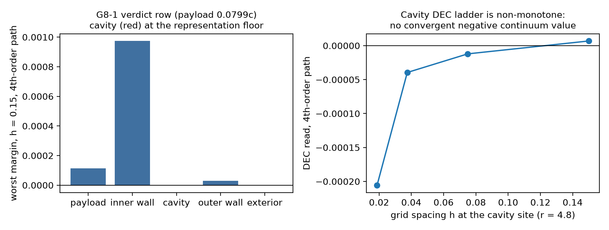
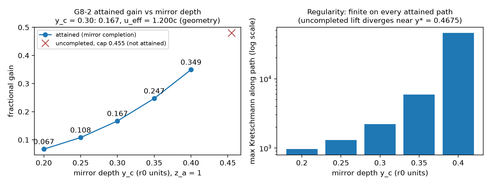

# Gate-8 claims — RESULTS (release v1.10.0)

Two results from Phase 46, put through Gate-8 (2026-11-22):
the programme's standing two-part gate — an independent
second-path recomputation AND a documented literature novelty
search. Full gate record: `GATE8.md` in this folder; per-claim
worker reports in `results/`; verifier code and numbers in
`code/` and `results/`; the phase-source records each claim
rests on in `sources/`; file-by-file provenance in
`MANIFEST.md`.

**Count for this bundle: UPLOAD-READY AFTER RESTATEMENT 2
(G8-1 in its AMENDED wording — see the amendment note in
§1 and `GATE8_AMENDMENT.md`; G8-2). G8-1 was held in
release v1.10.0 over the wording point that amendment
resolves and is released in v1.10.0.**
Categories, stated exactly: G8-1 is a payload-transport
configuration (subluminal); G8-2 is a bulk-shortcut geometry
result (EFFECTIVE ONLY — a geometry statement, not a
transport configuration). No cross-category comparison is
made anywhere in this bundle, and neither claim is compared
with any single-shell speed mark.

---

## 1. G8-1 — the composed payload at 0.0799c

Gate verdict (GATE8.md): UPLOAD-READY AFTER RESTATEMENT —
correctness REPRODUCED WITH RESTATEMENT; the carried DEC
caveat settled as a representation-floor artefact; novelty
graded NOVEL by the gate (11 queries logged), which under
the Uniqueness Protocol is carried only as a new catalogue
entry of allowed warp geometries, not as any wider claim.

**Amendment note (2026-11-22):** this claim was HELD in
release v1.10.0 (bundle assembly). The gate's restated
wording (worker report `results/wA_g8_1.md` §6) stated
that the cavity DEC read "is sign-unstable across
spacings, directions and discretisations at
|DEC| ≲ 4×10⁻⁵ under refinement," while the gate's own
stored ladder (the §3 ladder in the same worker report;
series `wa_run2.richardson_o4.dec_series`) reads
−2.06×10⁻⁴ at h = 0.01875 at the fixed cavity site, with
a further −2.27×10⁻⁴ read at r = 4.95 at that spacing —
excursions beyond the wording's band at the finest
spacing. Gate amendment `GATE8_AMENDMENT.md` (in this
bundle; original in `gate8/`) re-read the stored ladder
from the raw run JSONs and corrected ONLY the band
figure, to |DEC| ≲ 2.3×10⁻⁴; every other word of the
gated wording is unchanged (byte check in the
amendment). The hold is LIFTED: the wording below is
the amended wording, and the claim is released in
v1.10.0. The substantive settlement was never in
question (no convergent negative continuum value in
either discretisation; every stencil-clear cavity read
≥ +9.98×10⁻⁵; Type-I 1.000 throughout). The full
evidence set for the claim is in this bundle
(`results/wA_g8_1.md`, `results/wa_g8_1_numbers.json`,
`results/wa_run1.json` – `wa_run6.json`,
`sources/p462_*`). The gate's restated wording, as
amended:

> Nested GR shells with the inner shell solved in the composed lapse (coordinate β_i turned down by exactly the lapse factor ×0.6451; orthonormal shift W held at the verified alone value 0.06638) carry a payload at 0.0799c at full bars on the registered audit pattern (full-volume all-directions NEC/WEC/SEC/DEC at h = 0.3/0.15, Hawking–Ellis Type-I fraction 1.000, conservation clean; h = 0.15 worst margins by region: inner wall +9.79×10⁻⁴, outer wall +4.05×10⁻⁵, payload region +1.09×10⁻⁴; independently reproduced by a direct-∂² evaluator: +9.74×10⁻⁴ / +2.86×10⁻⁵ / +1.14×10⁻⁴). One floor caveat is part of the claim: in the near-edge cavity shell 4.6 < r < 5 the DEC read is at the discretisation/representation floor — it touches −3.7×10⁻⁶ at h = 0.075 on the focused set, is sign-unstable across spacings, directions and discretisations at |DEC| ≲ 2.3×10⁻⁴ under refinement, and has no convergent negative continuum value in either of two discretisations different in kind; every stencil-clear cavity read is ≥ +9.98×10⁻⁵ and Type I remains 1.000 — the touch is a floor artefact, and no clean continuum DEC value is asserted for that shell. Follow-up rows (not verdict rows): dual re-equilibration passes at 0.0729; β_o capped at its verified 0.05 gives a passing 0.0821 (independently confirmed). At 0.0998 the inner wall passes (+9.86×10⁻⁴; the P41-3 inner kill is gone) but the outer wall fails: its worst point is Hawking–Ellis non-Type-I in two independent discretisations (sampled NEC ≈ −3.4×10⁻⁵; the Phase-1 judge's sampled SEC quantification is −2.73×10⁻⁴), so the P22-3 trigger does not fire. C12: subluminal pre-arranged configuration; construction-inclusive arrival ≥ D/c; no transport claim beyond the payload's own speed.

Gate evidence summary (from GATE8.md and
`results/wA_g8_1.md`): anchors passed before any claim
number (Minkowski exactly 0.0; Finalist-A calibration worst
+5.30×10⁻⁷ vs record +5.50×10⁻⁷, Type-I 1.000); composed
lapse ratio 0.64507 reproduced, orthonormal shift held at
0.066381; verdict row at h = 0.15 reproduced (inner wall
+9.74×10⁻⁴, outer wall +2.86×10⁻⁵, payload +1.14×10⁻⁴,
Type-I 1.000, conservation clean); the β_o-capped follow-up
row (payload 0.0821) passes on the gate path; the dual
re-equilibration row (0.0729) was not re-run by the gate.
The 0.0998 failure is confirmed in machinery-independent
form (worst point non-Type-I in both discretisations,
sampled NEC ≈ −3.4×10⁻⁵).

## 2. G8-2 — the attained completion: gain 0.167 at y_c = 0.30 r₀

> **G8-2 (P46-3), restated:** The v1.9.0 statement stands untouched: in the P29-3 constructed Gaussian-normal bulk lift of the exhibited √-shape braneworld throat, the cross-throat bulk shortcut at z_a = 1 has fractional gain **0.480** (cap y ≤ 0.455 r₀), cap-labelled, its infimum **not attained** — it lives at the bulk curvature singularity at y* ≈ 0.4675 r₀ — **EFFECTIVE ONLY** under C12, graviton-only carrier. **New content:** closing that lift at y_c = 0.30 r₀ with a Z₂ mirror brane (the standard Randall–Sundrum move) makes the shortcut an **attained** minimising geodesic of an everywhere-regular completed bulk: gain **0.167** (bulk 5.2304 r₀/c vs brane 6.2784 r₀/c; u_eff = 1.200c; independently reproduced by geodesic-ODE shooting at 5.2305, gain 0.1669), Kretschmann finite along the whole path (≤ 2.21×10³/r₀⁴), the minimiser a valley-floor minimising geodesic of the completed space in the metric-geometry sense (smooth geodesic arcs joined by the mirror-interface segment, where the optical metric D/A has its transverse minimum; not a smooth transversal crossing). Deeper mirrors attain more: **0.247 at y_c = 0.35 r₀, 0.349 at y_c = 0.40 r₀** (shallower: 0.067 at 0.20, 0.108 at 0.25). The price is one **pre-existing** tension-like mirror brane (σ ∈ [1.001, 1.47] over |z| ≤ 3 — the throat peak discretisation-bracketed [1.40, 1.47] — p ≈ −λ; NEC/WEC/DEC saturated-pass; SEC −2.00, exactly the model's own RS-brane tension value); no bulk matter and no added endpoint-brane matter. The 0.480 is attained by **no** completion tried: the singularity is load-bearing for the *size* of that number, not for the *existence* of the effect. Alternative regular completions (regular core, gain 0.195; floored-D, gain 0.135) attain only with NEC-violating bulk matter (~10⁶× the audit floor; floored-D slab NEC_min ≈ −0.40 independently reproduced) — exoticity relocated into the bulk, not credited. **C12: EFFECTIVE ONLY** — the throat, its bulk and the mirror brane are pre-existing structure; formation has no classical route (Phase 28), so the decision-inclusive arrival does not beat brane light; carrier graviton-only.

Gate evidence (worker W-B, `results/wB_g8_2.md`; fresh code
`code/wb_g82_solver.py`, `code/wb_g82_israel.py`,
`code/wb_g82_spotcheck2.py` — Euler–Lagrange geodesic-ODE
shooting, the phase's variational minimiser not re-run;
numbers `results/wb_g82_numbers.json`,
`results/wb_g82_israel.json`): gates first — flat-RS2 zero
exact (relative error 0.0), and the uncompleted record
reproduced on the gate path (gain 0.4799 at cap 0.455 vs the
published 0.480), so the v1.9.0 statement the wording leaves
untouched is confirmed as it stands. Attained gain curve
(gate path, every row within 5×10⁻⁴ of the phase record):
0.0669 at y_c = 0.20, 0.1081 at 0.25, 0.1669 at 0.30
(T = 5.2305 r₀/c, u_eff = 1.200c), 0.2471 at 0.35, 0.3494 at
0.40. Regularity: Kretschmann ≤ 2.21×10³/r₀⁴ along the
attained path at y_c = 0.30, finite, the singularity cut off
by the completion. Geodesic honesty settled as worded: the
optical metric's transverse minimum sits exactly at the
mirror interface, no smooth transversal crossing geodesic
exists (31-slope scan), and the folded-space optimum agrees
with the phase's double-space minimisation to 9×10⁻⁵. Price:
the gate's own Israel computation (validated at y = 0 to
0.13–0.20%) gives σ ∈ [1.001, 1.40], the throat peak
discretisation-bracketed [1.40, 1.47] across methods;
NEC +0.00072 saturated-pass, WEC/DEC pass, SEC −1.998 — the
model's own RS value. The floored-D alternative completion's
slab NEC_min ≈ −0.40 on the gate path (against its own audit
floor −0.0085) confirms the relocation verdict is not
phase-specific. Novelty: PARTIALLY KNOWN — the shortcut
concept and measurements (Chung–Freese
arXiv:hep-ph/9910235, corrected ID; Caldwell–Langlois
arXiv:gr-qc/0103070; Abdalla et al.; Leach–Lesame
arXiv:gr-qc/0502109; Dai–Stojkovic arXiv:2306.04069), the
Z₂/Israel machinery, regular braneworld completions for
black holes, and two-brane RS wormhole solutions are all in
print; the attained-regular-completion statement for an
exhibited throat lift was not found in our search (limits:
INSPIRE-HEP / Semantic Scholar via the web index only, no
native sessions; non-English literature not searched).

---

## Errata recorded with this bundle (from GATE8.md; not executed by the gate)

- Phase-46 record: the P46-2 caveat's location is the cavity
  near-edge shell (4.6 < r < 5), not the payload region as
  CHECKPOINT46.md's status log phrases it; the payload region
  reads +1.21×10⁻⁵ at h = 0.075.
- Phase-46 record: the 0.0998 outer-wall figure
  "SEC −2.73×10⁻⁴" is the Phase-1 judge's sampled
  quantification at a non-Type-I point; the
  machinery-independent statement is in §1's wording.
- P46-3's mirror-brane peak σ = 1.47 is carried as the
  discretisation bracket [1.40, 1.47].
- Ledger: G8-2's source entry (Phase 46, P46-3) moves to
  the ledger's PUBLISHED tier in its restated wording only;
  G8-1's source entry stays GATE-QUEUED while the claim is
  held (prepared separately as `ledger_note_v1100.md`).
  [Amendment, 2026-11-22: the hold is lifted by
  `GATE8_AMENDMENT.md`; G8-1's source entry moves to
  PUBLISHED in its amended wording with release
  v1.10.0.]
- Follow-up (science, not owed by this gate): the dual
  re-equilibration row (0.0729) was not independently
  re-run; the cavity shell 4.6 < r < 5 has no clean
  continuum DEC value in the current metric representation.

## What this bundle does not claim

No faster-than-light transport: G8-1 is a subluminal
payload configuration, and G8-2's u_eff = 1.200c is a
bulk-geodesic geometry statement labelled EFFECTIVE ONLY —
the throat, its bulk and the mirror brane are pre-existing
structure with no classical formation route, so no
decision-inclusive arrival beats brane light. Nothing here
is a device or a drive design.
