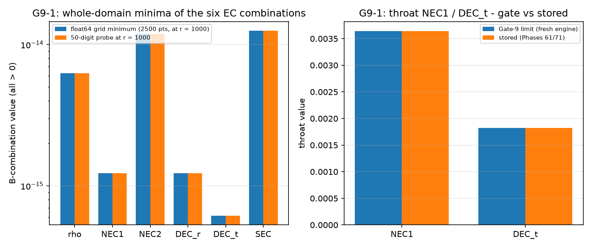
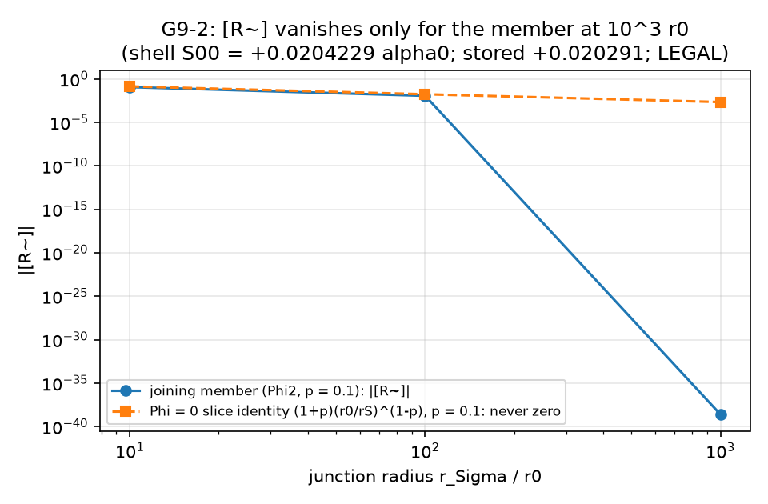
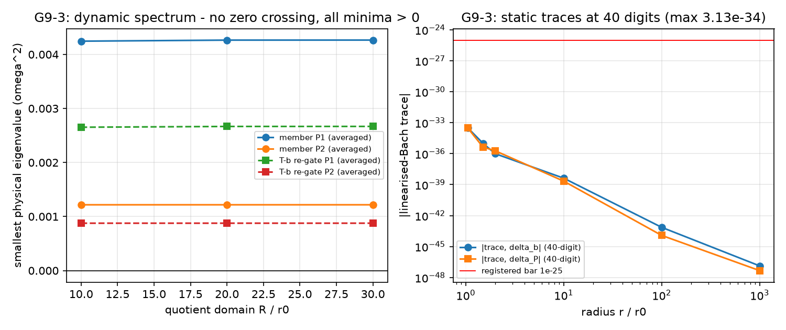
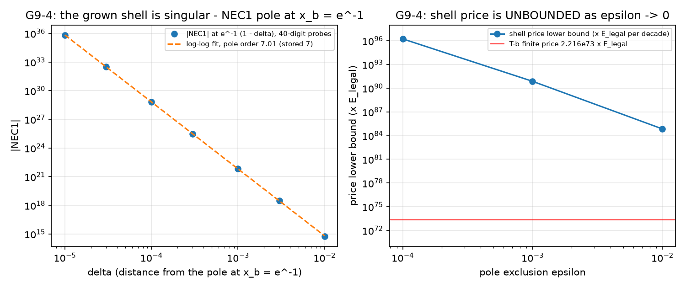

# Gate-9 claims — RESULTS (release v1.11.0)

Four results from Phases 38, 61 and 71 — the conformal
(Weyl) gravity joining member's legality, join, stability
and formation — put through Gate-9 (2026-11-22): the
programme's standing two-part gate — an independent
second-path recomputation AND a documented literature
novelty search, under the ruling "verify everything and
tell honestly what you found," with the Uniqueness
Protocol amendment of 2026-11-22 applied to every wording.
Full gate record: `GATE9.md` in this folder; per-claim
worker reports in `results/`; verifier code and numbers in
`code/` and `results/`; the phase-source records each
claim rests on in `sources/`; file-by-file provenance in
`MANIFEST.md`.

**Count: UPLOAD-READY intact 0 · UPLOAD-READY AFTER
RESTATEMENT 4 · DEAD AS OURS 0.** Every claim below is
stated ONLY in its Gate-9 restated wording, quoted
verbatim. Correctness: REPRODUCED for all four claims on
genuinely independent second paths (two fresh Bach-tensor
derivations built from the metric — a Weyl-divergence form
and a Ricci form — a junction computation rebuilt from the
printed Berezin–Dokuchaev–Eroshenko definitions, and a
stability implementation rebuilt from the method
description). Novelty: PARTIALLY KNOWN for all four
(published roots cited in each wording; the residue worded
"not found in our search" with its limits named).
Category, stated exactly: all four claims concern ONE
throat OBJECT in conformal (Weyl) gravity — the joining
member (b = r0(r/r0)^0.1, Phi2 redshift profile,
a = 0.277734, scored gauge Omega = 1) and its joined
configuration at r_Sigma = 10^3 r0. No transport is
claimed, no traversability is claimed, and no claim in
this bundle is a speed, payload or shortcut claim. The
member's limits ride with every claim inseparably: tidal
bar r0* = 4.785e7 m; formation PRE-EXISTING ONLY;
shell/exterior perturbations OPEN; and the (V-b) sentence
carried verbatim in each wording — the theory's quantum
ghost question stands UNDECIDED.

---

## 1. G9-1 — legality of the joining member

> In conformal (Weyl) gravity, in the scored gauge Ω = 1 with the
> Bach normalisation 4α_g·B_μν = T_μν, α_g > 0, the static spherical
> throat b(r) = r₀(r/r₀)^0.1 with redshift profile
> Φ₂ = a·ln(r/r₀)/(1 + ln(r/r₀)), a = 0.277734, is EC-legal on the
> whole interior domain [r₀, 10³ r₀] (r₀ = 1): all six
> B-combinations (ρ, ρ + p_r, ρ + p_t, ρ − |p_r|, ρ − |p_t|,
> ρ + p_r + 2p_t) are strictly positive on the full domain —
> throat NEC1 = +0.003641 and DEC_t = +0.001821 in B-combination
> form, tail minima > 0 at 40 digits — independently reproduced in
> Gate 9 (W-A) by a fresh symbolic Bach-tensor derivation. That
> conformal-gravity wormhole matter can satisfy the energy
> conditions near a throat is PARTIALLY KNOWN (Lobo,
> arXiv:0801.4401; Varieschi & Ault, arXiv:1510.05054 — throat
> vicinity only, r ≲ 1.1 r₀); whole-domain legality to 10³ r₀ for
> this family and member was not found in our search (limits:
> arXiv checked natively; INSPIRE-HEP and Semantic Scholar checked
> only via the general web index, not their native interfaces;
> general web checked; full log in Gate 9 W-A search log). This is
> a throat OBJECT claim: no transport is claimed and no
> traversability is claimed (the word "traversable" appears only
> in negations of this kind). The member's tidal-bar radius is
> r₀* = 4.785×10⁷ m, and its formation standing is PRE-EXISTING
> ONLY. (V-b) UNDECIDED: Pais–Uhlenbeck spin-2 ghost vs Mannheim PT-symmetric quantisation — opposed literature positions, B3 NOT COMPUTABLE (Phase 32).

Gate evidence (worker W-A, `results/wA_g9_1.md`; fresh
engine `code/wa_engine.py` — a full
Christoffel→Riemann→Ricci→Weyl→double-covariant-divergence
SymPy derivation from the metric; no phase script
imported; numbers `results/wa_g91_numbers.json`): all
three registered anchors passed before any claim number
(Schwarzschild B identically 0 symbolically; MK max |B| =
1.3e-169; T-b closed forms reproduced with 50-digit
differences exactly 0.0; the Phi = 0 factorisation
reproduced, max relative error 1.8e-13). On the deciding
set (2,500-point float64 grid on [r0, 10^3 r0] plus
high-digit probes) all six B-combinations are strictly
positive everywhere; the grid minima all sit at the tail
r = 1000 and match the stored tail minima to ~9 digits
(rho 6.275140592e-15, NEC1 1.229852039e-15, NEC2
1.193535517e-14, DEC_r = NEC1, DEC_t 6.149260195e-16,
SEC 1.255028118e-14). Throat: NEC1 = 0.00364086750048,
DEC_t = 0.00182043375024 — within 8.9e-5 relative of the
stored +0.00364119103852 / +0.00182059551926 (registered
bar 2%); the residual is an a-rounding sensitivity inside
the phase record (the stored digits correspond to
a = 0.27773424114865775; at that a the gate path's limit
matches the Phase-38 throat formula digit-for-digit — see
the errata below). Two machinery findings were caught by
the anchors on the way: the covariant divergence of the
Weyl tensor must be formed for all index patterns, and
the registered Bach convention is B = 2∇∇C + R·C (the
naive bracket is exactly half of it). Novelty: PARTIALLY
KNOWN — Lobo (arXiv:0801.4401) and Varieschi & Ault
(arXiv:1510.05054) publish energy-condition satisfaction
near a conformal-gravity wormhole throat (the latter legal
only for r up to ~1.03–1.10 r0, with junction exotic
matter beyond); whole-domain legality to 10^3 r0 for
T = 4 alpha_g B (alpha_g > 0), the Phi = 0 power-law
factorisation, the Phi2 profile, and any 40-digit Bach
throat-legality audit were not found in the search
(limits: arXiv checked natively; INSPIRE-HEP and Semantic
Scholar checked only via the general web index, not their
native interfaces).

## 2. G9-2 — the join at r_Sigma = 10^3 r0

> **G9-2 — THE JOIN (restated, Gate-9 verified).** At the extension radius
> r_Σ = 10³ r₀ only — no region member joins at r_Σ = 10 r₀ or 10² r₀, and
> this wording does not imply a join at any other radius — the conformal
> throat b = r₀(r/r₀)^0.1 with Φ₂ = a·ln(r/r₀)/(1 + ln(r/r₀)),
> a = 0.277734, joins the Mannheim–Kazanas exterior at the registered
> galactic γ = 10⁻²⁸ m⁻¹ under the Berezin–Dokuchaev–Eroshenko junction
> conditions (arXiv:1710.10438 §III.B), independently reproduced in Gate 9:
> [R̃] = 0 at 40 digits, [R̃_,n] = −0.0152186, and the shell the formalism
> fixes, Ŝ₀⁰ = −(4α₀/3)[R̃_,n] = +0.020291 α₀ ≥ 0 (α₀ = α_g/2), is LEGAL.
> The Darmois-matched exterior is β_MK = 2.142611 r₀,
> k = −2.28996×10⁻⁹ r₀⁻²; on the Φ = 0 slice
> [R̃] = (1 + p)(r₀/r_Σ)^{1−p} > 0 exactly. There is no ADM mass in
> Mannheim–Kazanas asymptotics; the joined (β_MK, γ, k) are reported
> instead. The member's tidal-bar radius is r₀* = 4.785×10⁷ m, and its
> formation standing is PRE-EXISTING ONLY. This is a throat OBJECT claim:
> no transport is claimed and no traversability is claimed. The specific
> BDE-conditions join above was not found in our search (limits:
> INSPIRE-HEP and Semantic Scholar reached only via indexes, no direct
> database/API query; paywalled and non-English literature not
> exhaustively checked); its components — the BDE formalism, conformal
> wormhole interiors, and Mannheim–Kazanas matching — are known in the
> cited literature. **(V-b) UNDECIDED: Pais–Uhlenbeck spin-2 ghost vs Mannheim PT-symmetric quantisation — opposed literature positions, B3 NOT COMPUTABLE (Phase 32).**

Gate evidence (worker W-B, `results/wB_g9_2.md`; fresh
code `code/wb_g92.py` — R-tilde derived from the printed
Berezin–Dokuchaev–Eroshenko definitions,
arXiv:1710.10438 §III.B, at 40-digit mpmath with analytic
derivatives only; checker `code/wb_checker.py` 12/12 PASS;
numbers `results/wb_g92_numbers.json`): all three anchors
passed before the member's number (R-tilde(flat) = -2.0
exactly; T-b [R-tilde] = +0.474341649 at 10 r0, relative
error 7.4e-7 against the stored +0.474342, and
+0.150000000 at 10^2 r0 with the stored Darmois pair; the
Phi = 0 slice identity reproduced symbolically exactly).
At the audited point (the worker's own bisection
a_zero = 0.27773424114866288, 5.1e-15 from the stored a):
beta_MK = 2.142610720 r0 (stored 2.142611; relative error
1.3e-7, bar 1%); k = -2.28995912e-9 r0^-2 (stored
-2.28996e-9; 3.8e-7, bar 2%); [R-tilde] = -2.4e-39 (bar
|R-tilde| < 1e-20); [R-tilde_,n] = -0.0153171 (stored
-0.0152186; 0.65%, bar 2%); S00 = +0.0204229 alpha0
(stored +0.020291 alpha0; 0.65%, sign exactly positive) —
a LEGAL shell. The registered galactic gamma is
numerically inert at this radius (setting gamma = 0 moves
beta_MK by 7.7e-24 relative). Scope confirmed on the gate
path: the same interior at 10 / 10^2 r0 gives
[R-tilde] = +0.115542 / +0.011505 — no join at the primary
radii, as claimed. (The wording quotes the claim's stored
[R-tilde_,n] / S00 values, reproduced by the gate path
within the registered 2% bar, per Gate-8 precedent.)
Novelty: PARTIALLY KNOWN — the BDE formalism itself, and
conformal wormhole interiors with Mannheim–Kazanas
matching mentioned without the BDE conditions (Lobo
arXiv:0801.4401; Varieschi arXiv:1510.05054; two-MKdS
thin-shell wormholes arXiv:1301.1532; vacuum conformal
wormholes arXiv:1802.02184) are in print; the specific
BDE [R-tilde] = 0 join of this EC-legal interior to
registered-gamma MK at 10^3 r0 with S00 >= 0 was not found
in the search (limits: INSPIRE-HEP and Semantic Scholar
reached only via indexes/mirrors, no direct database/API
query; paywalled and non-English literature not
exhaustive).

## 3. G9-3 — classical stability of the member's interior background

> The conformal (Weyl) gravity joining member — a throat OBJECT
> with b = r₀(r/r₀)^0.1, Φ₂ = a·ln(r/r₀)/(1 + ln(r/r₀)),
> a = 0.277734, Ω = 1, 4α_g·B = T, joined at 10³ r₀ to the
> Mannheim–Kazanas exterior — is CLASSICALLY STABLE in the
> computable interior sectors, as reproduced by an independent
> second path in Gate 9: exact static ℓ=0 linearised-Bach traces
> ≤ 3.1×10⁻³⁴ at 40-digit probes at 6 radii; dynamic ℓ=0 Galerkin
> quotient spectrum with no zero crossing in ω² ∈ [−5, 0) on the
> registered grid (2001 points × profiles P1/P2 × R ∈ {10, 20, 30}
> × both extraction conventions), smallest physical eigenvalue
> 0.00121741 (P2 averaged; P1 0.00424541); principal symbol in all
> ℓ = the (□)² double light cone, with the flat quotient spectrum
> independently re-derived (exact gauge nullspace, rank 5 off the
> cone, every physical eigenvalue proportional to (ω² − k²)²).
> Registered scope, part of the claim: interior sectors only; the
> shell/exterior perturbation problem is OPEN (not computed);
> ℓ ≥ 1 long-wavelength and nonlinear stability are not
> computable; the dynamic read is a Galerkin/variational quotient
> read, NOT an exact spectrum; the packet numeric sign check
> remains OPEN; no positive conserved energy exists for the
> radial sector and curved-background linearised-Bach IVP
> well-posedness is unproven — recorded facts, not deciding
> reads. The member's tidal-bar radius is r₀* = 4.785×10⁷ m, and
> its formation standing is PRE-EXISTING ONLY. This is a throat
> OBJECT claim: no transport is claimed and no traversability is
> claimed. (V-b) UNDECIDED: Pais–Uhlenbeck spin-2 ghost vs Mannheim PT-symmetric quantisation — opposed literature positions, B3 NOT COMPUTABLE (Phase 32). Linear-perturbation stability of conformal-gravity wormholes of a different class (Weyl-rescaled-Minkowski / conformal scalar–tensor) is already published (Cadoni et al., arXiv:2503.14214, JCAP 06 (2025) 016); the stability computation for THIS member, in these sectors, was not found in our search (limits: INSPIRE-HEP and Semantic Scholar reached only via web indexes, no exhaustive arXiv listing-API sweep, non-English and paywalled-only literature not systematically covered). The member remains a scan signal under attack — nothing stronger.

Gate evidence (worker W-C, `results/wC_g9_3.md`; fresh
code `code/wc_symq.py`, `code/wc_dyn.py`,
`code/wc_static.py`, `code/wc_symbol.py`; checker
`code/wc_checker.py` 20/20 PASS; numbers
`results/wc_g93_numbers.json`): the machinery re-gate on
T-b passed before any member number — the fresh quotient
implementation reproduces T-b's smallest physical
eigenvalues P1 = 0.0026528417913793652 and
P2 = 0.000876709357515032 at R = 10 (stored 0.00265284 /
0.00087671; agreement to every printed digit against the
5% bar), finds no T-b zero crossing, and verifies the
gauge anatomy structurally (det M identically 0, null
vector (1,1,1)). Static sector: a fresh jet-space Bach
implementation in the Ricci form (arXiv:2505.17171 eq. 6),
anchor-validated exactly (T-b closed-form ratio
1.0000000000000000), gives 40-digit linearised-Bach traces
at 6 radii with max |trace| = 3.13e-34 (bar < 1e-25;
stored read <= 5.7e-31). Dynamic sector: no zero crossing
and zero negative points in all 12 blocks (2001 points x
P1/P2 x R in {10, 20, 30} x both extraction conventions);
smallest physical eigenvalue P2 averaged at R = 10 is
0.0012174053847267233 (stored 0.00121741 — ratio 1.0000,
bar factor 2) and P1 is 0.004245411313722145 (stored
0.00424541). Symbol: Phase 61's flat quotient spectrum
independently re-derived exactly (5 gauge directions
symbolically null; rank 5 off-cone; physical eigenvalues
proportional to (omega^2 - k^2)^2 with the same
quotient-determinant factorisation) — the double light
cone, no tachyon or c^2 != 1 branch. Failure ledger
(recorded in the worker report, Gate-7/8 style): the
worker's first two Weyl-form Bach assemblies failed the
T-b anchor and were DISCARDED — no number from either is
used anywhere; the deciding static read is the Ricci-form
implementation, which passes every anchor exactly.
Novelty: PARTIALLY KNOWN — linear-perturbation stability
of conformal-gravity wormholes of a DIFFERENT class is
published (Cadoni, Modesto, Pitzalis & Sanna,
arXiv:2503.14214, JCAP 06 (2025) 016; Weyl-rescaled-
Minkowski / conformal scalar-tensor); this member's
linearised-Bach stability computation was not found in
the search (limits: INSPIRE-HEP / Semantic Scholar via
web indexes only; no exhaustive arXiv listing-API sweep).

## 4. G9-4 — formation: PRE-EXISTING ONLY

> **PRE-EXISTING ONLY** (standing, never separated). The
> conformal joining member (frozen Φ₂ family, p = 0.1,
> a = 0.277734, scored gauge Ω = 1, T = 4α_g·B, α_g > 0)
> is a throat OBJECT (C12: no transport claimed, no
> traversability claimed); its tidal-bar radius is
> r₀* = 4.785×10⁷ m. Formation (Gate 9, G9-4, reproduced
> on an independent second path): (i) the frozen family
> is EC-legal at all 8 ladder radii 1 m → 4.785×10⁷ m by
> scale covariance T = r₀⁻⁴F(r/r₀), verified by direct
> evaluation at r₀ = 10 and r₀ = 10³ (max relative
> deviation ≤ 1.31×10⁻¹²); (ii) the common-domain growth
> increment fails NEC1/DEC_r/DEC_t only in a thin inner
> layer x_b ∈ [1, 1.00348], ΔNEC1 = −0.016680
> r₀_{j+1}⁻⁴ scale-free, priced 5.83×10⁶⁸ × E_legal per
> decade step; (iii) the grown shell under the Phase-30
> Class-B read-off (the new slice's closed form extended
> inside its own throat, x < 1 — the shell failure is a
> property of this registered read-off, scored as P30-1
> scored its rows, as recorded in P61-4/P71-2) is
> SINGULAR: Φ₂ = a·ln(x)/(1 + ln x) has a pole at
> x_b = e⁻¹ where all ECs diverge (40-digit NEC1 =
> −6.58×10²¹ at e⁻¹(1−10⁻³), −6.65×10⁴² at e⁻¹(1−10⁻⁶);
> pole order ≈ 7, non-integrable), so the shell price
> per decade step is UNBOUNDED (lower bounds ≥
> 6.925×10⁸⁴ / 7.327×10⁹⁰ / 1.711×10⁹⁶ × E_legal at
> pole-exclusion ε = 10⁻²/10⁻³/10⁻⁴, strictly increasing
> as ε → 0), against T-b's finite 2.216×10⁷³ × E_legal;
> growth is therefore GROWABLE-ONLY-EXOTICALLY, and the
> dynamic growth read is UNCOMPUTED for this member
> (carried, not hidden); (iv) nucleation is CLOSED as a
> property of the theory's home by P61-4's
> conformally-flat fork, inherited by this member:
> every fork premise quantifies over the conformal
> action's Euclidean sector, Robertson–Walker geometry
> as such, or the Bach equation, and none over any
> throat family's (b, Φ). Novelty: PARTIALLY KNOWN —
> the ingredients (EC-legal Weyl-gravity wormholes;
> throat-less conformal instantons; the conformally
> flat Giddings–Strominger class) are published; the
> growth-increment audit, the singular-shell unbounded
> price, and the fork closure with its inheritance
> audit were not found in our search (limits:
> INSPIRE-HEP and Semantic Scholar reached only via
> indexed records, not their own search interfaces;
> arXiv and the general web searched directly,
> 2026-11-22). (V-b) UNDECIDED: Pais–Uhlenbeck spin-2 ghost vs Mannheim PT-symmetric quantisation — opposed literature positions, B3 NOT COMPUTABLE (Phase 32).

Gate evidence (worker W-D, `results/wD_g9_4.md`; fresh
code `code/wd_derive.py` — the worker's own Ricci-form
Bach derivation, W-A's engine not used — `code/wd_audit.py`,
`code/wd_rw.py`, `code/wd_checker.py` 16/16 PASS; numbers
`results/wd_g94_numbers.json`): the engine was
anchor-validated before any claim number (Bach trace
identically 0 symbolically; Schwarzschild B = 0.0 exactly;
MK max |B| = 8.91e-17; T-b against closed forms, max
relative deviation 2.05e-16). All four registered clauses
REPRODUCED: (a) scale covariance — direct evaluation at
r0 = 10 / 10^3 gives max EC-combination relative deviation
5.18e-13 / 1.31e-12 (bar < 1e-9), so legality at all 8
ladder radii (1 m to 4.785e7 m) follows in the phase's
stated form; (b) the common-domain increment —
Delta NEC1 min = -0.016679355263679 r0_{j+1}^-4 (stored
-0.016680), failures confined to exactly {NEC1, DEC_r,
DEC_t} in the layer x_b in [1, 1.0034815202679233] (the
crossing digit-identical to the stored endpoint), priced
5.828036304258646e68 x E_legal per decade step with
E_legal re-derived from the Phase-61 record (matches its
stored 3.00309032448144e-29 J at 10 m); (c) the pole —
Phi2's pole at exactly x_b = e^-1 shown analytically
(1 + ln x_b = 0); 40-digit NEC1 probes -6.58154461639e21
at e^-1(1-1e-3) and -6.64506547545e42 at e^-1(1-1e-6),
digit-for-digit the stored probes; pole order 7.009 by
log-log fit; shell price lower bounds
6.925055976328622e84 / 7.32659837454598e90 /
1.7106788738441663e96 x E_legal at epsilon =
1e-2 / 1e-3 / 1e-4, strictly increasing as epsilon -> 0 —
the deciding content UNBOUNDED holds; (d) nucleation
inheritance — all 8 premises of Phase 61's
conformally-flat fork extracted in substance and checked:
each quantifies over the theory's home (the conformal
action's Euclidean sector, Robertson–Walker geometry as
such, the Bach equation), none mentions T-b's (b, Phi) or
the member; a fresh SymPy check confirms the Bach tensor
vanishes identically on a general Robertson–Walker metric
(a(t) arbitrary, k free). Novelty: PARTIALLY KNOWN — the
ingredients are published (Lobo arXiv:0801.4401;
Varieschi & Ault arXiv:1510.05054; Strominger–Horowitz–
Perry, Nucl. Phys. B238 (1984) 653; Corral–Giribet–Olea
arXiv:2105.10574); the growth-increment audit, the
singular-shell unbounded price, and the fork-closure-
with-inheritance as applied to a member were not found in
the search (limits: INSPIRE-HEP and Semantic Scholar
reached only via indexed records, not their own search
interfaces).

---

## Errata and open scope recorded with this bundle (from GATE9.md)

- **"DEC_t = NEC2" is false as stated** (Gate-9 erratum 1;
  the identity appears in Phase 38's checkpoint summary
  and in `sources/p381_memo.md`): on the Phi = 0 slice,
  DEC_t - NEC2 = -2 p_t != 0 at all probed points, and the
  identity contradicts Phase 32's own T-b closed forms.
  The correct identity is DEC_t = rho - |p_t| (DEC_r =
  NEC1 and SEC = 2 rho are correct as stated). No claim
  number in Phase 38, 61, 71 or Gate-9 depends on it —
  every audit scores the six EC combinations directly.
  The correction is executed in `phase38/CHECKPOINT38.md`
  (erratum block appended with this release, 2026-11-23,
  citing Gate-9), which also records Gate-9's catches 2
  and 3 below.
- **a-rounding sensitivity of the stored throat digits**
  (Gate-9 erratum 2): the stored throat NEC1 =
  +0.00364119103852 / DEC_t = +0.00182059551926 correspond
  to a at fuller precision (0.27773424114865775); at
  exactly a = 0.277734 the values shift by ~9e-5 relative.
  Inside every registered bar; future quotations of the
  throat digits should carry a's precision with them.
- **Bach-convention identification** (Gate-9 erratum 3):
  the programme's registered Bach tensor is
  B = 2∇∇C + R·C (the Mannheim/Varieschi W), exactly twice
  the ∇∇C + (1/2)R·C bracket (ratio 0.500 at every T-b
  point/component). Recorded so future fresh derivations
  start from the registered convention.
- **G9-3 wording note** (Gate-9 erratum 4): the §3 wording
  retains the worker's sentence "The member remains a scan
  signal under attack — nothing stronger." It is carried
  verbatim, as are all four wordings; this bundle does not
  edit worker wordings.
- **Coverage gap** (Gate-9 erratum 5): no worker queried
  the INSPIRE-HEP or Semantic Scholar search interfaces
  natively (indexes/mirrors/general-web index only) — the
  same bounded gap as Gates 5–8, stated in each wording's
  limits.
- **Open scope, carried not closed** (Gate-9 erratum 6):
  the shell/exterior perturbation problem (the joined
  configuration's one unaudited stability sector — being
  run in Phase 80); the packet numeric sign check (Phase
  38's named follow-up); the member's dynamic growth read
  (FU-P712-1); and (V-b) UNDECIDED, untouched by every
  read in this gate and attached verbatim to every
  wording.
- Ledger: the four claims move to the ledger's PUBLISHED
  tier in their restated wordings only, and the conformal
  row's UNDER ATTACK bullet is updated, as prepared
  separately in `ledger_note_v1110.md`.

## What this bundle does not claim

No transport, no traversability, and no faster-than-light
anything: this is a throat OBJECT result in conformal
(Weyl) gravity. The object is joined only at the extension
radius r_Sigma = 10^3 r0; its tidal-bar radius is
4.785e7 m; its shell/exterior perturbation problem is
OPEN; its formation is PRE-EXISTING ONLY with an unbounded
exotic growth price and nucleation closed; and the theory
it lives in carries the (V-b) UNDECIDED quantum-ghost
clause, attached to every claim above. Nothing here is a
device, a drive design, or a route to building one.
