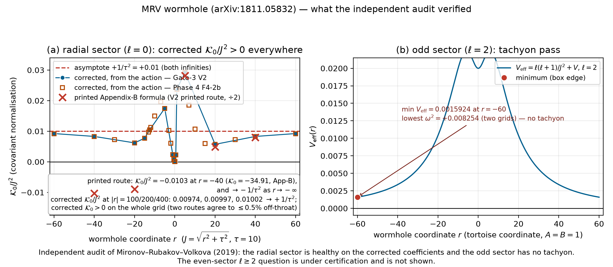
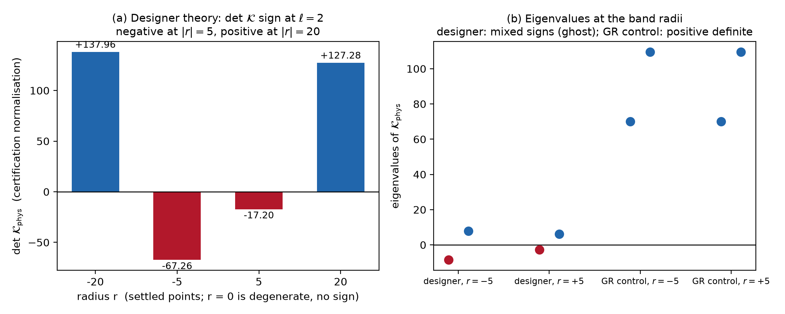

# An independent audit of the Mironov–Rubakov–Volkova beyond-Horndeski wormhole

**Object of the audit:** S. Mironov, V. Rubakov, V. Volkova, "Towards
wormhole beyond Horndeski" (arXiv:1811.05832) and its journal version
"More about stable wormholes in beyond Horndeski theory"
(arXiv:1812.07022, Class. Quantum Grav. 36 (2019) 135008) — a
traversable wormhole supported entirely by a beyond-Horndeski scalar
sector, with no ordinary matter: metric ds² = −dt² + dr² + (r²+τ²)dΩ²,
τ = 10, scalar π = τ·arcsinh(r/τ).

**Nature of this note.** This is a methods/audit note. It reports an
independent, action-level recomputation of the construction's
background equations and perturbation sectors, carried out as part of
a broader verification programme. Its findings are of three kinds:
results of the paper that the audit *verified*, two printed
coefficients in the paper's Appendix B that are *inconsistent with
the action as printed*, and one structural limitation of the
published construction. Nothing in this note touches the
beyond-Horndeski γ-crossing formalism itself, which is the paper's
framework contribution; every finding below concerns the published
*example* and its printed formulas.

## 1. What the audit verified

The construction's background is a genuine solution of the stated
theory. All four background equations close, in our recomputation, at
the level of the numerical transcription floor: E_A ≤ 1.27×10⁻⁹,
E_B ≤ 5.9×10⁻¹⁷, E_J ≤ 1.14×10⁻⁹, and the scalar equation
E_π ≲ 1.6×10⁻⁸ (the last derived from scratch by Euler–Lagrange
variation of the reduced action, sharing no formula with the paper's
Appendix A). The odd-parity perturbation sector is healthy and
complete, exactly as the paper states: ℱ = 𝒢 = ℋ = 1 to within
1.8×10⁻¹⁵, both propagation speeds equal to 1, and the effective
potential is positive for all ℓ ≥ 2. The even radial (App. D)
quantities also reproduce as computed: the no-ghost combination
2𝒫₁ − ℱ ≥ 0.713 and the radial sound speed squared in
[0.261, 0.877]. The γ-crossing mechanism — the means by which the
effective stress-energy violates the null energy condition at the
throat (ρ_eff + p_r,eff = −2/τ²) while the perturbation sector is
arranged to stay healthy — is untouched by every finding in this
note.

## 2. Balance: the tachyon item and the ℓ=0 sector

The audit is not a demolition, and two of its results run in the
paper's favour.

**Tachyons.** No converged slow tachyon (a normalisable bound state
with ω² < 0) is found in any even channel. The odd sector reproduces
the paper's result exactly (effective potential positive, minimum
0.00159 at ℓ = 2; our independent rebuild gives 0.0015924, and an
independent eigensolver returns the same lowest box-continuum value,
ω² = +0.008254, on two grids). In the ℓ ≥ 2 even channels, no
converged ω² < 0 bound state is established by any route.

**The ℓ=0 sector is healthy.** The paper does not compute the
spherically symmetric (ℓ=0) even modes ("for technical reasons" it
treats ℓ ≠ 0 and expects nothing pathological at ℓ=0). Read off the
printed Appendix B coefficients, the ℓ=0 kinetic coefficient 𝒦₀
comes out negative on one side — but an independent derivation of
the ℓ=0 sector directly from the covariant action, using no
Appendix B formula anywhere, finds 𝒦₀ > 0 at every sampled radius
in [−60, 60], with 𝒦₀/J² → +1/τ² at both infinities (covariant
normalisation) and the gradient coefficient 𝒢₀ ≥ 0 throughout. The
printed-formula ghost is an artefact of the coefficient defects
documented in §3. An independent gate recomputation confirms the
health: its 𝒦₀ spot values match the from-action derivation to
≤ 0.5%, and 𝒦₀ vanishes only at the throat, quadratically, as it
should.

The ℓ=0 spectrum is now settled, and the settlement strengthens
the health conclusion. No ℓ=0 tachyon is found by any route (three
independent eigensolvers agree the lowest ω² is positive); the
ℓ=0 spectrum in the box begins at the positive continuum value
ω² ≈ +0.0045; the D = 0 pole at r* = 1.772437990426927 is a
parametrisation singularity of the reduced variable, across which
the physical (Liouville) problem decouples.

One correction to the first version of this note (v1.6.x) belongs
here. That version reported, as the programme's own
not-yet-gate-reproduced result, a soft throat-localised near-zero
mode at ω² ≈ +0.00021. With dense corrected coefficient profiles
in hand, that mode does not exist: the value +0.00021 was a
discretisation artefact of a flux-form solve that bridged the
D = 0 pole at r* = 1.772437990426927 — a trial function constant
across the pole has a discrete 𝒦₀-norm diverging like 1/h, which
drives its Rayleigh quotient spuriously toward zero, and under
refinement and grid offset the bridging solve's lowest eigenvalue
does not converge. The value is retracted. Solving instead the
well-posed problem — pole excised, the two sides decoupled — the
throat-segment ground state is ω² = +0.00445402, obtained by two
independent routes in agreement: the formula route (identically
at every excision width δ ∈ [0.01, 0.35] and both grid spacings)
and the dense from-action profile, independently interpolated and
solved (+0.00445398 at h = 0.01, +0.00445406 at h = 0.005). The
sector is cleanly gapped, with no soft mode.

## 3. Two printed coefficients inconsistent with the action

Two coefficients in the paper's Appendix B do not reproduce from
the covariant action. In each case the discrepancy is exact, not
numerical, and in each case the correct on-background value is
recovered independently.

**(a) The coefficient a₂^BH is spurious.** Appendix B prints
a₂ = a₂^H + a₂^BH with a₂^BH = 2√(AB³)π′³F₄. The constraint
identity b₃ = 2(a₁′ − a₂) holds for the Horndeski part a₂^H alone
(to ≤ 3.6×10⁻¹⁵ in the gate's recomputation) and fails with the
printed a₂ by exactly −4π′³F₄. An independent from-action
derivation recovers a₂ = a₂^H at every sampled radius (e.g. at
r = 5: −3.18040 from the action, equal to a₂^H, versus the printed
−4.38759).

**(b) A pair of J′² terms in e₁.** The printed e₁ contains the pair

    +2BJ′²ℱ/X   and   −ℋ(B²J′²/(JA))·d/dr(J²A/B),

whose on-background contribution is (J′² − J′³)/X. This cancels
identically in the frame of the original derivation
(Kobayashi–Motohashi–Suyama, arXiv:1402.6740, set J = r, so
J′ = 1 identically) and is a failed general-J generalisation of a
term that vanishes there. Removing the pair — a basis fit returns
coefficients −0.99998 and −1.00000 for the two terms, with maximum
residual 1.3×10⁻³ while the difference itself ranges up to 71.5 —
restores 𝒦₀ > 0 on the whole domain, with 𝒦₀/J² → +2/τ² at both
infinities in the Appendix B normalisation.

**On-background caveat.** The derivation fixes the pair's
*on-background* value (zero); a correct general form could differ
by factors vanishing on this background (e.g. ∝ (ℱ−ℋ)). The claim
is that the printed general-J form is inconsistent with the action
on this background, not that the unique correction is known.

**A disclosure, in the same place.** The one background-equation
error found in the course of this audit was *ours*: an early
transcription in our own code dropped a factor 1/J in the first
beyond-Horndeski term of the current-conservation equation E_J,
producing a spurious residual. With the factor restored, E_J
closes to 1.14×10⁻⁹. The paper's printed E_J is correct, and the
paper's statement that E_J vanishes automatically for this metric
is correct as printed.

**Bibliographic note.** The expressions discussed in this section
are republished unchanged in the authors' sequel, arXiv:2212.05969,
Appendix B — a₂ with the same additional term in its eq. (98), and
both e₁ pair terms in its eq. (121). This is stated as a
bibliographic fact only.

## 4. Incompleteness: the theory is defined on its trajectory

**Category: (ii) NOT EXCLUDED BUT INCOMPLETE.**

The published construction specifies the designer functions only
along the one-dimensional background trajectory (π(r), X(r)), with
X ∈ [−1/2, 0). The polynomial-in-X ansatz through which the
functions are presented is a choice, not a derived or unique
extension; nothing in the paper selects among the infinitely many
(π, X) extensions sharing the trajectory data, and the paper
nowhere evaluates the theory off the trajectory. It follows that
weak-field / PPN / binary-pulsar predictions are **not computable
from the published construction**. The scope of that statement is
the published construction: it is a claim that the published
designer data do not determine off-trajectory predictions, not
that no extension could.

The authors themselves state the asymptotic caveat: they "do not
impose any restrictions on the asymptotic behavior of the
Lagrangian", the "weak gravity regime is grossly different from
General Relativity even at large distances", and viability against
large-distance observational tests is left open in their
conclusions. This audit adds the consequence (the predictions are
not computable), it does not discover the caveat.

On the background itself, every computable quantity is
GR-identical, so nothing here is an observational exclusion: the
gravitational-wave speed deviation is at the roundoff floor
(max |c_T − 1| = 2.2×10⁻¹⁶ on grids to |r| = 10⁴ in the gate's
recomputation; the audit's own grids give the same floor class),
the ADM mass is exactly 0, and perturbation quantities equal their
GR values to roundoff out to |r| = 10⁴ (spot checks to 10⁶). The
price of that on-background GR-ness is a cancellation that grows
without bound: the individual designer terms grow ∝ r², r⁴ and r⁶
along the trajectory (the largest crosses 10⁶× the cancelled sum
at |r| ≈ 126), and within F₄ itself, pieces of size ~10¹¹ cancel
to ~10⁻⁴³⁴ at |r| = 10⁴.

## 5. A pattern, stated over the certified instances

In this one paper, independent recomputation found errors in the
printed stability-sector coefficients (the a₂^BH term and the e₁
J′² pair of §3) and in the printed no-ghost determinant
factorisation of §6, and one error of our own in transcribing the paper
(E_J — the paper was right); the printed coefficients in question
had been republished unchanged in the authors' sequel. We record
this as the programme's stated lesson from this audit, offered as
a hypothesis for similar constructions rather than as an
established literature fact: in designer beyond-Horndeski
constructions, the printed stability criteria are derived for the
construction and are rarely independently recomputed, and they
are therefore a natural place for errors to persist. The practical
consequence we draw for our own work is procedural: candidates in
this class should be audited at the action, not at the printed
criteria.

## 6. The even sector at ℓ ≥ 2: a certified ghost

The paper's printed no-ghost argument for the even sector rests on
a printed formula for the kinetic determinant, det 𝒦 ∝
J′²(j²−2)(2𝒫₁−ℱ), which is non-negative everywhere if the
factorisation holds. The factorisation does not hold. Computed
from the covariant action, the sign of det 𝒦 at ℓ = 2 is
**negative** at r = −5 and at r = +5, and **positive** at r = −20
and at r = +20: the ghost band around the throat is bracketed by
settled points at |r| = 5 (negative) and |r| = 20 (positive). At
r = 0, det 𝒦 degenerates in every presentation — no sign exists
there, and none is claimed. Only the sign is reported: the sign of
det 𝒦 is invariant under field redefinitions (which rescale it by
a squared determinant), while magnitudes are
presentation-dependent and are not compared across computations.
(The programme's two original computations also return a negative
sign at r = +5 for ℓ = 10.)

This result is stated on the strength of three computations
sharing no deciding formulas. Two were made in the audit itself: a
variationally exact canonical reduction of the action, and a
covariant-action jet extraction that tracks its auxiliary block
explicitly. They agreed on the sign at every settled point except
r = −20, where the reduction returned negative against the jet
extraction's positive. The third computation — the gate's
certification follow-up — is branch-independent by construction:
it eliminates an auxiliary field by a Schur complement of the
action's symbol and restricts the resulting kinetic form to the
Hamiltonian-constraint surface, a congruence, performing no
equation-of-motion row operation at any step. It returns the
signs (+, −, −, +) at (r = −20, −5, +5, +20), resolving the
r = −20 disagreement in favour of the jet extraction. Its
branch-independence is demonstrated, not assumed: all three
parametrisations of the constraint surface give the same sign at
every radius; 18 of 18 random congruences preserving the sector
structure leave every sign invariant; and a GR +
canonical-scalar control — healthy, and therefore required to
come out positive — is positive definite at r = ±5 on the same
machinery on which an equation-of-motion row elimination had
flipped its sign between branches.

The scope of the finding is the published example. The
construction's background is a genuine solution of the stated
theory and the beyond-Horndeski γ-crossing formalism is
untouched by every finding here. What closes is the example's
printed stability argument: with det 𝒦 negative at ℓ ≥ 2 in a
band around the throat, the example as published has a ghost in
its even sector, and its no-ghost conclusion does not stand as
printed.

## 7. Reproducibility

All arithmetic is float64. The deciding computations are included
in this bundle:

- `phase4/p44_ej.py`, `phase4/p44b_elpi.py` — background closure
  (E_J with the corrected transcription; E_π from the action).
- `phase4/p42b_ell0_indep.py` — the from-action ℓ=0 derivation
  (with `phase4/p42_ell0.py`, the printed-coefficient route whose
  artefact it resolves).
- `phase4/p43_tachyon.py` — the tachyon bound-state solves.
- `phase4/p45_asymptotics.py` — the asymptotics audit of §4.
- `gate3/v_g3_2.py` — the gate's independent ℓ=0 / defect
  verification (different ansatz and machinery from Phase 4).
- `gate3/v_g3_3.py` — the gate's independent tachyon and
  on-background gravitational-wave-speed verification.
- `gate3/v_g3_1_cert.py` — the gate's branch-independent
  action-level certification of the §6 sign structure.
- `gate3/g3_ell0_profile_worker.py`, `gate3/g3_ell0_route1.py`,
  `gate3/g3_ell0_route2.py` (with `gate3/g3_ell0_dense.py`) — the
  dense ℓ=0 coefficient profiles and the two settlement routes
  of §2.

Result data for each script sit beside it under `results/`. The
gate's verdicts, reproduction margins and wording conditions are
summarised in `GATE3_SUMMARY.md`.

## Figures

*Figure 1 — the audit's verified side. Left: the radial (ℓ=0) kinetic coefficient on the corrected coefficients is positive everywhere (two independent from-action routes agree to ≤0.5%), while the printed Appendix-B formula's value goes negative on one side. Right: the odd sector's effective potential is positive everywhere (minimum 0.00159) — no tachyon. The even-sector ℓ≥2 result is shown in Figure 2. Generated by plot_mrv_audit_verified.py from the bundle's result files.*

*Figure 2 — the certified sign structure of §6, from
`gate3/results/v_g3_1_cert.json`. Left: det 𝒦_phys at the four
settled radii in the certification route's normalisation (the sign
is the content; magnitudes are presentation-dependent). Right:
eigenvalues of 𝒦_phys at r = ±5 — mixed signs for the designer
theory (a ghost), both positive for the GR + canonical-scalar
control (positive definite). Generated by
plot_mrv_ghost_certified.py.*
