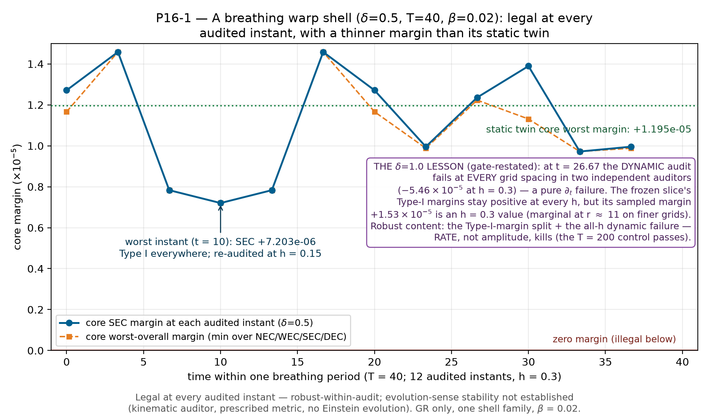
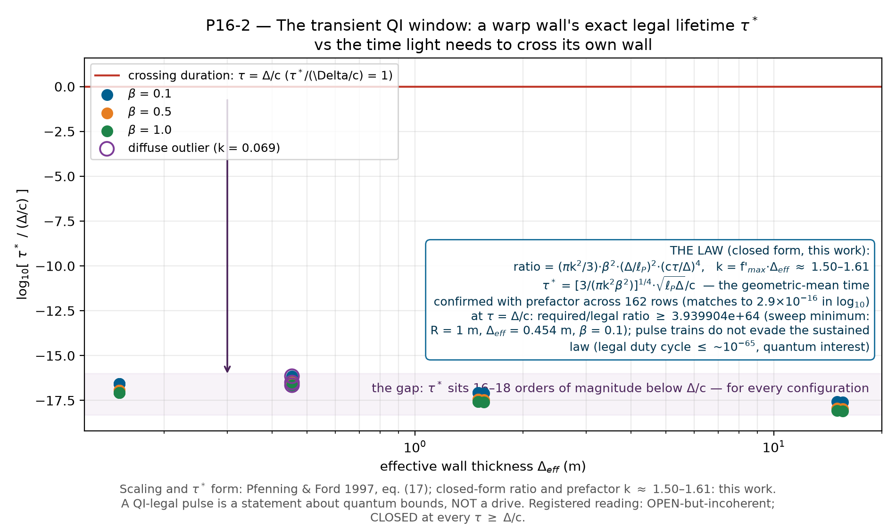
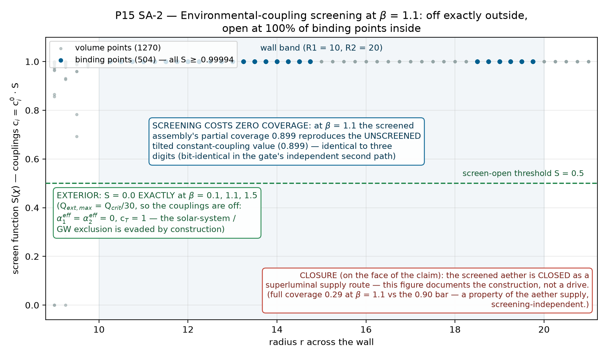

# Phase 15–16 claims (Gate-4 verified)

Three results from Phase 15 (an originated screening construction
for Einstein-aether) and Phase 16 (dynamic warp shells and the
transient quantum-inequality budget), each passed through the
programme's Novelty & Verification Gate 4 (2026-11-21): a
documented literature search for prior art, and an independent
second-path reproduction of the deciding computations. The gate
verdicts, the prior-art caps the searches found, and every
wording condition are summarised in `GATE4_SUMMARY.md` in this
folder. Where the gate required a claim to be restated, the
claim below appears **only** in the gate's restated form.

**No superluminal result is claimed anywhere in this document.**
Claim 1 is a legality result about a subluminal (β = 0.02)
dynamic shell in general relativity. Claim 2 is a statement
about quantum bounds, not a drive. Claim 3's family is closed
as a superluminal supply route, on the face of the claim.

All arithmetic is float64. Hedges are part of the claims and
must not be stripped when quoting.

---

## Claim 1 — A breathing warp shell is legal at every audited instant; time-dependence never helps, and its failures isolate a pure time-derivative tax

**Gate verdict: UPLOAD-READY AFTER RESTATEMENT** (novelty
NOVEL, delimited; correctness REPRODUCED with one fragility
caveat, absorbed into the restatement below).

### The configuration and the audit

The shell is the programme's conditions-first Finalist-A family
(R1 = 10, R2 = 20, M_geom = 2.0, edge-peaked density wd = 3.0 /
floor = 0.2, s_rho = 2.0, s_P = 1.16, cosine shift on [10, 20],
β = 0.02), with its wall radii oscillating sinusoidally
("breathing") at amplitude δ = 0.5 and period T = 40. A
non-stationary point auditor (finite-difference Einstein tensor
for time-dependent metrics, Eulerian tetrad, Hawking–Ellis
type classification, all four classical energy conditions)
audits the configuration at 12 instants across its full period.

Result: the breathing shell is **legal at every audited
instant** — worst-instant margins NEC/WEC/DEC +9.52e-06, SEC
+7.20e-06, Hawking–Ellis Type I fraction 1.0 at every instant
(the worst instant, t = 10, confirmed at finer grid spacing
h = 0.15: SEC +7.19e-06). Its static twin also passes, with a
*thicker* margin (+1.19e-05): the breathing margin is thinner
than the static one. No dynamic variant tested produced a legal
configuration the static family cannot reach, and the exoticity
E_- = 0 at every instant of every variant. **Time-dependence
does not help.**

Robustness: 29 perturbed configurations, each audited over a
full period (8 instants), map a legal island around the nominal
configuration. Confirmed legality flips within the smallest
perturbation step occur in only 2 of 13 parameter directions —
the island is **robust-within-audit**. (This is a statement
about the audit map only. Dynamical stability in the evolution
sense is **not** established and is not claimed: the auditor is
kinematic, the metrics are prescribed, and no Einstein-equation
evolution is performed.) The island is thinnest along the
wall-thinning diagonal; the amplitude boundary is pocketed and
non-monotone (δ = 0.6 fails at two instants, δ = 0.75 passes at
all 8 audited instants, δ = 1.0 fails), so "legal at every
instant" always means *at every audited instant, at the stated
grid spacings*.

### Where dynamics kills: frozen-vs-dynamic separation

Comparing each dynamic audit against the audit of the same
instant's frozen (time-independent) slice separates failures
into frozen-shape illegality and pure time-derivative failure.
Two measured facts:

- **Rate, not amplitude, kills.** The δ = 1.0, T = 40 breathing
  shell fails; the same amplitude at T = 200 passes everywhere
  (+1.19e-05). This is stated for the two periods tested, in
  this one family.
- **A measured ∂_t tax.** For the oscillating-shift variant at
  amplitude A = 1.0 (β₀ = 0.02, T = 40), at the instants of
  maximum |β′| the dynamic audit's DEC margin sits ~1.2e-05
  below the frozen value — a tax of ~1.2e-05 in DEC, quoted
  only with these parameters — and that tax alone flips those
  two instants from pass to fail.

The pure time-derivative isolation at breathing δ = 1.0,
t = 26.67 is stated **only in the gate's restated form**:

> At breathing δ=1.0, t=26.67, the frozen slice's Type-I
> margins are positive at every grid spacing in two independent
> auditors (+1.53e-05 at h=0.3 in the original audit; +1.22e-05
> at h=0.15 Type-I-only in the second path), while the dynamic
> audit fails at every grid spacing in both paths (−5.46e-05 at
> h=0.3; −4.59e-05 in the second path at matched h, deepening at
> finer h), the failure carried by non-Type-I points in both
> paths. The frozen slice is nevertheless marginal at one site
> class (r ≈ 11, just inside the frozen inner edge): a
> finer-grid second path finds points within ~10% of the
> Type-I/IV boundary there, so the frozen sampled margin
> +1.53e-05 is an h=0.3 audit value, quoted with that fragility
> — the robust content of the isolation is the Type-I-margin
> split and the all-h dynamic failure.

### Novelty delimitation (Gate-4 worker N1, verbatim)

> "To our knowledge, based on the documented search reported
> here, the first per-instant full-period energy-condition audit
> of a genuinely time-dependent warp shell is the present one:
> a conditions-first (Fuchs-family) shell with sinusoidally
> breathing wall radii (δ = 0.5, T = 40) satisfies all classical
> energy conditions at every audited instant (worst SEC
> +7.20e-06, Type I 1.0) with a mapped robustness island over 29
> perturbed dynamic configurations, while a frozen-vs-dynamic
> comparison at the same instants isolates pure time-derivative
> failures (δ = 1.0, t = 26.67: frozen +1.53e-05, dynamic
> −5.46e-05), a measured ∂_t tax of ~1.2e-05 in DEC for an
> oscillating shift, and a rate-not-amplitude control (the
> δ = 1.0 shell killed at T = 40 passes at T = 200) — none of
> which was found in the published dynamic-warp literature,
> whose time-dependent constructions are metric-first bubbles
> that violate the energy conditions, are semiclassically
> unstable on formation, or collapse under evolution."

(The frozen figure inside this delimitation is the h = 0.3
audit value, governed by the restatement above.)

### What this claim is not

- This is **not** a "first dynamic warp drive": time-dependent
  warp metrics predate it (Alcubierre's v_s(t), 1994; Natário's
  general time-dependent class, gr-qc/0110086;
  Finazzi–Liberati–Barceló's "dynamical warp drives",
  arXiv:0904.0141).
- Harold White's 2012 oscillation conjecture (that oscillating
  a warp field might reduce its energy requirement) is flagged
  and is **not confirmed** — the audited result runs in the
  opposite direction: dynamics never helps, and the legal
  margin thins.
- Nothing here refutes or evades Natário (gr-qc/0110086) or
  Santiago–Schuster–Visser (arXiv:2105.03079): the Finalist-A
  family sits outside their unit-lapse, flat-slice class. That
  is a scope statement, not a victory over their theorems.
- Scope: general relativity only; one shell family; β = 0.02;
  constant mean parameters. A legality result about a dynamic
  shell — not a drive result.

Deciding material: `p161_dynamic.py`, `p161_controls.py`,
`p163_robust.py`; results in `phase16-results/` (breathing,
shift, travelling-wave, static, control and robustness JSONs);
written record in `p161_memo.md` and `p163_memo.md`.

---

## Claim 2 — The transient quantum-inequality law for a one-shot warp wall, in duration form

**Gate verdict: UPLOAD-READY** (novelty PARTIALLY KNOWN on all
three components, with the residue delimited below; correctness
REPRODUCED exactly — symbolic identity plus numeric spot
checks).

### The law

For a one-shot Alcubierre-family wall (tanh profile), the ratio
of the required peak Eulerian density to the Ford–Roman legal
density ρ_min(τ) = −(3/(32π²))ħ/(c³τ⁴) is

    ratio = (πk²/3) · β² · (Δ/l_P)² · (cτ/Δ)⁴,

where k = f′_max·Δ_eff is the profile prefactor. Across the
27-configuration sweep, k = 1.50–1.61 for the 26 proper-wall
configurations; the closed form matches all 162 computed rows
(27 configurations × 6 durations) to 3e-16 in log₁₀, and the
density formula reproduces the programme's Phase 1 ledger
anchor to 2.2e-5. Setting the ratio to 1 gives the exact legal
duration

    τ* = [3/(πk²β²)]^{1/4} · √(l_P·Δ)/c,

the geometric-mean time √(l_PΔ)/c up to the k- and
β-correction. Across the sweep τ*/(Δ/c) = 7.9e-19 … 7.1e-17:
the legal duration sits **16–18 orders of magnitude below the
wall-thickness light-crossing time Δ/c**. The smallest ratio at
the crossing duration τ = Δ/c anywhere in the sweep is the
exact row value **3.939904e64** (R = 1 m, Δ_eff = 0.454 m,
β = 0.1). Pulse trains do not evade the bound: the legal duty
cycle is D ≤ ~1e-65 across the sweep (exact spot value at
R = 100 m, σ = 2/m, β = 1: D_max = 4.9272835297184655e-71), and
quantum interest (Ford & Roman 1999, arXiv:gr-qc/9901074)
returns any indefinite train to the sustained budget law.

Here τ is a wall **lifetime** — how long a pulse of negative
energy may last — not an observer's sampling time. The
prefactor is tied to the Ford–Roman form of the bound used;
other quantum-inequality prefactors are sampling-function
dependent (Fewster/Eveson), and no universality is implied.

### Credit and the delimited residue

The decisive near neighbour is **Pfenning & Ford 1997
(arXiv:gr-qc/9702026), eq. (17)**. With the bracket neglected —
as the authors themselves neglect it — their eq. (17) is this
ratio set to unity for their piecewise-linear profile
(effectively k = 1), with sampling time in place of a free
pulse duration; solving it for the sampling time gives the
same √(l_PΔ) form, constant and β-dependence as τ* at k = 1.
**The τ⁻⁴ scaling, the π/3 combination, the Δ²/(v_b²t₀⁴)
structure, and the τ* functional form are Pfenning & Ford's
and are not claimed.** They never state τ*: they eliminate the
sampling time against the curvature radius and report a wall
thickness. The qualitative verdict — that a macroscopic warp
wall is unphysical under the quantum inequalities — is also
theirs (1997), quantified by them in thickness and total-energy
form.

What is claimed is only the delimited residue:

> "Dividing the Alcubierre tanh family's peak required density
> by the Ford–Roman bound as a function of a free pulse
> duration τ — rather than eliminating the sampling time
> against the curvature radius as Pfenning & Ford (1997) do —
> gives the closed-form ratio (πk²/3)β²(Δ/l_P)²(cτ/Δ)⁴ with
> the tanh prefactor k = f′_max·Δ_eff ≈ 1.50–1.61, whose unit
> crossing is the legal duration
> τ* = [3/(πk²β²)]^{1/4}√(l_PΔ)/c (a form implicit in
> Pfenning & Ford's eq. (17) at k = 1, here stated and
> evaluated as a pulse lifetime for the first time in the
> sources searched), 16–18 orders of magnitude below Δ/c with
> smallest ratio 3.9×10⁶⁴ at crossing, and a legal pulse-train
> duty cycle below ~10⁻⁶⁵."

(That sentence's "3.9×10⁶⁴" is its own two-digit rounding; the
binding figure is the exact row value 3.939904e64 quoted
above.)

### The binding label

Phase 16's registered reading stands, unsoftened: the
duration-form window is **OPEN-but-incoherent** for all 27
configurations — "OPEN-but-incoherent" is this programme's
registered term, meaning the quantum-inequality window is
formally open at sufficiently short durations while the legal
duration is 16–18 orders of magnitude below the wall's own
light-crossing time, so no coherent wall exists inside it —
and **CLOSED at every τ ≥ Δ/c**. A QI-legal pulse is a
statement about quantum bounds, **not a drive**.

Scope: the one-shot Alcubierre tanh family at peak density.
Other geometries (the Van den Broeck pocket; Bobrick–Martire,
arXiv:2102.06824) are different geometries and are not
addressed, let alone refuted, by this law.

Deciding material: `p162_ledger.py`; results in
`phase16-results/p162_ledger.json`; written record in
`p162_memo.md`.

---

## Claim 3 — Screened Einstein-aether: couplings slaved to a ∇u-activity invariant, verified on a warp bed — and the family closed as an FTL route

**Gate verdict: UPLOAD-READY AFTER RESTATEMENT** (novelty
PARTIALLY KNOWN overall, with components (B) and (C) NOVEL;
correctness REPRODUCED on all three spot sub-items).

### The construction

The Einstein-aether couplings are promoted to
c_i = c_i⁰·S(χ), S(χ) = χ²/(χ²+1), where χ is driven by a
symmetron-type transition on a **positive kinetic invariant Q
of ∇u** (Q = spatially-projected ∇u squares + acceleration²;
Q ≥ 0, and Q = 0 iff ∇u is covariantly constant). χ = 0 where
Q < Q_crit, so the couplings are exactly off there; χ rolls to
its effective-potential minimum where Q > Q_crit. One constant
serves all rows and speeds: Q_crit = 2.386e-8 = 30 × the
bed-exterior maximum Q (exterior Q max 7.954e-10).

Verified properties, on the programme's warp-wall bed at
β ∈ {0.1, 1.1, 1.5}:

- **Exterior identically GR (on the sampled bed exterior):**
  S = 0.0 *exactly* on the exterior at all three β, so
  α1^eff = α2^eff = 0 and c_T = 1 there. (Domain: the sampled
  bed exterior; gravitational-wave propagation through an
  *open* region is uncomputed.)
- **Screen open in the wall:** S ≥ 0.5 at 100% of binding
  points at all three β; volume open fraction ≥ 0.996.
- **Interior supply undiminished:** at β = 1.1 the screened
  assembly's partial coverage, 0.899, reproduces the
  unscreened tilted constant-coupling value (Phase 10) to
  three digits — screening costs zero coverage. The tensor
  identification for the pointwise-coupling construction
  passes at 7.6e-12 (bar 1e-6), and local health passes for
  all c14 > 0 rows wherever the screen is open.

### Novelty delimitation (Gate-4 worker N3, verbatim)

> "Promoting the Einstein-aether couplings to
> c_i=c_i^{0}·χ²/(χ²+1), with χ driven by a symmetron-type
> transition on a positive kinetic invariant Q of ∇u
> (projected-gradient squares plus acceleration²) so that the
> couplings are exactly off — the theory identically GR —
> where Q<Q_crit and roll on where Q>Q_crit, is a construction
> not found in the literature: verified on the Gate-2 warp-wall
> bed it is exactly GR on the exterior (S=0.0 at
> β=0.1,1.1,1.5, hence α1=α2=0, c_T=1 there) while reproducing
> the unscreened tilted supply to three digits inside (partial
> coverage 0.899 at β=1.1), thereby evading by construction
> the Phase-9/10 PPN scaling-law exclusion at zero supply
> cost — where screening mechanisms themselves
> (Hinterbichler–Khoury, arXiv:1001.4525), screening for
> vector-tensor gravity (Beltrán Jiménez et al.,
> arXiv:1212.1923), an aether response depending on a ∇u
> invariant (Zlosnik–Ferreira–Starkman,
> arXiv:astro-ph/0607411), scalar-dependent aether couplings
> (Kanno–Soda, via Donnelly–Jacobson, arXiv:1007.2594;
> Paliathanasis–Leon, arXiv:2107.12546), kinetic-invariant
> screening (Babichev–Deffayet–Ziour, arXiv:0905.2943) and the
> constant-coupling supply and exclusion it builds on
> (Gate 2, G2-2) are all published and credited, the
> energy-budget law is claimed only as a design constraint
> (its Q²/(4μ) value is standard symmetron algebra), the
> slaving law only in its spatial, wall-scale form, and the
> screened-aether family is closed as a superluminal supply
> route."

The novel content is (B) — the couplings slaved to a
∇u-activity invariant Q with a symmetron switch — and (C) —
the verified package on the warp bed. Comparisons with density
screening must show trigger and on/off assignment adjacently:
this is a symmetron-**type** transition **on Q**, with the
trigger replaced and the assignment inverted relative to
density screening. No "first vector screening", "first
∇u-invariant aether response", or "first c_i(φ)" priority is
claimed — all three are unavailable on the published record.

### The two design laws, in gate-approved form

**(iv) The screen energy-budget law — restated (the gate's
form, verbatim):**

> The BUDGETING REQUIREMENT — a screened supply's stored
> screen energy must be budgeted against the host
> configuration's density scale at registration — together
> with its trigger–budget pathology (a trigger set by a
> near-flat exterior forces μ ≈ 5.3e-9, χ ~ 3×10³ and a screen
> stress ~1e6× the supply it switches) and the decoupled
> repair window (μ ~ 1e-3–4e-3: χ_wall ~ 2–4, V ≲ 1e-3,
> exterior still exactly closed, the closed branch being
> μ-independent). The scaling V ~ Q²/(4μ) itself is standard
> symmetron algebra and is not claimed.

**(v) The adiabatic-slaving residual law — spatial form
only.** A screening field slaved pointwise to a wall-scale
source fails its own equation of motion by ~1/(L_Q²λQ):
median |□χ|/|λQχ| = 4.65 at β = 1.1 and 3.05 at β = 1.5,
against a 0.10 bar, h-converged to <0.1% — physics, not
finite-difference noise. Screens at wall scale must be
PDE-solved, not slaved. This law is stated only in its
**spatial, wall-scale** form: the temporal version of the
warning is published (Llinares–Mota, arXiv:1302.1774 /
1312.6016; Noller et al., arXiv:1310.3266), and temporal
adiabatic tracking is on record *succeeding* in a published
case (a chameleon in a red giant, arXiv:1802.04001).

### The qualifications, on the face of the claim

"Screening solves the aether's data problem" is **not** a
permitted unqualified statement. The evasion holds only for
the supply scan on this bed's exterior: the exterior couplings
are exactly zero by the registered Q_crit construction, which
is what licenses the constant-coupling PPN α formulas there.
Three registered openness items ride with the construction:
χ was solved **adiabatically** — law (v) is precisely the
statement that this is not solution-grade; the aether field u
remains the **prescribed** tilted ansatz, with conservation
relative median 0.35–0.88 (the "u-EOM residual open" label);
and the screen sector's own stress-energy (~1e6× the supply at
the registered constants) is **not** in the scan tensor.

### The family closure, on the face of the claim

**The screened-aether family is CLOSED as a superluminal
supply route.** Its coverage ceiling — full coverage 0.29 at
β = 1.1 and 0.54 at β = 1.5 against the 0.90 bar, with volume
NEC violation 0.66 / 0.63 — is a property of the aether supply
itself and is screening-independent: the screen is exact and
free, and the ceiling belongs to the supply. The claim is the
construction and the two design laws only. **No superluminal
result is claimed.**

Deciding material: `p152_lib.py`, `p152_gate.py`,
`p152_scan.py`, `p152_eom.py`; results in `phase15-results/`
(gate, scan and equation-of-motion JSONs).

## Figures

*Figure 1 — the breathing shell (δ=0.5, T=40) is legal at every audited instant (worst core SEC +7.20×10⁻⁶), against its static twin's +1.19×10⁻⁵. The δ=1.0 panel states the motion-tax lesson in its gate-restated form: the dynamic audit fails at every grid spacing; the frozen +1.53×10⁻⁵ is an h=0.3 value. Robust-within-audit; evolution-sense stability is not established. Generated by plot_breathing_shell.py from the phase16 result files.*

*Figure 2 — the transient QI law: the exact legal pulse duration τ* sits 16–18 orders of magnitude below the wall-crossing duration for every configuration swept; the smallest ratio at crossing is 3.939904×10⁶⁴. The scaling and the τ* form are Pfenning & Ford's (1997, eq. 17); the closed-form ratio and the prefactor k ≈ 1.50–1.61 are this work's. A statement about quantum bounds, not a drive. Generated by plot_qi_pulse_law.py.*

*Figure 3 — the screening construction at β=1.1: the screen is exactly closed (S = 0) outside the wall and open at 100% of binding points inside, and screening costs zero coverage (partial 0.899, identical to the unscreened value). The screened-aether family is CLOSED as a superluminal supply route — this figure documents the construction, not a drive. Generated by plot_screening.py.*
