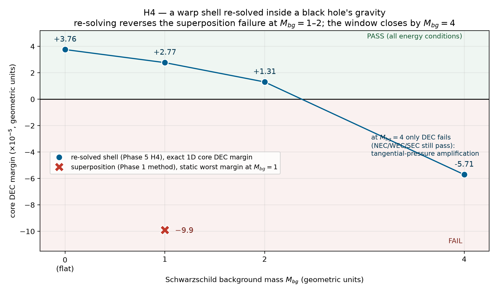
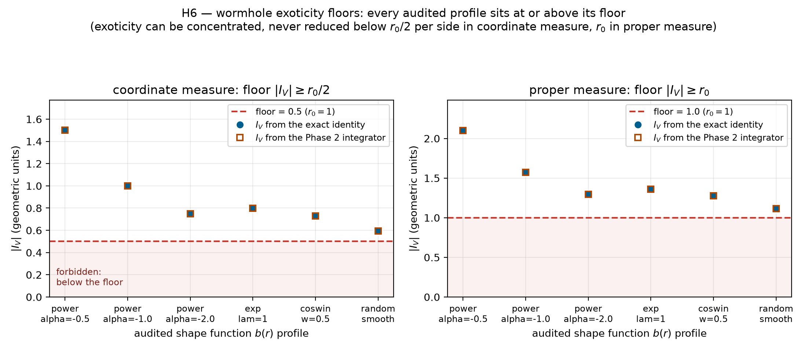
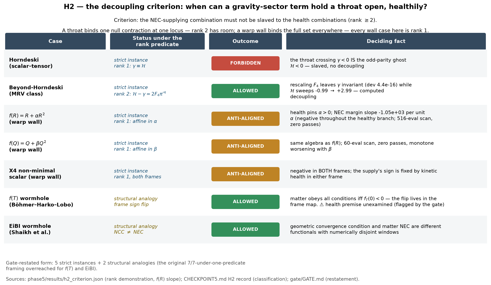

# Warp Pilot, Phase 5 — Three Claims Submitted for Independent Verification

These are three results from an independent computational research
programme on warp metrics and wormholes in general relativity and
modified gravity. They are published here so that anyone can check
them: every deciding computation is included as runnable code with
its recorded output, and each claim below states its limits as
plainly as its result.

None of these claims is a faster-than-light drive. One is an exact
mathematical identity about wormholes, one is a statement about
which warp shells can exist inside a black hole's gravity, and one
is a criterion for when a modified theory of gravity can hold a
wormhole throat open without exotic matter. Each claim was passed
through an internal novelty-and-verification gate before being
written up here: a documented literature search for prior
publication, and an independent re-derivation or re-implementation
of the deciding computation by a second, separate code path. The
gate's verdicts and the exact conditions it attached to each
claim's wording are summarised in `GATE_SUMMARY.md`; the conditions
themselves are quoted verbatim in each claim's section below and
are part of the claim as published.

**Standing limits (all claims).** Numerical margins of order
10⁻⁵–10⁻⁷ are strong evidence, not proofs; audits sample finitely
many points and observers. Novelty verdicts rest on documented
searches (queries logged, sources graded) and are stated as "not
found in the literature searched," never as a guarantee that no
prior statement exists anywhere.

---

## Claim 1 — The wormhole exoticity floor is an exact identity (H6)

**In plain language.** A traversable wormhole needs "exotic
matter" — material that violates the null energy condition. A
standard way to measure how much is needed is the volume integral
of ρ + p_r over one side of the throat (Visser's volume-integral
quantifier). The literature's headline result is that this amount
can be made *arbitrarily small* — but only by using a non-zero
tidal force (Φ ≠ 0) or by cutting the integral off at a finite
radius. We show that for the restricted but natural class of
*zero-tidal-force* wormholes (Φ = 0) that extend to infinity, the
integral is not just bounded below — it decomposes *exactly*, in
both of the two standard measures, into a fixed negative term plus
an explicit profile-dependent term. The exoticity can be
concentrated, but it can never be reduced below a floor set only
by the throat radius — and the floor in the proper (physical
volume) measure is exactly twice the floor in the coordinate
measure, a distinction the earlier literature did not make.

**Statement.** For a zero-tidal Morris–Thorne wormhole (Φ = 0)
with shape function b(r) satisfying the hypothesis set below, and
w = √(1 − b/r):

- Coordinate measure:
  I_V^coord = ∫(ρ + p_r) 4πr² dr = −r₀/2 − ½∫_{r₀}^∞ (b/r) dr ≤ −r₀/2
- Proper measure:
  I_V^prop = ∫(ρ + p_r) 4πr²/w dr = −r₀ + ∫_{r₀}^∞ (w − 1) dr ≤ −r₀

Both deficit terms are non-positive for b ≥ 0, so the floors are
exact and unattainable (attained only in the degenerate limit
b → 0 almost everywhere, which is no throat). Spot check:
b = r₀²/r gives I_V^prop = −π r₀/2 exactly.

**Verification.** The identities were verified against the
programme's Phase 2 integrators on 6 zero-tidal profiles
(relative deviations 10⁻¹⁴ up to 2.3×10⁻³, the large end being
the Phase 2 integrator's own finite-radius truncation, matched
quantitatively). The gate's independent second path re-derived
both identities symbolically from scratch (each integrand reduces
to a total derivative with residual exactly 0) and re-checked
them by fresh quadrature on 4 *new* profiles: left- and
right-hand sides agree to ≤ 1.6×10⁻¹¹ on every profile, both
floors hold on all profiles, and both floors scale linearly in
r₀. Code: `h6_floor_identity.py`, output
`results/h6_floor_identity.json`.

**What is and is not claimed as new** (the gate's delimitation,
quoting its novelty report verbatim):

> "For zero-tidal-force ($\Phi=0$), zero-ADM-mass Morris–Thorne wormholes, the volume integral of $\rho+p_r$ decomposes exactly as $I_V^{\rm coord}=-r_0/2-\tfrac12\int_{r_0}^{\infty}(b/r)\,dr$ in the coordinate measure and as $I_V^{\rm prop}=-r_0+\int_{r_0}^{\infty}\!\bigl(\sqrt{1-b/r}-1\bigr)dr$ in the proper measure — giving exact, unattainable floors $-r_0/2$ and $-r_0$, the proper floor twice the coordinate one, and $I_V^{\rm prop}=-\pi r_0/2$ for $b=r_0^2/r$ — none of which is stated in Visser–Kar–Dadhich (2003), Nandi–Zhang–Kumar (2004), Kuhfittig, Lobo, or the subsequent volume-integral-quantifier literature found in a 19-query documented search."

The ingredients (ρ, p_r, the quantifier itself) are previously
published; the identities, floors, and factor-of-2 comparison as
stated results are not found there.

**Gate wording conditions carried verbatim** (from the gate
record; all three are applied in the statement above):

> (i) N2's delimitation sentence (the ingredients are published; the identities/floors/factor-2 as stated results are not)

> (ii) the CORRECTED hypothesis set from C1 (b C¹, b(r₀)=r₀, 0≤b≤r, b(R)→0, ∫(b/r) dr < ∞) in place of the looser Phase 5 phrasing

> (iii) scope: zero-tidal Φ=0 only — the Φ≠0 extension remains open and must not be implied.

So, to be explicit: this claim is for zero-tidal Φ = 0 wormholes
only. The Φ ≠ 0 extension remains open, and nothing here should
be read as covering it. The hypothesis set is exactly: b is C¹,
b(r₀) = r₀, 0 ≤ b ≤ r, b(R) → 0, and ∫(b/r) dr < ∞. (The
integrability condition matters: without it both sides of the
identities can diverge together, e.g. for a logarithmic shape
function.)

---

## Claim 2 — A warp shell re-solved inside a black hole's gravity passes; the earlier failure was an artefact of superposition (H4)

**In plain language.** An earlier phase of this programme placed
a verified positive-energy warp shell (the "Finalist A" design: a
spherical shell of ordinary matter, all classical energy
conditions satisfied) into the gravity of a black hole by simply
*stacking* the two spacetimes — multiplying the shell's lapse by
the background's and adding the shifts. The stacked shell failed
its energy-condition audit, and the background was recorded as
hostile to shells. That conclusion was wrong about the reason.
When the shell is instead *re-solved* — its radial pressure
recomputed from stress-energy conservation in the combined
geometry, the way a real equilibrium shell would actually settle
— the static shell **passes** all energy conditions around black
holes of moderate mass. The failure belonged to the stacking
shortcut, not to the physics. Two honest limits come with this:
make the black hole heavy enough and the re-solved shell fails
again, by a specific mechanism (below); and a *moving* shell still
fails — not in the shell, which passes, but in the empty cavity
inside it. Nothing here moves, and nothing here is a drive; this
is a result about which equilibrium configurations exist.

**Statement.** Finalist-A-shaped shells (ρ*, p_t* prescribed on
areal radius r, support ≈ [10, 20], C∞ window on [9, 21]),
re-equilibrated in the total geometry (p_r from conservation in
the total metric; a shooting scale s on p_t* fixing the outer
boundary condition), pass all classical energy conditions
(NEC/WEC/SEC/DEC, Hawking–Ellis Type I) for:

- Schwarzschild background M_bg = 1, β = 0 — core NEC margin
  +4.32×10⁻⁵ (exact 1-D), where the superposed construction
  failed at −9.9×10⁻⁵;
- Schwarzschild background M_bg = 2, β = 0 — core worst margin
  +1.37×10⁻⁵;
- Anti-de Sitter background L = 30, β = 0 and β = 0.02 — judged
  on the difference tensor (the programme's standing convention,
  since the AdS background itself carries negative density); see
  the labelling conditions below.

At M_bg = 4, β = 0, the re-solved shell **fails** the dominant
energy condition only (core DEC −5.71×10⁻⁵ at r ≈ 10, confirmed
identically by finite differences and exact 1-D margins;
NEC/WEC/SEC pass). The mechanism is named and measured: the
equilibrium shooting scale s(M_bg) grows monotonically
(0.885 flat → 2.475 → 4.827 → **16.10** at M_bg = 4) and
amplifies the tangential pressure until |p_t| > ρ at the inner
edge; the core DEC margin is monotone in M_bg (+3.76×10⁻⁵ flat →
+2.77×10⁻⁵ → +1.31×10⁻⁵ → −5.71×10⁻⁵), crossing zero between
M_bg = 2 and M_bg = 4. Moving Schwarzschild shells (β = 0.02)
fail in the cavity: a uniform shift over a curved background is
not a gauge transformation (in flat space it is), so the
stationary moving ansatz sources a real, resolution-converged
stress ∝ β·∂(curvature) in the interior (cavity NEC ≈ −1.95×10⁻⁴
at M_bg = 1), while the shell core itself passes at every
M_bg ≤ 2.

**Verification.** The construction survived a pre-registered
adversarial point hunt (98 Fibonacci directions × 128 radii,
grid spacing down to h = 0.05): all cores stay positive and
converge to their exact 1-D values, and every non-core deficit
shrinks to the finite-difference floor. The gate's independent
second path reimplemented the whole construction from the claim
statement — fresh code importing only the prescription
definition, conservation solved with a different integrator
(DOP853, rtol 10⁻¹¹), the Einstein tensor re-derived symbolically
in-code — and reproduced it: shooting scales match to < 0.1% in
all five configurations, exact core DEC margins match to 3
significant figures (+3.76×10⁻⁵, +2.77×10⁻⁵, +1.31×10⁻⁵,
−5.71×10⁻⁵), the monotone DEC sequence and the M_bg = 4 DEC-only
failure reproduce exactly, and the realised tangential pressure
matches the prescription to ≤ 7.7×10⁻¹¹. One explicit exception,
carried as a label below: the AdS β = 0.02 row was **not**
independently re-checked by the gate's second path. Code:
`h4_resolved_shell.py`, output `results/h4_resolved_shell.json`.

**What is and is not claimed as new** — the gate requires the
following delimitation sentence (from its novelty report, §3) to
accompany the claim:

> "Re-solving a Fuchs-type positive-energy shell's radial pressure from stress-energy conservation in the total Schwarzschild-plus-shell geometry — instead of superposing the flat-space shell on the background — makes the static shell satisfy all classical energy conditions for background masses M_bg = 1 and 2 (shell mass 2, support r ∈ [10, 20]), reversing the superposed construction's failure, and at M_bg = 4 converts that failure into a DEC-only failure driven by the equilibrium rescaling amplifying tangential pressure past the density at the inner edge — a configuration, mechanism, and superposition-artefact demonstration not found in the published literature searched."

**Gate wording conditions carried verbatim** (from the gate
record; all three are applied above):

> Upload wording must carry: (i) the delimitation sentence from novelty_h4.md §3; (ii) the gravastar-class caveat (the ingredients are not new; the re-solved warp-shell configuration and the verdict flip are); (iii) the AdS rows labelled confirmatory, and the AdS β=0.02 row labelled as not independently re-checked by the gate's second path (static rows and the Schwarzschild core claim are).

Applying them explicitly:

- **Gravastar caveat:** static all-energy-condition hollow
  shells with Schwarzschild exteriors exist as a published class
  (gravastars), and material shells around black holes are old.
  The ingredients are not new; the re-solved warp-shell
  configuration and the verdict flip (same shell, two
  construction methods, opposite verdicts) are the claim.
- **AdS rows are labelled confirmatory:** the superposed
  construction also passed in AdS, so these rows confirm rather
  than extend; they are the weakest component of the claim.
- **The AdS β = 0.02 row is labelled as not independently
  re-checked by the gate's second path** (the static rows and
  the Schwarzschild core claim were re-checked; the AdS β = 0.02
  row and all moving cases were not, as they need the full 3-D
  judge and no independent Cartesian path was attempted).

---

## Claim 3 — A decoupling criterion for exotic-free wormhole throats, restated (H2)

**In plain language.** Several modified theories of gravity can
hold a wormhole throat open without any exotic matter: the
*geometry* side of the equations violates the energy condition
while the actual matter stays ordinary. Other theories cannot —
their corrections point the wrong way and make things worse. This
claim is a criterion that says, in advance, which situation a
theory is in. Roughly: the geometry forces one particular
combination of the theory's functions to go negative at the
throat. If that combination is *the same thing* as the
combination that keeps the theory's perturbations healthy
(ghost-free, stable), then health forbids the crossing and the
theory cannot do it. If the theory has an independent second
lever — so the crossing combination and the health combination
can move separately — it can. The mechanism itself is not ours
(see the credit below); what is ours is the general "iff"
formulation in terms of the rank of the map from the theory's
free functions to (crossing, health), the classification of seven
audited cases under it, an explanation of why throats admit this
decoupling but warp walls do not, and a prediction that follows.

**Statement (as restated under the gate's conditions).** A
classical gravity-sector term can supply a throat's NEC
violation while remaining healthy iff the crossing functional —
the combination whose sign the geometry forces negative — is not
slaved to the perturbation-health functionals; operationally,
iff the map from the theory's free functions to (crossing,
health) has rank ≥ 2 at the crossing point. Rank 1 with health
fixing the sign means forbidden / anti-aligned.

Scalar-tensor instance: with γ ≡ ℋ − 2F₄B²π′⁴, we show
γ = 2(G₄ − 2XG₄X) *identically* (the F₄ terms cancel; requires
G₅ = 0). In Horndeski theory (F₄ = 0), γ ≡ ℋ, rank 1 — the
crossing *is* a health functional going negative, i.e. a ghost:
forbidden. In beyond-Horndeski theory, ℋ − γ = 2F₄π′⁴ with F₄ an
independent free function — rank 2: allowed. The decoupling is
computed, not just argued: rescaling F₄ by λ ∈ {0, 0.5, 1, 2} on
the published background leaves γ(0) = −0.9900414979064531
invariant to ≤ 4.4×10⁻¹⁶ while ℋ(0) moves −0.990 → +0.005 →
+1.000 → +2.990.

**Classification — restated as the gate requires.** The gate's
correctness audit found that the rank predicate is one literal
mathematical statement for five of the seven cases and a
structural analogy for two. The classification is therefore
published in exactly that form:

- **Strict instances of the rank predicate (5/7):**
  Horndeski wormhole — forbidden (rank 1, γ ≡ ℋ);
  beyond-Horndeski wormhole — allowed (rank 2, above);
  f(R) = R + αR² warp — anti-aligned (the required-matter tensor
  is exactly affine in α; health pins α > 0; the judge's NEC
  margin has slope ≈ −1.1×10³ per unit α, negative throughout
  the healthy branch); f(Q) = Q + βQ² warp — anti-aligned
  (affine in β by the same algebra; deciding scan in the
  programme record); non-minimal scalar (X4) — anti-aligned in
  both frames (rank 1 in the same spirit).
- **Structural analogies (2/7):** f(T) wormhole — allowed (the
  decoupling is a frame sign flip, f_T(0) < 0; no Jacobian/rank
  is computed for this case); EiBI wormhole — allowed (the
  geometric null-convergence condition and the matter NEC are
  two genuinely distinct functionals with disjoint windows;
  "crossing" here means window-disjointness, not a sign change,
  and no rank is computed).

**Two flags the gate requires to travel with the claim:**

1. **The f(T) row carries an unexamined health premise.** The
   f(T) verdict rests on Phase 3's deciding computation, a
   single-number sign condition (f_T(0) < 0); the predicate's
   health half is waived for this row — f(T)'s Lorentz /
   strong-coupling health is flagged as open in the programme's
   own record and was not examined by the gate.
2. **Terminology disambiguation for γ.** Our γ (γ ≡ ℋ −
   2F₄B²π′⁴, the combination above) is **not** the published
   cosmological "γ-crossing" functional of
   Mironov–Rubakov–Volkova — that is a different object (a
   Θ/A₄ denominator crossing in cosmological perturbation
   theory) — and it is also not MRV's Γ, a different object
   again. Any use of this claim should keep the three distinct.

**Credit and delimitation.** The scalar-tensor mechanism — the
γ-crossing construction by which beyond-Horndeski theory evades
the Horndeski wormhole no-go — is due to **Mironov, Rubakov and
Volkova**; pieces of the γ identity appear inside their
published equations without the closed form or the rank reading.
The gate's novelty delimitation, quoted verbatim:

> "the general rank≥2 iff criterion together with its 7-case throat+wall classification, the asymmetry explanation, and the warp prediction is novel; the scalar-tensor mechanism is MRV's."

The novel core claimed as ours is exactly: the rank-iff
formulation, the classification (in the restated 5-strict +
2-analogy form above), the throat-vs-wall asymmetry explanation,
and the rank-≥2 warp prediction. The asymmetry: a throat binds
one null contraction at one locus, so a rank-2 sector has
somewhere for health to live while that single functional goes
negative; a warp wall binds the full Hawking–Ellis set over all
null directions at all wall points at once, against the rank-1
corrections actually tried. The prediction (untested, stated as
a prediction): only a rank-≥2 warp correction — two independent
functions with different wall profiles — could ever align on a
wall; no rank-1 correction can.

**Verification.** Every deciding computation was reproduced by
the gate's independent second path, implemented fresh from the
original papers' LaTeX source with no Phase 5 engine imports:
the γ identity and the ℋ − γ identity hold *exactly* (symbolic,
identically zero difference, for general B); the rank
demonstration reproduces to the digit (γ(0) as above; invariance
deviations 3.3×10⁻¹⁶ / 2.2×10⁻¹⁶ / 4.4×10⁻¹⁶ at λ = 0 / 0.5 / 2;
the ℋ(0) sweep as above); the f(R) required-matter tensor is
exactly affine in α (every α² coefficient zero, symbolic); and
a fresh finite-difference spot-check of the f(R) margin slope
gives −1052.19 per unit α against the claimed −1053.96 (0.17%,
converging), sign negative confirmed. Code: `h2_criterion.py`,
output `results/h2_criterion.json`.

**Gate wording conditions carried verbatim** (from the gate
record; the claim above is the restatement they require):

> (1) RESTATE the classification as 5/7 strict instances of the rank predicate + 2/7 structural analogies (f(T), EiBI), with the f(T) row carrying its unexamined-health-premise flag. No new computation needed — C2's audit supplies the text basis.

> (2) DISAMBIGUATE the γ terminology in any upload (N1 hazard: the published cosmological "γ-crossing" is a different functional; MRV's Γ is a different object) — rename or explicitly distinguish.

> Once (1) and (2) are applied to the claim text, this verdict converts to UPLOAD-READY on the existing evidence — no new computation is required.

One recommended strengthening is recorded, not applied: a
DHOST/EFT kinetic-matrix specialist sweep to further harden the
"rank formulation not found" novelty finding. The strong form of
the claim (a literal rank computation for f(T)/EiBI) remains an
open strengthening, not part of this claim.

---

## Files in this bundle

- `CLAIMS.md` — this write-up.
- `GATE_SUMMARY.md` — how each claim was gated.
- `h6_floor_identity.py`, `results/h6_floor_identity.json` —
  Claim 1's deciding computation and recorded output.
- `h4_resolved_shell.py`, `results/h4_resolved_shell.json` —
  Claim 2's deciding computation and recorded output.
- `h2_criterion.py`, `results/h2_criterion.json` — Claim 3's
  deciding computation and recorded output.

All arithmetic float64. Independent re-runs, corrections, and
counterexamples are the point of publishing this — if a number
here does not reproduce, that is a result we want to hear about.

## Figures

*Re-solved shells (plot script: `plot_h4_margins.py`, data: `results/h4_resolved_shell.json`). Core DEC margin vs Schwarzschild background mass: passes at mass 1 and 2, fails at 4 — only DEC fails there; the Phase 1 superposition value at mass 1 (−9.9×10⁻⁵) is shown for contrast: the flip from fail to pass is the difference between stacking spacetimes and re-solving in the total geometry. Gate-cleared data only.*

*The exoticity floors (plot script: `plot_h6_floor.py`, data: `results/h6_floor_identity.json`). Every audited zero-tidal profile's volume integral, in both measures, against its floor (−r₀/2 coordinate, −r₀ proper): no profile goes below its floor, and the exact identities agree with the Phase 2 integrator values on every profile.*

*The decoupling criterion's classification (plot script: `plot_h2_classification.py`). Five cases are strict instances of the rank predicate; f(T) and EiBI enter by structural analogy, and the f(T) row carries its unexamined-health-premise flag, per the gate restatement. Quantitative entries from `results/h2_criterion.json`; classification rows from the Phase 5 record and the gate document, as cited on the figure.*
