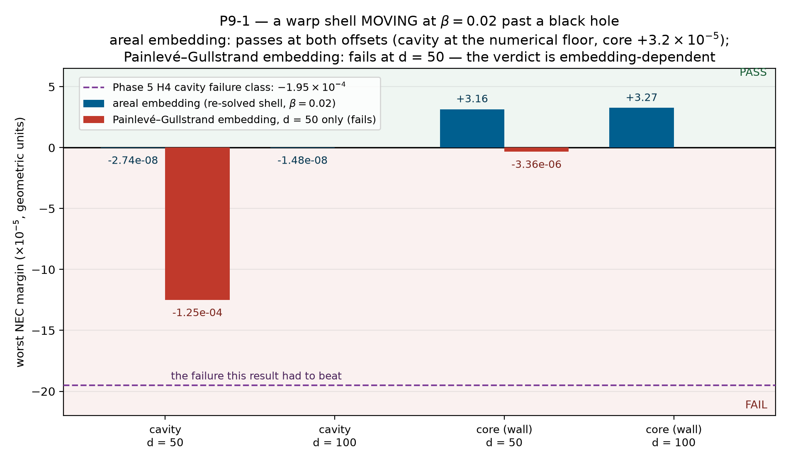
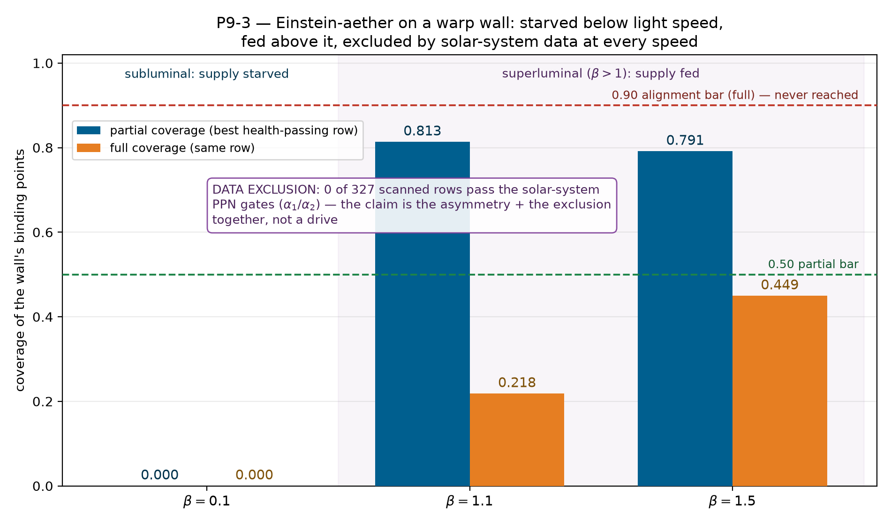
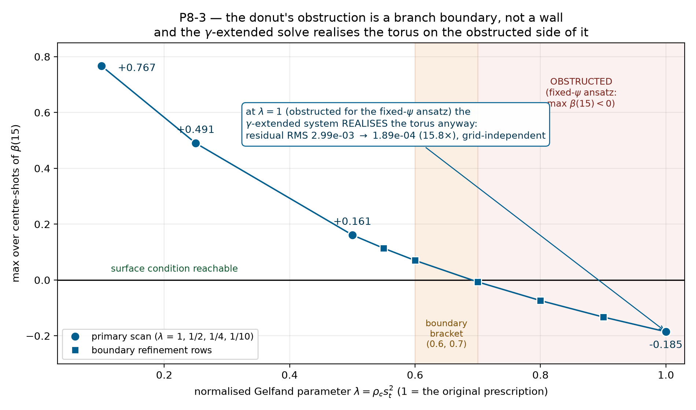

# Warp Pilot, Phases 8–9 — Three Claims Submitted for Independent Verification

These are three results from an independent computational research
programme on warp metrics and wormholes in general relativity and
modified gravity. They are published here so that anyone can check
them: every deciding computation is included as runnable code with
its recorded output, and each claim below states its limits as
plainly as its result.

None of these claims is a faster-than-light drive, and none is a
superluminal result. One is a legality result about a *moving*
positive-energy shell inside a black hole's gravity; one is a
measured statement about how a modified-gravity correction supply
behaves below and above light speed — together with the
observational data that excludes it; and one is a toroidal
(donut-shaped) warp shell obtained by prescribing its matter and
solving the Einstein equations for it, together with the honest
negative that the solved shell fails its energy audit once set
moving. Each claim was passed through an internal
novelty-and-verification gate (Gate-2) before being written up
here: a documented literature search for prior publication, and an
independent re-derivation or re-implementation of the deciding
computation by a second, separate code path. The gate's verdicts
and the exact conditions it attached to each claim's wording are
summarised in `GATE2_SUMMARY.md`; the conditions themselves are
quoted in each claim's section below and are part of the claim as
published.

**Published in gate-restated form — stated openly.** Two of the
three claims below are published in a form *restated by the gate*,
because the gate's independent checks found parts of the original
internal statements to be wrong or unstable, and the corrections
are part of the result:

- **Claim 2 (G2-2)** is restated in its exclusion *mechanism*. The
  original internal explanation of *why* the scanned supply is
  excluded by solar-system data was false (the gate's second path
  disproved it symbolically). The headline exclusion itself —
  0 of 327 scanned rows passes the data gates — was reproduced
  exactly and stands. The claim is published with the gate's
  corrected mechanism in place of the false sentence, which does
  not appear anywhere in this document.
- **Claim 3 (G2-3)** is restated in its motion-audit *numbers*.
  The original headline value was produced on a coarse grid at a
  stencil-sensitive location and does not reproduce as a converged
  number in either of two independent judges. The claim is
  published with the converged fine-grid value the two judges
  agree on; the coarse-grid figure is not quoted as a result
  anywhere in this document.

Claim 1 (G2-1) needed no restatement of its numbers, but it is
published under a binding wording correction from the gate: the
dependence it reports is an **embedding/ansatz-dependence** —
the two constructions it compares are different ansatz spacetimes,
not two coordinate choices for one spacetime — and it is worded
that way throughout.

**Standing limits (all claims).** Numerical margins of order
10⁻⁵–10⁻⁸ are strong evidence, not proofs; audits sample finitely
many points and observers. Novelty verdicts rest on documented
searches (queries logged, sources graded) and are stated as "not
found in the literature searched," never as a guarantee that no
prior statement exists anywhere. All arithmetic is float64.

---

## Claim 1 — A moving shell, re-solved in a black hole's local field, passes its energy audit in one embedding and fails in another (G2-1)

**In plain language.** An earlier claim from this programme (H4,
published separately) showed that a positive-energy warp shell
re-solved — its pressure recomputed from stress-energy
conservation in the combined geometry — passes all energy
conditions when placed *around* a black hole, centred on it. This
claim moves the shell *off* centre: the shell sits at a distance
from a separate black hole and is re-solved in the local field it
actually sits in (a nearly uniform inflow toward the black hole,
plus its tidal field). Two things are then shown. First, the
re-solved shell can be *set moving* — slowly, at 2% of light
speed — and still pass the full energy-condition audit, but the
verdict depends on which of two embeddings (two genuinely
different ansatz spacetimes realising the same physical
configuration) is used: it passes in the areal embedding at both
distances tried, and in the Painlevé–Gullstrand (PG) embedding it
passes at the larger distance and fails at the smaller one.
Second, a stationary failure recorded earlier in the PG embedding
is *diagnosed*: it was caused by an inconsistent lapse (a
shell-only lapse paired with a total, superposed shift), and
correcting the lapse flips the failing core margin to a pass.
Nothing here is a drive: the velocity is β = 0.02, constant, and
the result is about which moving equilibrium configurations are
legal, not about propulsion.

**Statement.** Finalist-A-shaped shells (the verified
positive-energy shell family of this programme), re-solved in the
local field at offset positions d ∈ {50, 100} from a Schwarzschild
mass M_bg = 1 (two-centre configuration: background centre ≠ shell
centre; the shell is locally re-solved, not a global exact
two-centre solution), set moving at β = 0.02 (cosine shift window,
genuinely time-dependent, audited at t = 0):

- **Areal embedding — PASS at both offsets.** Cavity worst NEC
  −2.75×10⁻⁸ (d = 50) and −1.48×10⁻⁸ (d = 100) at h = 0.1 — the
  finite-difference floor class, against the concentric
  construction's cavity failure of −1.95×10⁻⁴ (Phase 5, H4). Core
  NEC +3.16×10⁻⁵ (d = 50) and +3.27×10⁻⁵ (d = 100); core
  Hawking–Ellis Type-I fraction 1.000.
- **Total-lapse-consistent PG embedding — PASS at d = 100, FAIL
  at d = 50.** At d = 100 the core passes (NEC +1.15×10⁻⁵). At
  d = 50 the core fails: NEC −3.36×10⁻⁶, the binding point at the
  outer core edge, carried by a window×inflow flux term. (The
  gate's second path reproduces this value's *sign* at the same
  binding site, with magnitude in the range
  −1.5×10⁻⁶…−3.4×10⁻⁶ across the two paths; it is labelled a
  sign-reproduced value, not a precision value — see the wording
  conditions below.)
- **The dependence is an embedding/ansatz-dependence, stated as
  part of the claim.** The areal and PG builds are different
  ansatz spacetimes — an exact coordinate transform between them
  was shown to be obstructed — so the pass and the failure are
  properties of two different constructions of the same physical
  configuration, and neither verdict may be silently substituted
  for the other. (Pointwise energy conditions for a *fixed*
  stress-energy tensor are coordinate-invariant; nothing here
  claims otherwise.)
- **Total-lapse diagnosis.** The stationary (β = 0) PG core
  failure recorded in Phase 8 at d = 50 (−9.63×10⁻⁵) was a lapse
  inconsistency: a shell-only lapse kept over a superposed total
  shift. With the total lapse
  α_tot = √(e^{2Φ_tot} + |W_tot|²) the stationary core flips to
  +4.11×10⁻⁵ (the areal re-solved value is +4.57×10⁻⁵).
- **Edge-artefact separation.** The cavity sample at
  r_rel ≈ 8.9 (one step inside the shell's inner edge) is a
  finite-difference stencil artefact in both embeddings, by both
  prongs of a pre-registered separation criterion (it collapses
  ~72× under one grid refinement, and it appears identically when
  an exact isolated shell is audited); the cavity numbers above
  are stated with that separation applied.

**Scope (binding).** β = 0.02 only; constant velocity; M_bg = 1;
d ∈ {50, 100}. A legality result about a moving re-solved shell —
not a drive result, not a superluminal result, and
embedding-independence is explicitly *not* claimed.

**Verification.** The gate's independent second path was a fresh
auditor written from the claim statement (no import of the
programme's audit machinery; the Einstein tensor from direct
metric finite differences with its own stencils, its own Eulerian
triad and Hawking–Ellis margins, off-lattice sampling; only the
shell *prescription* and the metric builders were shared
definitions). Background-only controls sit at the
finite-difference floor (max|T| ≈ 1.2–1.6×10⁻¹⁴). Results:
(a) areal moving rows reproduced — d = 50 cavity NEC −2.54×10⁻⁸
(claim −2.75×10⁻⁸, same edge site), core +2.82×10⁻⁵ (claim
+3.16×10⁻⁵), Type-I 1.000; d = 100 cavity −2.8×10⁻⁹ (claim
−1.48×10⁻⁸; both in the floor class), core +2.93×10⁻⁵ (claim
+3.27×10⁻⁵), Type-I 1.000 — pass criteria met at both offsets.
(b) The lapse diagnosis reproduced with the tightest match of the
gate: shell-only-lapse PG core −9.80×10⁻⁵ (claim −9.63×10⁻⁵, same
site); total-lapse PG core +4.13×10⁻⁵ (claim +4.11×10⁻⁵), Type-I
1.000; areal re-solved +4.60×10⁻⁵ (claim +4.57×10⁻⁵) — the sign
flip reproduces essentially exactly. (c) The PG moving split
reproduced: d = 50 core negative at the same binding site
(−1.54×10⁻⁶ on the second path vs −3.36×10⁻⁶ claimed — sign
reproduced, magnitude ~2.2× smaller, as pre-registered for this
sub-item); d = 100 core +1.35×10⁻⁵ (claim +1.15×10⁻⁵), Type-I
1.000. Code: `p91_chain.py`, `p91_follow.py`; outputs
`results/p91_chain.json`, `results/p91_follow.json`.

**What is and is not claimed as new** (the gate's delimitation,
quoting its novelty report verbatim):

> "Re-solving a Fuchs-type positive-energy shell in the local field at offsets d = 50 and d = 100 from a Schwarzschild mass M_bg = 1 and setting it moving at β = 0.02 gives a shell that passes the full NEC/WEC/SEC/DEC Type-I audit in the areal two-centre embedding at both offsets, while the total-lapse-consistent Painlevé–Gullstrand embedding of the same configuration passes at d = 100 and fails at d = 50 (core −3.4e-6, window×inflow flux carrier) — and Phase 8's stationary PG core failure (−9.6e-5) is shown to have been a lapse inconsistency, the total lapse flipping it to +4.1e-5 — a two-centre re-solved configuration, moving curved-background pass, paired-embedding verdict split, and lapse diagnosis not found in the published literature searched, where shells around black holes are concentric and thin, curved-background warp bubbles are metric-first and violating, and lapse-dependent verdicts are published only for static concentric hollow shells."

Per component, the gate graded: the offset/two-centre re-solved
shells **NOVEL** (published shells around black holes are
concentric and thin — Frauendiener 1990, Brady–Louko–Poisson,
Idrissov 2026 — and no two-centre shell equilibrium or
inflow-value-mismatch mechanism was found); the moving re-solved
shell passing all energy conditions in a curved background
**NOVEL** (in the areal embedding; curved-background moving
results in print are metric-first with persisting violations —
Garattini–Zatrimaylov arXiv:2408.04495, Schuster–Santiago–Visser
arXiv:2205.15950 — and all-conditions passes exist only in flat
backgrounds); the embedding-dependence of the verdict
**PARTIALLY KNOWN** as a theme (the observer-class warning of
Santiago–Schuster–Visser arXiv:2105.03079; lapse-family verdict
flips in the work credited below), with the specific
areal-pass/PG-fail pair for one moving re-solved offset shell,
and its window×inflow anatomy, not found; and the
lapse-inconsistency diagnosis **PARTIALLY KNOWN** as a phenomenon,
with the specific diagnosis (shell-only lapse over a superposed
total shift, in this configuration) not found.

**Credit the gate requires to travel with the claim.** The
phenomenon of a lapse choice flipping an energy-condition verdict
is **published for static concentric hollow shells** by
Bolívar–Abellán–Vasilev (arXiv:2608.15000; see also Abellán,
Bolívar & Vasilev, Class. Quantum Grav. 41 (2024) 105011). What
is claimed here is only the specific diagnosis for this
configuration — an inconsistency between a shell-only lapse and
a superposed total shift — not the phenomenon in general.

**Gate wording conditions** (from the gate record; all five are
applied in the statement above; conditions (i)–(v) are quoted or
paraphrased here and quoted in full in `GATE2_SUMMARY.md`):

> (i) the novelty report's delimitation sentence accompanies the claim (quoted above);

> (ii) EMBEDDING/ANSATZ-DEPENDENCE language throughout — the dependence is between two different ansatz spacetimes, never a bare dependence on coordinate choice; both embeddings are named every time the moving pass is stated, and the PG d = 50 failure is stated alongside the areal pass, never footnoted away;

> (iii) the lapse-flip phenomenon is credited as published for static concentric hollow shells (Bolívar–Abellán–Vasilev, above) — the claim is the specific diagnosis for this configuration, not the phenomenon in general;

> (iv) the PG moving d = 50 core value is labelled sign-reproduced (−1.5e-6…−3.4e-6 across the two paths), not a precision value;

> (v) scope: β = 0.02, constant velocity, M_bg = 1, d ∈ {50, 100} — a legality result about a moving re-solved shell, not a drive result; the r ≈ 8.9 edge-artefact separation is stated with the cavity numbers.

**Gate verdict: UPLOAD-READY** — novelty NOVEL (delimited; two
components PARTIALLY KNOWN), correctness REPRODUCED on all three
sub-items, wording conditions (i)–(v) applied above.

---

## Claim 2 — An Einstein-aether correction supply is starved below light speed, fed above it, and excluded by solar-system data (G2-2, restated)

**In plain language.** Most of this programme's attempts to
supply a warp wall's energy-condition deficit with a
modified-gravity correction used scalar fields; those all failed,
each in its own way. This claim tests a different theory class:
Einstein-aether theory — general relativity plus a dynamical
unit timelike vector field (a preferred rest frame built into
the geometry) — evaluated as a *correction supply* against the
deficits of the programme's verified warp wall. The result is a
measured asymmetry. At a tenth of light speed the supply is
completely starved: across all 109 coupling combinations tried,
it covers *none* of the wall's binding deficits. At superluminal
speeds (β = 1.1 and 1.5) the same supply suddenly covers most of
them — 81% and 79% of binding points at partial strength — the
first theory class in this programme to clear the 50% partial
bar anywhere, at any speed. But two honest limits close the
story: *full* coverage stays low (22% and 45%), so there is no
alignment and this is not a drive claim; and the supply as
scanned is **excluded by existing solar-system observations** —
zero of the 327 scanned rows passes the precision tests that
any preferred-frame theory must satisfy. The asymmetry and the
exclusion together are the claim. (One correction is built into
this claim's wording: the programme's original one-line
explanation of *why* the data excludes the supply was wrong, and
the gate replaced it — see the restatement note in the
statement below.)

**Statement.** Einstein-aether theory (unit timelike vector u,
couplings c₁, c₂, c₃, c₄) evaluated as a correction supply on the
Finalist-A warp wall, on the programme's shared binding-point
test bed (judge points in the wall band whose GR null-energy
deficit is at least 50% of the maximum; consistent units; every
coverage fraction cross-checked by a ratio-free count). The
aether is prescribed as the Eulerian normal of the shell metric
— hence unit, timelike, and hypersurface-orthogonal (the
khronometric sector of the theory); u is prescribed, not solved
from its equation of motion, so this is a supply-side, off-shell,
binding-point statement. Couplings are scanned **on the
c₁₃ = 0 slice** imposed by the gravitational-wave speed
measurement GW170817 (on that slice the tensor-mode speed
c_T = 1 exactly): 109 coupling rows at each of
β ∈ {0.1, 1.1, 1.5}, 327 rows in total.

- **Speed-asymmetry.** At β = 0.1 the best partial coverage over
  all 109 rows is **0.000** (32 of 109 rows pass the
  pre-registered health gates; none covers a single binding
  point at half strength). At β = 1.1, health-passing rows reach
  partial coverage **0.813** with full coverage only **0.218**;
  at β = 1.5, partial **0.791** with full coverage only
  **0.449**. The alignment bar (full coverage ≥ 0.90,
  health-passing) is met at no β: no alignment is claimed.
- **Outer-band locus.** In the best health-passing rows, every
  failing (negative-supply) binding point sits in the outer wall
  band: all of them in r ∈ [18.5, 19.75] at β = 1.1 and in
  r ∈ [18.25, 19.75] at β = 1.5 — the supply changes sign in the
  outer band, capping partial coverage at the inner-wall
  fraction. (This is the same outer-band locus the programme
  found for a scalar supply in Phase 7 — a programme-internal
  recurrence across two unrelated theory classes, published here
  as a programme result, not as literature.) The supply has **no
  Hessian spikes** (worst single-point supply ratio −0.30 at
  β = 1.1, −0.61 at β = 1.5) — the opposite failure mode from
  the scalar-tensor scans.
- **Data exclusion, with the gate's corrected mechanism.** 0 of
  the 327 scanned rows passes the solar-system PPN gates
  |α₁| ≤ 10⁻⁴ and |α₂| ≤ 4×10⁻⁷ (the α₂ value is Jacobson's;
  Oost, Mukohyama & Wang quote the stricter 10⁻⁷, so the
  programme's gate is the conservative one). The best supply
  rows carry α₁ = −4.0 and α₂ = +2.0 — violations by orders of
  magnitude; rows built to probe the data boundary (c₁₄ = 10⁻⁵)
  pass α₁ but fail α₂ at −5.0×10⁻⁶, with coverage already
  collapsed to ≤ 0.03; and the best rows also fail the vacuum
  Čerenkov requirement (spin-1 mode speed squared
  s₁² = 0.2 < 1). The mechanism of the exclusion, **as restated
  by the gate** (the original sentence is deleted; it was
  false):

  > "on the c13=0 slice α1 = −4c14 exactly; the α2=0 curve is c2 = c14/(1−2c14), along which s0² ≡ 1 (the tuning is health-compatible); the scanned supply is excluded because rows with appreciable supply carry c14 large enough that α1 (and jointly α2) violate the PPN bounds by orders of magnitude, while the data-compatible corner (c14 ≲ 1e-5, incl. the α2=0-tuned row at c14=1e-5) has partial coverage 0.000 at every β — the supply collapses toward the data-compatible corner."

  In words: on the c₁₃ = 0 slice, α₁ = −4c₁₄ exactly, so any row
  whose supply is appreciable (which needs sizeable c₁₄) breaks
  the α₁ bound — jointly with α₂ — by orders of magnitude; the
  α₂ = 0 tuning itself is health-compatible on that slice, but
  the tuned, data-compatible corner carries essentially no
  supply. The gate's second path verified this directly: its
  α₂ = 0-tuned probe row at c₁₄ = 10⁻⁵ (c₂ = +1.00002×10⁻⁵)
  passes health *and* data and has coverage 0.000 at every β,
  while its tuned row at c₁₄ = 1 (c₂ = −1) passes health with
  partial coverage 0.708 / 0.741 and is excluded by α₁ = −4.
- **Labelling (binding).** This is a binding-point,
  prescribed-u (hypersurface-orthogonal / khronometric sector,
  u not solved from its equation of motion), off-shell supply
  statement at three sampled speeds. It is **not** a drive claim
  and **not** an alignment claim. The supply is never said to
  "work" superluminally: full coverage is 0.218 / 0.449, the
  best rows are PPN-excluded by orders of magnitude and fail
  vacuum Čerenkov, and aether *mode* superluminality (a
  Čerenkov-avoidance requirement in the theory's own literature)
  has nothing to do with the bubble speed β. The GR deficit
  itself grows ×14–17 between β = 0.1 and the superluminal
  rows; what flips with speed is the supply's coverage fraction
  of that larger bill.

**Verification.** The gate's independent second path derived the
aether correction tensor by hand and verified it against
pointwise finite differences (agreement to 2.8×10⁻¹⁰), used its
own divergences at its own step sizes, fitted the overall sign
by its own spherical gate, and evaluated the full 109×3 grid via
coupling linearity — no re-run of the Phase 9 scan and no import
of its tensor code in the deciding path. Results: the tensor
reproduces (spherical-gate ratio 1.0000, max deviation 2×10⁻⁴,
on two coupling sets); the binding-point bed re-derived from the
second path's own Einstein code matches Phase 9's to the digits
shown (251 / 504 / 594 binding points at the three speeds; max
GR deficits 1.980854×10⁻⁴ / 2.824736×10⁻³ / 3.387368×10⁻³).
Coverage reproduces: β = 0.1 best partial 0.000 over the full
grid (all 109 fractions identical to the recorded ones);
β = 1.1 named best row partial 0.8135 (recorded 0.813), full
0.2163 (recorded 0.218); best health-passing full 0.2202;
β = 1.5 best health-passing partial 0.7912, best full 0.4495 —
every deciding fraction within ±0.01, and the ratio-free
cross-checks never fired. The outer-band locus reproduces
(negative-supply points all in [18.5, 19.75] at β = 1.1,
[18.25, 19.75] at β = 1.5), as does the absence of spikes
(worst ratio −0.295 / −0.614 against the claimed −0.30 / −0.61).
Health and data flags are identical to the recorded ones on all
327 rows (α values to <10⁻⁹ relative): 32/109 health-passing per
speed, best rows α₂ = +2.0, probe rows α₂ = −5.0×10⁻⁶ failing
the 4×10⁻⁷ gate, total data-passing **0 of 327 — exact**. The
one item that did **not** reproduce is the original exclusion
mechanism sentence (see the statement): symbolically,
α₂ = 0 on the c₁₃ = 0 slice gives c₂ = c₁₄/(1−2c₁₄) — positive
for c₁₄ < 1/2 — and s₀² ≡ 1 exactly on the whole α₂ = 0 curve,
so the tuning is health-compatible and the exclusion runs
through α₁ = −4c₁₄ jointly with α₂, as restated. Code:
`p93_tensor.py`, `p93_gate.py`, `p93_scan.py`; outputs
`results/p93_scan.json`, `results/p93_gate.json`,
`results/p93_anatomy.json`.

**What is and is not claimed as new** (the gate's delimitation,
from its novelty report §3.1 — quoted with one clause replaced,
as flagged in the note after the quote):

> "Evaluating the Einstein-aether correction tensor — with the aether prescribed as the Eulerian normal of the shell metric and the couplings scanned on the GW170817 slice c₁₃=0 — as a supply against an Alcubierre-type warp wall's binding NEC deficits gives a speed-asymmetric result not reported in the literature: zero partial coverage at β=0.1 over all 109 coupling rows, rising superluminally to 0.813 (β=1.1) / 0.791 (β=1.5) with full coverage only 0.218 / 0.449 and every failing point confined to an outer wall band (r≈18.5–19.75) where the supply changes sign; and the scanned supply is excluded by solar-system PPN data as a stated row-by-row result (0/327 rows pass |α₁|≤10⁻⁴, |α₂|≤4×10⁻⁷, the exclusion driven by α₁ = −4c₁₄ jointly with α₂, with the data-compatible corner carrying essentially zero supply) — where the PPN formulas, bounds and slice are Foster–Jacobson/Jacobson/Oost et al.'s, the observation-exclusion pattern has an æ-theory precedent for wormhole throats (Golchin et al., arXiv:2511.00825), and no alignment or drive is claimed."

*Editorial note on the quote (part of this claim's honesty
record):* the novelty report's original delimitation sentence
contained, as its tuning clause, the mechanism the gate's
correctness path then disproved. That clause has been replaced
above by the gate's corrected mechanism (α₁ = −4c₁₄ jointly with
α₂; the supply collapsing toward the data-compatible corner),
under the same delimitation — exactly as the gate's verdict
directs. Nothing else in the sentence was changed.

Per component, the gate graded: the aether-on-a-warp-wall
computation **NOVEL** (delimited — no Einstein-aether,
khronometric, or vector-tensor correction tensor on any warp
metric was found; the theory's only exotic-geometry paper is
Golchin et al. on static wormhole *throats*, a different object
with no speed axis); the speed-asymmetry **NOVEL** (no supply
reported starved subluminal / fed superluminal in any theory;
published speed results run opposite or flat); the outer-band
sign-flip locus **PARTIALLY KNOWN** (wall localisation of NEC
failure is textbook; a correction *supply* covering the inner
wall and failing exclusively in an outer sub-band, capped by its
own sign flip, was not found); and the PPN exclusion
**PARTIALLY KNOWN** (the formulas, bounds, GW slice, health
functionals, and the general α₁ = α₂ = 0 tuning are
Foster–Jacobson / Jacobson / Oost et al.; two precedents cap the
novelty — Golchin et al. published the identical exclusion
*pattern* for æ-theory wormholes, and Rodal, arXiv:2507.09724,
published PPN/solar-system exclusion of a scalar-tensor warp
supply — while the row-by-row 0/327 exclusion with α₂ as the
binding gate is new as a stated result). Overall novelty:
**PARTIALLY KNOWN**, with the computation and the asymmetry
novel. Two wording hazards travel with the claim: the healthy
α₁ = α₂ = 0 family that exists in the *full* theory must never
be denied — every tuning statement here carries "on the
c₁₃ = 0 slice"; and Ellis's "ether" (gr-qc/0411096, a drainhole
flow, not Einstein-aether) is a false friend, not a precedent,
and is not cited as one.

**Gate wording conditions** (from the gate record; all four are
applied in the statement above):

> (i) the novelty report's delimitation sentence accompanies the claim, with the PPN machinery credited to Foster–Jacobson / Jacobson / Oost and the exclusion pattern's æ-theory wormhole precedent (Golchin et al. arXiv:2511.00825) and Rodal arXiv:2507.09724 cited;

> (ii) "on the c13=0 slice" is attached to every tuning statement; the supply is never said to "work" superluminally (no alignment, PPN-excluded, Čerenkov-failing on the best rows; mode superluminality ≠ bubble β);

> (iii) the α2 gate is named as |α2|≤4e-7 (Jacobson's value; Oost quotes 1e-7 — the programme's gate is the conservative one);

> (iv) labelling: binding-point, prescribed-u (hypersurface-orthogonal/khronometric sector, u not solved from its EOM), off-shell supply statement at 3 sampled β — NOT a drive claim, NOT an alignment claim.

And the restatement itself, which is the claim's form above:

> DELETE the original mechanism sentence (it is false) and REPLACE it with the corrected mechanism quoted in the statement (α1 = −4c14 on the slice; the α2=0 curve c2 = c14/(1−2c14) with s0² ≡ 1 on it; exclusion by α1 jointly with α2 for supplying rows; the data-compatible corner carrying ~zero supply).

**Gate verdict: UPLOAD-READY AFTER RESTATEMENT** — novelty
PARTIALLY KNOWN (computation + asymmetry NOVEL), correctness
REPRODUCED on every deciding number, the restatement above
applied.

---

## Claim 3 — A toroidal warp shell realised by prescribing its matter and solving the full meridional Einstein system (G2-3, restated)

**In plain language.** A warp shell does not have to be a sphere.
This claim prescribes the matter for a *toroidal* shell — a
filled tube bent into a ring (a donut of ordinary matter, ring
radius 45, tube radius 15) — and then *solves* the Einstein
equations for the spacetime that matter produces, instead of
writing down a metric and reading off what matter it would need.
That direction (prescribe the matter, solve for the geometry —
"conditions-first") is easy for a spherical shell, where the
equations are ordinary differential equations, but for a torus
they are a two-dimensional system, and the natural ansatz turns
out to have one equation too many: the simpler form of the
ansatz provably cannot be solved at this prescription. Adding
one extra metric freedom (a function γ in the ring-direction
metric component) restores the balance, and with the boundary
conditions built into the solver's basis the system solves: the
equations' mismatch falls by a factor of about 16, verified as
independent of the grid. The simpler ansatz's obstruction is
also located precisely: it is a branch boundary — below about
0.65× the prescription's density-times-tube-radius-squared, the
obstruction disappears. The honest negative is part of the
claim: set the solved donut moving (at β = 0.02) and it fails
its energy-condition audit at the inner equator. Realisation:
achieved. A legal moving donut: not. (This is a different
construction from this programme's Phase 1 toroidal attempt,
which stacked a bent spherical shell onto a torus by
superposition and failed; nothing here repairs or reuses that
metric. The torus here is a *matter distribution shaped like a
filled donut* in an otherwise ordinary warp-shell spacetime —
not a change of spatial topology, and not a toroidal wormhole
throat.)

**Statement.** Prescribed filled-tube toroidal shell matter
(ring radius R = 45, tube radius s_t = 15, central density
ρ_c = 2.708×10⁻⁴, M = 2, σ = 0.8135), with the metric ansatz
extended by γ(s,φ) in g_ψψ = e^{2γ}W² — restoring the freedom
count the fixed-ψ ansatz lacks (5 equations / 6 unknowns in the
γ-extended system) — solved by damped Gauss–Newton in a basis
that enforces the boundary conditions exactly (centre
regularity; surface conditions β(15,φ) = 0 and Δα(15,φ) = 0;
γ finite):

- **Realisation.** The construction equations' residual RMS
  falls from 2.99×10⁻³ (γ = 0 base) to **1.894×10⁻⁴ — a 15.8×
  reduction** (180 degrees of freedom); a 252-dof refinement
  reaches 1.651×10⁻⁴ (18.1×), and re-evaluating the solved
  fields on an independent 121×48 grid gives 1.895×10⁻⁴ — the
  residual is grid-independent, has no uniform per-component
  floor, and the field amplitudes are sane (γ ∈ [−0.336,
  +0.201]). This is a numerical solve to a stated residual, not
  an exact solution.
- **Branch boundary.** The fixed-ψ ansatz's obstruction (a
  Gelfand-type shooting incompatibility) is a branch phenomenon
  in the control parameter λ = ρ_c·s_t² (normalised): the
  shooting maximum of β(15) is −0.185 at λ = 1, +0.161 at
  λ = 1/2, +0.491 at λ = 1/4, +0.767 at λ = 1/10, and refinement
  brackets the **branch boundary in λ ∈ (0.6, 0.7)×** the
  original prescription (ρ_c·s_t² ∈ (0.0366, 0.0427)). The
  boundary is a numerical bracket, not an analytic extremal
  value; the fold phenomenon itself is classical (Joseph–
  Lundgren) and is not claimed.
- **Motion negative — as restated by the gate.** The realised
  metric with an axial shift at β = 0.02 fails its
  inner-equator NEC audit, in the gate's restated form:

  > "the realised metric with an axial shift at β=0.02 fails its inner-equator NEC audit: the NEC is negative at every grid spacing in two independent judges, with the converged fine-grid value −1.51e-4 at h=0.075 (identical in both judges; static control −3.4e-5); coarse-grid values near the surface ring are stencil-sensitive and are not quoted as converged."

  The moving configuration's inner Type-I fraction is 0.79. The
  static control on the same metric is also negative (converged
  −3.4×10⁻⁵), so the negative is a property of this
  slice/metric, reported as such — not a theorem about toroidal
  warp shells. Realisation is achieved; legality at β = 0.02 is
  not.

**Scope (binding).** One prescription (R = 45, s_t = 15,
ρ_c = 2.708×10⁻⁴); the residual is a numerical solve, not an
exact solution; the branch boundary is a numerical bracket
(0.6–0.7)×, not an analytic λ*. The word "first" is used for
this result **only** in the delimited conditions-first sense
spelled out in the delimitation below.

**Verification.** The gate's independent second path used a
generic tensor-calculus Einstein evaluator in toroidal
coordinates (explicit index sums; different stencils; a new
97×40 grid against the original 81×32; the stored solution
fields — which are the claim's definition — carried over by
interpolation; no Phase 8 script re-run). Results: (1)
realisation residual reproduced — solved fields RMS 1.978×10⁻⁴
(claim 1.894×10⁻⁴, +4.4%), γ = 0 base on the same grid
3.015×10⁻³ (claim 2.99×10⁻³), reduction 15.24× (claim 15.8×);
the no-uniform-floor structure confirmed component by component
in the same ordering and spread; the boundary-condition facts
on the stored fields exact (β(15,φ) = 0, Δα(15,φ) = 0, centre
φ-spread 0, γ range matching). (2) Branch boundary reproduced
to the digits — fresh high-order shooting gives max β(15) =
−0.18528 at λ = 1 (claim −0.18528), +0.16130 at λ = 1/2,
+0.491 at 1/4, +0.767 at 1/10, and refinement −0.00694 at
λ = 0.7, +0.07014 at λ = 0.6: the boundary sits in (0.6, 0.7)×,
exactly as claimed. (3) Motion audit reproduced in sign and
converged magnitude — a fresh Cartesian point judge (different
stencils, 642 sampled null directions, two orientations) finds
the inner-equator NEC negative at every grid spacing and both
orientations, Type-I fraction 0.784 (claim 0.79), and the
converged fine-grid value −1.51×10⁻⁴ at h = 0.075, identical to
Phase 8's own fine-grid value (static control −3.37×10⁻⁵
against the claimed −3.40×10⁻⁵). The caveat the gate attached:
the coarse-grid values near the surface ring are
stencil/orientation-unstable in *both* judges (the worst point
sits one stencil-reach from the surface taper), which is why
the claim is published with the converged value only. Code:
`p83_solve.py`, `p83_check_judge.py`, `p83_control_scan.py`,
`p83_branch_refine.py`; outputs `results/p83_solve_A.json`,
`results/p83_solve_B.json`, `results/p83_check_judge.json`,
`results/p83_branch_refine.json`, `results/p83_control_scan.json`,
and the stored solution fields `results/p83_fields_A.npz`,
`results/p83_fields_B.npz`.

**What is and is not claimed as new** (the gate's delimitation,
from its novelty report §4 — quoted with the motion-audit
parenthetical replaced by the gate's restated converged value,
as flagged in the note after the quote):

> "Prescribing a filled-tube toroidal warp shell (ring radius 45, tube radius 15, ρ_c = 2.708e-4) and solving the full meridional Einstein system for it — with a γ(s,φ) freedom in g_ψψ restoring the equation/unknown count and the boundary conditions built into the basis — yields a toroidal warp-shell metric realised to a grid-independent residual RMS of 1.89e-4, while the simpler fixed-ψ ansatz's Gelfand-type obstruction is a branch phenomenon whose boundary lies at ρ_c·s_t² ∈ (0.6–0.7)× that prescription's value, and the realised metric with an axial shift at β = 0.02 fails its inner-equator NEC audit (converged value −1.51e-4 at h = 0.075, negative at every grid spacing in two independent judges) — a conditions-first toroidal realisation, branch location, and realised-metric motion audit not found in the published literature searched."

*Editorial note on the quote (part of this claim's honesty
record):* the novelty report's original sentence quoted the
coarse-grid motion values; the gate's correctness path found
those stencil-unstable and required the restated converged form
used above and in the statement. Nothing else in the sentence
was changed.

Per component, the gate graded: toroidal geometry in warp
physics **KNOWN** (Alcubierre's 1994 read-off source is a
negative-energy torus; White's toroidal thickness analysis,
2011–12; González-Díaz's ringhole, 1996 — none of it
prescribed-matter solving); the conditions-first method
**PARTIALLY KNOWN** (the classical direction of GR; Fuchs et
al., arXiv:2405.02709, is a genuine partial precedent —
prescribed density to metric — but spherical and one-dimensional,
with the shift added afterwards; Einstein–Vlasov tori prescribe
and solve in astrophysics); the realised toroidal shell itself
**NOVEL (delimited)** — every neighbour misses a load-bearing
element (Dzhunushaliev et al.'s thin-shell T² wormholes,
arXiv:1901.07545 / 1905.00296, explicitly leave the thick PDE
problem open; Lynden-Bell & Katz and Krisch & Glass are exact
fitted toroidal solutions with matter read off); the branch
boundary **NOVEL (delimited)**, the fold phenomenon itself
textbook; toroidal shells audited against energy conditions
outside warp physics **KNOWN** (Lynden-Bell & Katz 2012;
toroidal black holes, Class. Quantum Grav. 42 (2025) 155015);
and the β = 0.02 inner-equator NEC negative on the realised
metric **NOVEL as a specific measurement, low weight** (moving
warp NEC failure in general is known). The γ-count-restoring
move and boundary-conditions-in-the-basis are standard
techniques and are credited as tools, not claimed as
inventions; the novelty is the realised object and its
residual.

**Wording hazards the gate requires to be carried.** An
unqualified "first toroidal warp metric" is **not** used
anywhere in this document: a self-published manuscript (Meyler,
PhilArchive, March 2025 — not arXiv-indexed, not peer-reviewed)
publicly claims toroidal positive-energy warp language, and
while its method is the opposite of this claim's (an
ansatz-first construction with the stress-energy read off and
the energy conditions asserted, no prescribed tube, no
meridional solve, no residual), it occupies the unqualified
phrase. Also never used here: "first toroidal shell satisfying
energy conditions" (this claim makes no all-conditions pass
claim for the torus — its only audit, the moving one, fails),
"first toroidal Einstein solution", "solved" without the
1.89×10⁻⁴ residual attached, and any wording conflating this
filled-donut matter distribution with T²-throat wormhole
topology.

**Gate wording conditions** (from the gate record; all applied
in the statement above):

> The restatement required is ONLY in the motion-audit numbers (the realisation and branch parts of the claim stand as stated): RESTATE the motion negative as: "the realised metric with an axial shift at β=0.02 fails its inner-equator NEC audit: the NEC is negative at every grid spacing in two independent judges, with the converged fine-grid value −1.51e-4 at h=0.075 (identical in both judges; static control −3.4e-5); coarse-grid values near the surface ring are stencil-sensitive and are not quoted as converged."

> (i) the novelty report's delimitation — "first" ONLY in the delimited conditions-first sense; the banned wordings listed above are not used;

> (ii) credit: toroidal warp geometry (Alcubierre 1994; White 2011–12; González-Díaz ringhole 1996), conditions-first precedent (Fuchs et al. arXiv:2405.02709, spherical), the γ-technique and fold phenomenon as standard tools;

> (iii) scope: one prescription (R=45, s_t=15, ρ_c=2.708e-4), residual is a numerical solve not an exact solution, branch boundary is a numerical bracket (0.6–0.7)× not an analytic λ*.

**Gate verdict: UPLOAD-READY AFTER RESTATEMENT** — novelty
PARTIALLY KNOWN with a NOVEL delimited core, correctness
REPRODUCED (one precision caveat, resolved by the restatement),
the restatement above applied.

---

## Files in this bundle

- `CLAIMS2.md` — this write-up.
- `GATE2_SUMMARY.md` — how each claim was gated.
- Claim 1 (G2-1): `p91_chain.py`, `p91_follow.py`; outputs
  `results/p91_chain.json`, `results/p91_follow.json`.
- Claim 2 (G2-2): `p93_tensor.py`, `p93_gate.py`, `p93_scan.py`;
  outputs `results/p93_scan.json`, `results/p93_gate.json`,
  `results/p93_anatomy.json`.
- Claim 3 (G2-3): `p83_solve.py`, `p83_check_judge.py`,
  `p83_control_scan.py`, `p83_branch_refine.py`; outputs
  `results/p83_solve_A.json`, `results/p83_solve_B.json`,
  `results/p83_check_judge.json`, `results/p83_branch_refine.json`,
  `results/p83_control_scan.json`, and the stored solution fields
  `results/p83_fields_A.npz`, `results/p83_fields_B.npz`.

All scripts and outputs are byte-identical copies of the
programme's Phase 8 / Phase 9 records (md5-verified at bundle
assembly). All arithmetic float64. Independent re-runs,
corrections, and counterexamples are the point of publishing
this — if a number here does not reproduce, that is a result we
want to hear about.

## Figures

*The moving shell (plot script: `plot_moving_shell.py`, data: `results/p91_chain.json`). In the areal embedding the re-solved shell at β = 0.02 passes at both distances — cavity clean at the 10⁻⁸ level against the Phase 5 failure class (−1.95×10⁻⁴, dashed). In the total-lapse-consistent PG embedding it passes at d=100 and fails at d=50; both embeddings are part of the claim, per the gate's wording conditions.*

*The aether asymmetry (plot script: `plot_aether_asymmetry.py`, data: `results/p93_scan.json`). Best health-passing coverage: 0.000 at β = 0.1, partial 0.813 / full 0.218 at β = 1.1, partial 0.791 / full 0.449 at β = 1.5 — and 0 of 327 rows pass the solar-system PPN data gates. The claim is the asymmetry and the exclusion together; it is not a drive claim.*

*The donut's branch structure (plot script: `plot_torus_branch.py`, data: `results/p83_control_scan.json`, `results/p83_branch_refine.json`). The fixed-form obstruction exists only above the branch boundary, bracketed at (0.6–0.7)× the original density×size²; the γ-extended solve realises the metric at residual RMS 1.89×10⁻⁴.*
